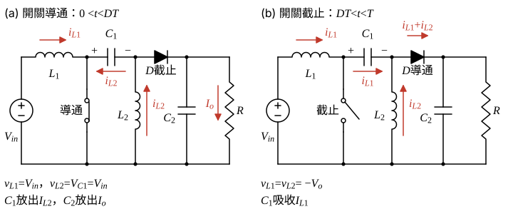

# 111 年電子學第 2 題｜SEPIC 轉換器元件設計

## 已知與所求

SEPIC：$V_{in}=15\,\mathrm V$、$V_o=6\,\mathrm V$、$R=2\,\Omega$、$f=250\,\mathrm{kHz}$（$T=4\,\mu\mathrm s$）。求（一）$L_1,L_2$ 使各自電感電流峰對峰變化為其平均值的 40%；（二）$C_1,C_2$ 使電容電壓變化為 $V_o$ 的 2%（$0.12\,\mathrm V$）。

## 考場標準作答

### 步驟 1：兩段等效電路

設 CCM 穩態。參考方向：$i_{L1}$ 由 $V_{in}$ 經 $L_1$ 向右；$i_{L2}$ 由地經 $L_2$ 向上；$C_1$ 左端為正。

- **導通（$0<t<DT$）**：$L_1$ 直接跨 $V_{in}$，$v_{L1}=V_{in}$；$C_1$ 經開關跨在 $L_2$ 上，$v_{L2}=V_{C1}$；二極體陽極電位 $-V_{C1}$ 而逆偏。$C_1$ 放出 $i_{L2}$（$i_{C1}=-I_{L2}$），$C_2$ 獨自供應負載（$i_{C2}=-I_o$）。
- **截止（$DT<t<T$）**：二極體導通，$i_{L1}$ 經 $C_1$、$i_{L2}$ 一起經二極體送往輸出；$v_{L1}=V_{in}-V_{C1}-V_o$，$v_{L2}=-V_o$。$C_1$ 吸收 $i_{L1}$（$i_{C1}=+I_{L1}$）。

### 步驟 2：伏秒平衡求 $D$ 與 $V_{C1}$

$L_2$：
\[
V_{C1}D+(-V_o)(1-D)=0\ \Rightarrow\ V_{C1}=\frac{V_o(1-D)}{D}
\]
$L_1$：
\[
V_{in}D+(V_{in}-V_{C1}-V_o)(1-D)=0
\]
把 $V_{C1}$ 代入，$(V_{C1}+V_o)(1-D)=V_o(1-D)/D+V_o(1-D)=V_o(1-D)/D$：
\[
V_{in}=\frac{V_o(1-D)}{D}\ \Rightarrow\ \frac{V_o}{V_{in}}=\frac{D}{1-D},\qquad V_{C1}=V_{in}=15\ \mathrm V
\]
\[
D=\frac{V_o}{V_o+V_{in}}=\frac{6}{6+15}=\frac{6}{21}=\frac27=0.2857
\]
\[
T=\frac{1}{f}=\frac{1}{250\times10^{3}}=4\ \mu\mathrm s,\qquad DT=\frac27\times4=\frac87=1.143\ \mu\mathrm s
\]

### 步驟 3：平均電流

負載電流：
\[
I_o=\frac{V_o}{R}=\frac62=3\ \mathrm A
\]
$C_2$ 電荷平衡：導通段放出 $I_oDT$、截止段吸收 $(I_{L1}+I_{L2}-I_o)(1-D)T$；$C_1$ 電荷平衡 $I_{L2}D=I_{L1}(1-D)$。兩式合併得 $I_{L2}=I_o$：
\[
I_{L2}=I_o=3\ \mathrm A
\]
$L_1$ 電流即輸入電流，由功率守恆：
\[
I_{L1}=I_{in}=\frac{V_oI_o}{V_{in}}=\frac{6\times3}{15}=\frac{18}{15}=1.20\ \mathrm A
\]

### （一）電感 $L_1$、$L_2$

導通段兩電感都承受 $+V_{in}$（$L_2$ 承受 $V_{C1}=V_{in}$），令 $\Delta i_L$ 等於平均值的 $40\%$。

導通段伏秒（兩電感相同）：
\[
V_{in}DT=15\times\frac87\ \mu=\frac{120}{7}\ \mu\mathrm{V\cdot s}=17.14\ \mu\mathrm{V\cdot s}
\]
允許的峰對峰變化：
\[
\Delta i_{L1}=0.40\times1.20=0.48\ \mathrm A
\]
\[
\Delta i_{L2}=0.40\times3=1.20\ \mathrm A
\]
\[
L=\frac{V_{in}DT}{\Delta i_L}
\]
\[
L_1=\frac{120/7\ \mu}{0.48}=\frac{250}{7}\ \mu\mathrm H=35.71\ \mu\mathrm H
\]
\[
L_2=\frac{120/7\ \mu}{1.20}=\frac{100}{7}\ \mu\mathrm H=14.29\ \mu\mathrm H
\]
\[
\boxed{L_1=35.71\ \mu\mathrm H},\qquad \boxed{L_2=14.29\ \mu\mathrm H}
\]

### （二）電容 $C_1$、$C_2$

導通段 $C_1$ 放出 $I_{L2}$、$C_2$ 放出 $I_o$，兩者都是 $3\ \mathrm A$ 持續 $DT$，故放出電荷相同。

允許的電壓變化：
\[
\Delta V_C=0.02\times6=0.12\ \mathrm V
\]
導通段放出的電荷：
\[
\Delta Q=3\times\frac87\ \mu=\frac{24}{7}\ \mu\mathrm C=3.429\ \mu\mathrm C
\]
\[
C=\frac{\Delta Q}{\Delta V_C}=\frac{24/7\ \mu}{0.12}=\frac{200}{7}\ \mu\mathrm F=28.57\ \mu\mathrm F
\]
\[
\boxed{C_1=28.57\ \mu\mathrm F},\qquad \boxed{C_2=28.57\ \mu\mathrm F}
\]

## 驗算

截止期間核對電荷平衡：$C_1$ 吸收 $I_{L1}(1-D)T=1.20\times\frac57\times4\,\mu=3.43\,\mu\mathrm C$，等於導通期間放出的 $I_{L2}DT=3\times\frac27\times4\,\mu=3.43\,\mu\mathrm C$，故 $\Delta V_{C1}=3.43\,\mu/28.57\,\mu=0.12\,\mathrm V$。功率守恆 $15\times1.20=6\times3=18\,\mathrm W$。

## 失分點

- $C_1$ 的轉移電荷用 $I_{L2}=3\,\mathrm A$（或截止期間的 $I_{L1}$ 配 $1-D$）；用 $I_{in}=1.2\,\mathrm A$ 配 $D$ 會得 $11.43\,\mu\mathrm F$。
- $L_2$ 的平均電流是 $I_o=3\,\mathrm A$，不是 $I_{in}$。
- SEPIC 增益為 $D/(1-D)$，誤用 Boost 的 $1/(1-D)$ 會得負的 $D$。
