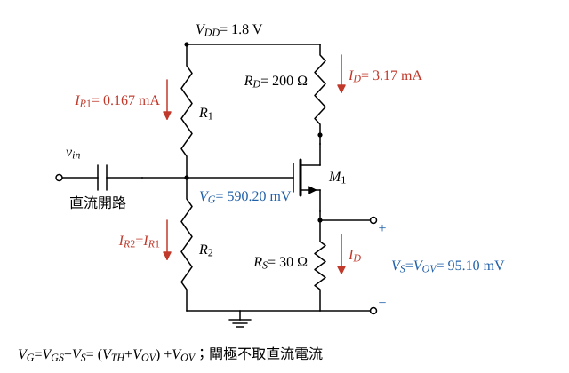
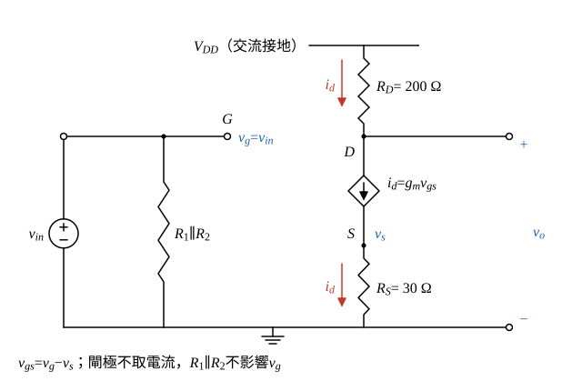

# 111 年電子學第 3 題｜MOSFET 源極退化放大器

## 已知與所求

$\mu_nC_{ox}=200\,\mu\mathrm{A/V^2}$、$\lambda=0$、$V_{TH}=0.4\,\mathrm V$、$|A_v|=5\,\mathrm{V/V}$、$I_{DS}=3.17\,\mathrm{mA}$、$I_{R1}=0.167\,\mathrm{mA}$、$R_S=30\,\Omega$、$R_D=200\,\Omega$、$V_{DD}=1.8\,\mathrm V$；$R_1$–$R_2$ 閘極分壓，輸入經電容耦合；跨 $R_S$ 電壓等於過驅電壓。求（一）$g_m$；（二）$W/L$；（三）$R_1,R_2$。

題面資料互相矛盾：$V_{OV}=I_DR_S$ 加上平方律必得 $g_m=2I_D/V_{OV}=2/R_S$，與指定增益 5 不相容，故 $g_m$、$W/L$ 以雙分支作答。

## 考場標準作答

**解題邏輯**：前提：$M_1$ 工作於**飽和區**（長通道平方律、$\lambda=0$），閘極不取直流電流，耦合電容直流開路、信號頻率短路，$V_{DD}$ 對交流為地。先由「跨 $R_S$ 電壓 = 過驅電壓」求 $V_{OV}$、$V_G$ 並驗證飽和；（一）用源極退化小訊號增益 $|A_v|=g_mR_D/(1+g_mR_S)$ 解 $g_m$；（二）用 $g_m=\mu_nC_{ox}(W/L)V_{OV}$ 或 $I_D=\tfrac12\mu_nC_{ox}(W/L)V_{OV}^2$ 解 $W/L$；（三）分壓器電流與 $V_G$ 定 $R_1,R_2$。題面資料互相矛盾（平方律加上 $V_{OV}=I_DR_S$ 必得 $g_m=2/R_S$，與增益 5 不相容），$g_m$、$W/L$ 以雙分支作答，$R_1,R_2$ 與分支無關。

### 步驟 1：直流偏壓量

飽和區 MOSFET 閘極無直流電流，$I_D$ 全部流過 $R_S$；題設跨 $R_S$ 的電壓即過驅電壓：
\[
V_{OV}=V_S=I_DR_S=3.17\,\mathrm{mA}\times30\,\Omega=95.10\ \mathrm{mV}
\]
\[
V_{GS}=V_{TH}+V_{OV}=0.4\ \mathrm V+95.10\ \mathrm{mV}=495.10\ \mathrm{mV}
\]
\[
V_G=V_{GS}+V_S=495.10\ \mathrm{mV}+95.10\ \mathrm{mV}=590.20\ \mathrm{mV}
\]
飽和檢查（$I_D$ 依序流過 $R_D$、$M_1$、$R_S$）：
\[
V_{DS}=V_{DD}-I_D(R_D+R_S)=1.8-3.17\,\mathrm{mA}\times230\,\Omega=1.8-0.7291=1.0709\ \mathrm V
\]
$V_{DS}=1.0709\,\mathrm V>V_{OV}=0.0951\,\mathrm V$，飽和成立。

### （一）$g_m$

**邏輯**：$R_S$ 未旁路，源極電壓隨 $i_d$ 變動而抵消部分 $v_{in}$（源極退化），由小訊號等效電路推得 $|A_v|=g_mR_D/(1+g_mR_S)$；題給 $|A_v|=5$ 可直接解 $g_m$，但平方律另給一個 $g_m$，兩者都要列出。

增益推導（圖 2）：
\[
v_s=i_dR_S=g_mv_{gs}R_S
\]
\[
v_{gs}=v_{in}-v_s=v_{in}-g_mR_Sv_{gs}\ \Rightarrow\ v_{gs}=\frac{v_{in}}{1+g_mR_S}
\]
\[
v_o=-i_dR_D=-g_mv_{gs}R_D=-\frac{g_mR_D}{1+g_mR_S}\,v_{in}
\]
\[
|A_v|=\frac{g_mR_D}{1+g_mR_S}
\]

增益分支（以題給 $|A_v|=5$ 為準）：
\[
\frac{g_mR_D}{1+g_mR_S}=5\ \Rightarrow\ g_mR_D=5+5g_mR_S\ \Rightarrow\ g_m=\frac{5}{R_D-5R_S}
\]
\[
g_m=\frac{5}{200-5\times30}=\frac{5}{50\,\Omega}
\]
\[
\boxed{g_m=100.00\ \mathrm{mS}}
\]
平方律分支（以 $I_D$ 與 $V_{OV}$ 為準）：飽和區 $I_D=\tfrac12g_mV_{OV}$，故
\[
g_m=\frac{2I_D}{V_{OV}}=\frac{2I_D}{I_DR_S}=\frac{2}{R_S}=\frac{2}{30\,\Omega}=\frac{1}{15}\ \mathrm S
\]
\[
\boxed{g_m=66.67\ \mathrm{mS}}
\]
以此 $g_m$ 回代增益：
\[
g_mR_D=\frac{200}{15}=\frac{40}{3},\qquad 1+g_mR_S=1+\frac{30}{15}=3
\]
\[
|A_v|=\frac{40/3}{3}=\frac{40}{9}=4.444444\neq5
\]

### （二）$W/L$

**邏輯**：飽和區 $g_m=\mu_nC_{ox}\dfrac WLV_{OV}$（增益分支代入 $g_m$），或直接用平方律 $I_D=\tfrac12\mu_nC_{ox}\dfrac WLV_{OV}^2$（平方律分支）。

增益分支：
\[
\frac WL=\frac{g_m}{\mu_nC_{ox}V_{OV}}
\]
\[
\mu_nC_{ox}V_{OV}=200\,\mu\mathrm{A/V^2}\times0.0951\,\mathrm V=19.02\,\mu\mathrm{A/V}
\]
\[
\frac WL=\frac{100.00\ \mathrm{mA/V}}{19.02\,\mu\mathrm{A/V}}=\frac{0.1}{19.02\times10^{-6}}
\]
\[
\boxed{\frac WL=5257.62}
\]
平方律分支：
\[
\frac WL=\frac{2I_D}{\mu_nC_{ox}V_{OV}^2}
\]
\[
2I_D=2\times3.17\,\mathrm{mA}=6.34\ \mathrm{mA}
\]
\[
V_{OV}^2=(0.0951\,\mathrm V)^2=0.00904401\ \mathrm{V^2}
\]
\[
\mu_nC_{ox}V_{OV}^2=200\,\mu\mathrm{A/V^2}\times0.00904401\ \mathrm{V^2}=1.808802\,\mu\mathrm A
\]
\[
\frac WL=\frac{6.34\ \mathrm{mA}}{1.808802\,\mu\mathrm A}=\frac{6.34\times10^{-3}}{1.808802\times10^{-6}}
\]
\[
\boxed{\frac WL=3505.08}
\]

### （三）$R_1,R_2$

**邏輯**：閘極不吸收直流電流，$R_1$、$R_2$ 串聯分壓，兩者電流都是 $I_{R1}=0.167\,\mathrm{mA}$；分壓點電壓必須等於步驟 1 的 $V_G$（圖 1）。此結果與 $g_m$ 的分支無關。

$R_1$ 承受 $V_{DD}-V_G$：
\[
V_{R1}=V_{DD}-V_G=1.8\ \mathrm V-0.5902\ \mathrm V=1.2098\ \mathrm V
\]
\[
R_1=\frac{V_{R1}}{I_{R1}}=\frac{1.2098\ \mathrm V}{0.167\,\mathrm{mA}}=7244.31\ \Omega
\]
\[
\boxed{R_1=7.24\ \mathrm{k}\Omega}
\]
$R_2$ 承受 $V_G$：
\[
R_2=\frac{V_G}{I_{R1}}=\frac{0.5902\ \mathrm V}{0.167\,\mathrm{mA}}=3534.13\ \Omega
\]
\[
\boxed{R_2=3.53\ \mathrm{k}\Omega}
\]

## 驗算

- 增益分支回代：$g_mR_D=0.1\times200=20$、$1+g_mR_S=1+0.1\times30=4$，$|A_v|=20/4=5$。
- 平方律分支以另一式 $g_m=\sqrt{2\mu_nC_{ox}(W/L)I_D}=\sqrt{2\times200\,\mu\times3505.08\times3.17\,\mathrm m}=\sqrt{0.0044444}=66.67\ \mathrm{mS}$，與 $2I_D/V_{OV}$ 一致。
- KVL：$0.167\,\mathrm{mA}\times(7244.31+3534.13)\,\Omega=0.167\,\mathrm{mA}\times10778.44\,\Omega=1.80\ \mathrm V=V_{DD}$。

## 失分點

- $V_G$ 要加兩次 $V_{OV}$（$V_{GS}=V_{TH}+V_{OV}$ 再加 $V_S=V_{OV}$），只加一次會得 $R_2=2.96\,\mathrm{k}\Omega$。
- 源極未旁路，增益分母必有 $1+g_mR_S$；寫成 $g_mR_D=5$ 會得 $g_m=25\,\mathrm{mS}$。
- 只寫其中一個 $g_m$ 而不說明另一條件不成立，會被視為忽略題給數據。

## 條件與疑義

**雙分支來源。**參考書主解列 $g_m=1\,\mathrm{mS}$、$W/L=3522.2$、$R_2=3.3185\,\mathrm{k}\Omega$、$R_1=7.459\,\mathrm{k}\Omega$；但 $g_m=1\,\mathrm{mS}$ 代入其增益式只得 $\frac{200}{1030}=0.1942$，應為排印或計算錯誤，且其 $R_1,R_2$ 來自把 $V_{GS}=0.4951\,\mathrm V$ 誤排為 $0.4591\,\mathrm V$。

**最小更正候選。**矛盾無法靠改 $I_D$ 消除（$g_m=2/R_S$ 與 $I_D$ 無關），只有兩種單點更正：

- 增益改為 $4.444444$：即上方平方律分支。
- 保留 $|A_v|=5$、改 $R_S$：$5=\frac{(2/R_S)R_D}{3}\Rightarrow R_S=26.666667\,\Omega$、$g_m=0.075\,\mathrm S$、$V_{OV}=0.0845333\,\mathrm V$、$W/L=4436.120$，$R_1=7.370858\,\mathrm{k}\Omega$、$R_2=3.407585\,\mathrm{k}\Omega$。

**完整精度對照。**以下為上方各分支顯示值的完整精度（雙分支來源說明用，非考場作答）：增益分支 $W/L=5257.624$；平方律分支 $g_m=0.0666667\,\mathrm S$、$W/L=3505.082$。
