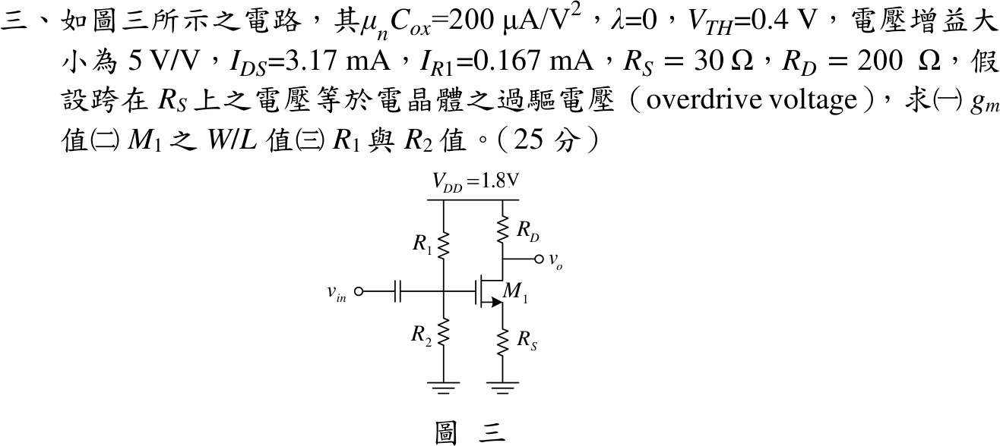

# 111 年電子學第 3 題｜MOSFET 源極退化放大器

## 已知與所求

$\mu_nC_{ox}=200\,\mu\mathrm{A/V^2}$、$\lambda=0$、$V_{TH}=0.4\,\mathrm V$、$|A_v|=5\,\mathrm{V/V}$、$I_{DS}=3.17\,\mathrm{mA}$、$I_{R1}=0.167\,\mathrm{mA}$、$R_S=30\,\Omega$、$R_D=200\,\Omega$、$V_{DD}=1.8\,\mathrm V$；$R_1$–$R_2$ 閘極分壓，輸入經電容耦合；跨 $R_S$ 電壓等於過驅電壓。求（一）$g_m$；（二）$W/L$；（三）$R_1,R_2$。

題面資料互相矛盾：$V_{OV}=I_DR_S$ 加上平方律必得 $g_m=2I_D/V_{OV}=2/R_S$，與指定增益 5 不相容，故 $g_m$、$W/L$ 以雙分支作答。

## 考場標準作答

### 偏壓量

飽和區 MOSFET 的閘極無直流電流，直流只由 $I_D$ 流過 $R_S$；題設跨 $R_S$ 的電壓即過驅電壓，且 $V_{GS}=V_{TH}+V_{OV}$。
\[
V_{OV}=V_S=I_DR_S=3.17\,\mathrm{mA}\times30\,\Omega=95.10\ \mathrm{mV}
\]
\[
V_{GS}=V_{TH}+V_{OV}=0.4\ \mathrm V+95.10\ \mathrm{mV}=495.10\ \mathrm{mV}
\]
\[
V_G=V_{GS}+V_S=495.10\ \mathrm{mV}+95.10\ \mathrm{mV}=590.20\ \mathrm{mV}
\]
檢查飽和：$V_{DS}=V_{DD}-I_D(R_D+R_S)=1.8-3.17\,\mathrm{mA}\times230\,\Omega=1.07\ \mathrm V>V_{OV}$，飽和成立。

### （一）$g_m$

小信號模型：$\lambda=0$ 且源極無旁路電容，$R_S$ 造成源極退化，增益為 $|A_v|=\dfrac{g_mR_D}{1+g_mR_S}$。

增益分支（以題給 $|A_v|=5$ 為準），解 $g_m$：
\[
\frac{g_mR_D}{1+g_mR_S}=5\ \Rightarrow\ g_m=\frac{5}{R_D-5R_S}=\frac{5}{200-5\times30}=\frac{5}{50}
\]
\[
\boxed{g_m=100.00\ \mathrm{mS}}
\]
平方律分支（以 $I_D$ 與 $V_{OV}$ 為準）：飽和區 $I_D=\frac12g_mV_{OV}$，故 $g_m=2I_D/V_{OV}$，且 $V_{OV}=I_DR_S$ 使它化簡為 $2/R_S$：
\[
g_m=\frac{2I_D}{V_{OV}}=\frac{2}{R_S}=\frac{2}{30\,\Omega}
\]
\[
\boxed{g_m=66.67\ \mathrm{mS}}
\]
以此 $g_m$ 回代增益：
\[
|A_v|=\frac{66.67\ \mathrm{mS}\times200\,\Omega}{1+66.67\ \mathrm{mS}\times30\,\Omega}=\frac{13.33}{3}=4.44\neq5
\]

### （二）$W/L$

平方律模型：飽和區 $g_m=\mu_nC_{ox}\dfrac WL V_{OV}$，先算常數 $\mu_nC_{ox}V_{OV}=200\,\mu\mathrm{A/V^2}\times95.10\,\mathrm{mV}=1.90\times10^{-5}\ \mathrm{A/V^2}$。

增益分支：
\[
\frac WL=\frac{g_m}{\mu_nC_{ox}V_{OV}}=\frac{100.00\times10^{-3}\ \mathrm S}{1.90\times10^{-5}\ \mathrm{A/V^2}}=\frac{100.00\times10^{-3}}{1.90\times10^{-5}}
\]
\[
\boxed{\frac WL=5257.62}
\]
平方律分支（直接由 $I_D=\frac12\mu_nC_{ox}\frac WL V_{OV}^2$ 解）：
\[
\frac WL=\frac{2I_D}{\mu_nC_{ox}V_{OV}^2}=\frac{2\times3.17\,\mathrm{mA}}{200\,\mu\mathrm{A/V^2}\times(95.10\,\mathrm{mV})^2}
\]
\[
2I_D=6.34\ \mathrm{mA},\qquad \mu_nC_{ox}V_{OV}^2=1.81\times10^{-6}\ \mathrm A,\qquad \frac WL=\frac{6.34\times10^{-3}}{1.81\times10^{-6}}
\]
\[
\boxed{\frac WL=3505.08}
\]

### （三）$R_1,R_2$

閘極不吸收直流電流，$R_1$、$R_2$ 為串聯分壓器，流過兩者的電流都是 $I_{R1}=I_{R2}=0.167\,\mathrm{mA}$；分壓點電壓必須等於 $V_G$。此結果與 $g_m$ 的分支無關，兩分支相同。

$R_1$ 承受 $V_{DD}-V_G$：
\[
V_{R1}=1.8\ \mathrm V-590.20\ \mathrm{mV}=1.21\ \mathrm V,\qquad R_1=\frac{V_{R1}}{I_{R1}}=\frac{1.21\ \mathrm V}{0.167\,\mathrm{mA}}
\]
\[
\boxed{R_1=7.24\ \mathrm{k}\Omega}
\]
$R_2$ 承受 $V_G$：
\[
R_2=\frac{V_G}{I_{R2}}=\frac{590.20\ \mathrm{mV}}{0.167\,\mathrm{mA}}
\]
\[
\boxed{R_2=3.53\ \mathrm{k}\Omega}
\]

## 驗算

- 增益分支回代：$\frac{100.00\ \mathrm{mS}\times200\,\Omega}{1+100.00\ \mathrm{mS}\times30\,\Omega}=\frac{20}{4}=5$。
- 平方律分支以另一式 $g_m=\sqrt{2\mu_nC_{ox}(W/L)I_D}=\sqrt{2(200\,\mu)(3505.08)(3.17\,\mathrm m)}=66.67\ \mathrm{mS}$，與 $2I_D/V_{OV}$ 一致。
- KVL：$0.167\,\mathrm{mA}\times(7.24+3.53)\,\mathrm{k}\Omega=1.80\ \mathrm V=V_{DD}$。

## 失分點

- $V_G$ 要加兩次 $V_{OV}$（$V_{GS}=V_{TH}+V_{OV}$ 再加 $V_S=V_{OV}$），只加一次會得 $R_2=2.96\,\mathrm{k}\Omega$。
- 源極未旁路，增益分母必有 $1+g_mR_S$；寫成 $g_mR_D=5$ 會得 $g_m=25\,\mathrm{mS}$。
- 只寫其中一個 $g_m$ 而不說明另一條件不成立，會被視為忽略題給數據。

## 條件與疑義

**雙分支來源。**參考書主解列 $g_m=1\,\mathrm{mS}$、$W/L=3522.2$、$R_2=3.3185\,\mathrm{k}\Omega$、$R_1=7.459\,\mathrm{k}\Omega$；但 $g_m=1\,\mathrm{mS}$ 代入其增益式只得 $\frac{200}{1030}=0.1942$，應為排印或計算錯誤，且其 $R_1,R_2$ 來自把 $V_{GS}=0.4951\,\mathrm V$ 誤排為 $0.4591\,\mathrm V$。

**最小更正候選。**矛盾無法靠改 $I_D$ 消除（$g_m=2/R_S$ 與 $I_D$ 無關），只有兩種單點更正：

- 增益改為 $4.444444$：即上方平方律分支。
- 保留 $|A_v|=5$、改 $R_S$：$5=\frac{(2/R_S)R_D}{3}\Rightarrow R_S=26.666667\,\Omega$、$g_m=0.075\,\mathrm S$、$V_{OV}=0.0845333\,\mathrm V$、$W/L=4436.120$，$R_1=7.370858\,\mathrm{k}\Omega$、$R_2=3.407585\,\mathrm{k}\Omega$。

**完整精度對照。**以下為上方各分支顯示值的完整精度（雙分支來源說明用，非考場作答）：增益分支 $W/L=5257.624$；平方律分支 $g_m=0.0666667\,\mathrm S$、$W/L=3505.082$。
