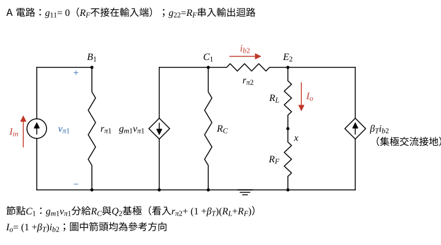

# 111 年電子學第 4 題｜並聯-串聯電流回授放大器

## 已知與所求

$I_{in}$ 注入 $Q_1$ 基極；$Q_1$ 共射，集極經 $R_C$ 接 $V_{CC}$ 並驅動 $Q_2$ 基極；$Q_2$ 射極電流 $I_o$ 向下流過負載 $R_L$（device）到節點 $x$，$x$ 經 $R_F$ 接回 $Q_1$ 基極，另以理想電流源接地（交流開路）。$V_A=\infty$（$r_o=\infty$），題面無數值。以 $\beta_T$ 表 $Q_2$ 電流增益、$\beta_f$ 表回授因素。求（一）回授因素；（二）開路增益；（三）閉路增益；（四）閉迴路輸入阻抗；（五）閉迴路輸出阻抗。

## 考場標準作答

### 步驟 1：回授型態

設 hybrid-$\pi$ 小訊號模型，$V_A=\infty$（$r_o=\infty$），$V_{CC}$ 交流接地，節點 $x$ 的偏壓電流源為理想電流源（交流開路）；題面無數值，以符號作答。

**型態：**輸入端是電流並聯混合，輸出端是電流串聯取樣，屬並聯-串聯（Shunt-Series）／電流-電流（Current-Current Feedback）負回授，以 g 參數二埠分析；回授網路為 $R_F$，埠 1 為 $Q_1$ 基極、埠 2 為節點 $x$。

- 輸出端：$R_L$ 與 $R_F$ 在 $Q_2$ 射極迴路中串聯，$R_F$ 取樣的是負載電流 $I_o$（串聯取樣）。
- 輸入端：$R_F$ 的電流與 $I_{in}$ 在 $Q_1$ 基極節點相加減（並聯混合），進入 $r_{\pi1}$ 的是誤差電流 $I_{in}-I_f$。

### （一）回授因素

令 $I_f$ 為由輸入節點經 $R_F$ 流出的電流（$I_f=(v_{b1}-v_x)/R_F$），$I_o$ 向下流過 $R_L$ 進入 $x$。節點 $x$ 的 KCL（流入 = 流出，偏壓電流源交流電流為 0）：
\[
I_o=\frac{v_x-v_{b1}}{R_F}+0=-I_f
\]
\[
\boxed{\beta_f=\frac{I_f}{I_o}=-1}
\]

### 步驟 2：A 電路（含回授網路負載）

g 參數負載：$g_{11}=I_1/V_1|_{I_2=0}$ 是 $x$ 端開路時由基極看入 $R_F$ 的電導，$R_F$ 無電流，故 $g_{11}=0$，輸入端不加負載；$g_{22}=V_2/I_2|_{V_1=0}=R_F$，串入輸出迴路。

輸入端：$I_{in}$ 全部流入 $r_{\pi1}$，
\[
R_{iA}=r_{\pi1},\qquad v_{\pi1}=I_{in}r_{\pi1}
\]
由 $Q_2$ 基極看入（射極迴路 $R_L+R_F$ 反射 $(1+\beta_T)$ 倍）：
\[
R_{b2}=r_{\pi2}+(1+\beta_T)(R_L+R_F)
\]

### （二）開路增益

節點 $C_1$ 分流（$i_{b2}$ 參考方向由 $C_1$ 流入 $Q_2$ 基極，與受控源抽出的方向相反，故帶負號）：
\[
i_{b2}=-g_{m1}v_{\pi1}\cdot\frac{R_C}{R_C+R_{b2}}
\]
射極電流：
\[
I_o=(1+\beta_T)\,i_{b2}=-g_{m1}v_{\pi1}\cdot\frac{(1+\beta_T)R_C}{R_C+R_{b2}}
\]
代入 $v_{\pi1}=I_{in}r_{\pi1}$ 與 $R_{b2}$：
\[
\boxed{A=\frac{I_o}{I_{in}}=-\frac{g_{m1}r_{\pi1}(1+\beta_T)R_C}{R_C+r_{\pi2}+(1+\beta_T)(R_L+R_F)}}
\]
$A<0$、$\beta_f<0$，迴路增益 $A\beta_f=|A|>0$，確為負回授。

### （三）閉路增益

\[
A\beta_f=A\times(-1)=|A|
\]
\[
\boxed{A_f=\frac{A}{1+A\beta_f}=\frac{A}{1+|A|}}\approx\frac1{\beta_f}=-1\quad(|A|\gg1)
\]

### （四）閉迴路輸入阻抗

輸入端為並聯（電流）混合，輸入阻抗除以 $1+A\beta_f$；開迴路輸入阻抗為步驟 2 的 $R_{iA}=r_{\pi1}$。

\[
\boxed{R_{if}=\frac{R_{iA}}{1+A\beta_f}=\frac{r_{\pi1}}{1+|A|}}
\]

### （五）閉迴路輸出阻抗

輸出端為串聯（電流）取樣，輸出阻抗提高為 $(1+A\beta_f)$ 倍，先求開迴路輸出阻抗 $R_{oA}$。

求 $R_{oA}$：令 $I_{in}=0$，則 $v_{\pi1}=0$、$g_{m1}v_{\pi1}=0$，$Q_2$ 基極只經 $R_C$ 接地。在 $Q_2$ 射極由下往上看入，$i_{b2}$ 由 $C_1$ 流入基極時 $C_1$ 電位為 $-i_{b2}R_C$：
\[
v_{e2}=v_{c1}-i_{b2}r_{\pi2}=-i_{b2}(R_C+r_{\pi2})
\]
流入射極的電流 $-(1+\beta_T)i_{b2}$，射極看入電阻：
\[
\frac{v_{e2}}{-(1+\beta_T)i_{b2}}=\frac{R_C+r_{\pi2}}{1+\beta_T}
\]
輸出迴路在與 $R_L$ 串聯處斷開看入（含 $R_L$ 與 $g_{22}=R_F$）：
\[
R_{oA}=R_L+R_F+\frac{R_C+r_{\pi2}}{1+\beta_T}
\]
$|A|$ 的分母可寫成 $(1+\beta_T)R_{oA}$：
\[
R_C+r_{\pi2}+(1+\beta_T)(R_L+R_F)=(1+\beta_T)\left[R_L+R_F+\frac{R_C+r_{\pi2}}{1+\beta_T}\right]=(1+\beta_T)R_{oA}
\]
\[
R_{oA}|A|=R_{oA}\cdot\frac{g_{m1}r_{\pi1}(1+\beta_T)R_C}{(1+\beta_T)R_{oA}}=g_{m1}r_{\pi1}R_C
\]
代入 $R_{of}=R_{oA}(1+|A|)=R_{oA}+R_{oA}|A|$：
\[
\boxed{R_{of}=R_{oA}(1+A\beta_f)=R_L+R_F+\frac{R_C+r_{\pi2}}{1+\beta_T}+g_{m1}r_{\pi1}R_C}
\]
$g_{m1}r_{\pi1}R_C$ 是 $Q_1$ 的電流增益 $\beta_1$ 乘 $R_C$，通常遠大於其他項，所以閉迴路輸出阻抗很高，接近理想電流源；若要由負載端看入（不含 $R_L$），再減去 $R_L$。

## 驗算

精確節點分析（不做二埠近似）：基極 KCL $v_b/r_{\pi1}=I_{in}-I_f$，$x$ 點 $I_f=-I_o$，解得
\[
\frac{I_o}{I_{in}}=\frac{-r_{\pi1}(1+\beta_T)(1+g_{m1}R_C)}{r_{\pi1}(1+\beta_T)(1+g_{m1}R_C)+R_C+r_{\pi2}+(1+\beta_T)(R_L+R_F)}
\]
與（三）只差 $R_F$ 的前饋項，$g_{m1}\to\infty$ 時同趨於 $-1$。精確輸入電阻 $R_{in}=R_{if}\parallel R_{oA}$（前饋路徑經 $R_F$、$R_L$ 進 $Q_2$），相對差約 $1/(g_{m1}R_C)$；負載看入的精確輸出電阻為 $R_F+\frac{R_C+r_{\pi2}}{1+\beta_T}+g_{m1}r_{\pi1}R_C+r_{\pi1}$，即（五）去掉 $R_L$ 後再加前饋項 $r_{\pi1}$。

## 失分點

- 把型態判成串聯-並聯（電壓）回授；本題輸入是電流源、取樣量是負載電流。
- 把 $R_F$ 當成輸入端對地負載（$R_F\parallel r_{\pi1}$）；$x$ 端只接交流開路的電流源，$g_{11}=0$。
- 偏壓電流源當交流短路，會讓 $I_o$ 分流到地而得 $|\beta_f|<1$。

## 條件與疑義

參考書取 $I_f$ 流入輸入節點，寫 $\beta_f=\frac{I_f}{I_o}=1$，並以 $R_{iA}=R_F\parallel r_{\pi1}$ 作輸入負載：$A=-(R_F\parallel r_{\pi1})g_{m1}\frac{(1+\beta_T)R_C}{R_C+r_{\pi2}+(1+\beta_T)(R_L+R_F)}$、$R_{if}=\frac{R_F\parallel r_{\pi1}}{1+A\beta_f}$（參考書開路增益式漏掉 $R_F\parallel r_{\pi1}$ 因子，此處已補回；其 $A<0$ 配 $\beta_f=+1$ 時分母須讀作 $1+|A|$）。$R_F$ 要成為輸入端對地負載，必須其遠端交流接地；但那樣 $I_o$ 會流入地而不經 $R_F$ 回到輸入，$\beta_f=0$，與參考書自己的 $|\beta_f|=1$ 矛盾，故不採用。以 $r_{\pi1}=2.5\,\mathrm{k}\Omega$、$r_{\pi2}=250\,\Omega$、$g_{m1}=40\,\mathrm{mS}$、$\beta_T=100$、$R_C=5\,\mathrm{k}\Omega$、$R_L=100\,\Omega$、$R_F=1\,\mathrm{k}\Omega$ 試算：$A_f$ 精確 $-0.997713$、本解 $-0.997701$、參考書形式 $-0.992001$；$A$ 本解 $-434.0$、參考書 $-124.0$；負載看入輸出電阻精確 $503.6\,\mathrm{k}\Omega$、本解（含 $R_L$）$501.2\,\mathrm{k}\Omega$、參考書形式 $144.0\,\mathrm{k}\Omega$。
