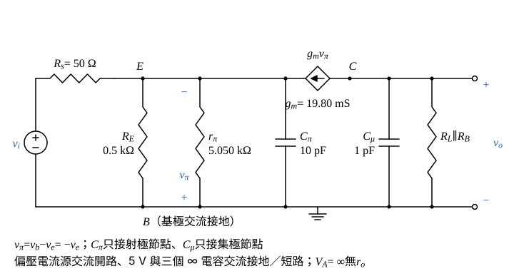

# 112 年電子學第 1 題｜共基極高頻響應

## 已知與所求

$\beta=100$、$V_{BE}=0.7\,\mathrm V$、$V_A=\infty$、$C_\pi=10\,\mathrm{pF}$、$C_\mu=1\,\mathrm{pF}$；$R_s=50\,\Omega$、$R_E=0.5\,\mathrm{k}\Omega$、$R_B=100\,\mathrm{k}\Omega$（集極接基極，基極經電容旁路）、$R_L=1\,\mathrm{k}\Omega$；$I_Q=0.5\,\mathrm{mA}$ 由 5 V 流入集極節點。圖中三個標示 $\infty$ 的外接電容交流短路。求 $f_{H\pi}$、$f_{H\mu}$ 與中頻 $A_v=v_o/v_i$。題圖沒有明示熱電壓，取 $V_T=25\,\mathrm{mV}$。

## 考場標準作答

**解題邏輯**：前提：BJT 在**主動區**（$V_{BE}=0.7\,\mathrm V$，以 $V_{CB}>0$ 驗證）、小訊號混合 $\pi$ 模型、$V_A=\infty$（無 $r_o$）；$V_T=25\,\mathrm{mV}$（題圖未給，假設）；偏壓電流源交流開路，5 V 與三個 $\infty$ 電容交流接地／短路。先由集極節點 KCL 得 $I_E$、$I_C$，再得 $g_m$、$r_\pi$、$r_e$。基極交流接地後 $C_\pi$ 只接在射極節點、$C_\mu$ 只接在集極節點，受控源單向耦合，兩個極點各由「電容 × 該節點對地電阻」決定；中頻增益則是 $R_s$ 對射極輸入電阻分壓後乘 $g_m(R_L\parallel R_B)$。

### 步驟 1：偏壓與小訊號參數

集極節點 KCL：$I_Q=I_C+I_B$（$I_B$ 經 $R_B$ 流入基極），而 $I_E=I_C+I_B$，故
\[
I_E=I_Q=0.5\,\mathrm{mA},\qquad I_C=\frac{\beta}{\beta+1}I_E=495.05\,\mu\mathrm{A}
\]
（$I_C=\tfrac{100}{101}\times0.5\,\mathrm{mA}=495.05\,\mu\mathrm A$。）主動區檢查：
\[
V_B=V_{BE}+I_ER_E=0.7+0.5\,\mathrm{mA}\times0.5\,\mathrm{k}\Omega=0.7+0.25=0.95\,\mathrm V
\]
\[
I_BR_B=\frac{0.5\,\mathrm{mA}}{101}\times100\,\mathrm{k}\Omega=4.9505\,\mu\mathrm A\times100\,\mathrm{k}\Omega=0.49505\,\mathrm V
\]
\[
V_{CB}=I_BR_B=0.49505\,\mathrm V>0
\]
集基接面逆偏，主動區成立。小訊號參數：
\[
g_m=\frac{I_C}{V_T}=\frac{495.05\,\mu\mathrm A}{25\,\mathrm{mV}}=19.80\,\mathrm{mS}
\]
\[
r_\pi=\frac{\beta}{g_m}=\frac{\beta V_T}{I_C}=\frac{100\times25\,\mathrm{mV}}{495.05\,\mu\mathrm A}=5.050\,\mathrm{k}\Omega
\]
\[
r_e=\frac{V_T}{I_E}=\frac{25\,\mathrm{mV}}{0.5\,\mathrm{mA}}=50\,\Omega
\]

### 步驟 2：高頻小訊號等效電路

- 基極經 $\infty$ 電容接地，$v_b=0$，故 $v_\pi=v_b-v_e=-v_e$。
- $r_\pi$、$C_\pi$ 接在 $B$–$E$，即射極節點對地；$C_\mu$ 接在 $B$–$C$，即集極節點對地，不必用米勒等效。
- 受控源 $g_mv_\pi$ 參考方向由 $C$ 流向 $E$；集極節點對地另有 $R_L$ 與 $R_B$（$R_B$ 另一端為交流地的基極）。
- 由射極看入電晶體（基極接地，外加 $v_e$）：流入電流 $=v_e/r_\pi+g_mv_e=v_e(1+\beta)/r_\pi$，故看入電阻 $r_\pi/(\beta+1)=5050/101=50\,\Omega=r_e$。

### $C_\pi$ 對應的 $f_{H\pi}$

**邏輯**：$C_\pi$ 只接在射極節點；令 $v_i=0$、$C_\mu$ 開路，射極節點對地電阻是 $R_s$、$R_E$ 與電晶體看入電阻 $r_e$ 三者並聯，$f_{H\pi}=1/(2\pi R_\pi C_\pi)$。

\[
R_\pi=R_s\parallel R_E\parallel r_e=\frac{1}{\dfrac1{50}+\dfrac1{500}+\dfrac1{50}}=\frac{1}{0.042\,\mathrm S}=\frac{500}{21}\,\Omega=23.8095\,\Omega
\]
\[
2\pi R_\pi C_\pi=2\pi\times23.8095\,\Omega\times10\,\mathrm{pF}=1.4960\times10^{-9}\,\mathrm s
\]
\[
f_{H\pi}=\frac{1}{2\pi R_\pi C_\pi}=\frac{1}{1.4960\times10^{-9}\,\mathrm s}
\]
\[
\boxed{f_{H\pi}=668.45\,\mathrm{MHz}}
\]

### $C_\mu$ 對應的 $f_{H\mu}$

**邏輯**：$C_\mu$ 只接在集極節點；$r_o=\infty$、受控電流源對所見電阻為開路，集極節點對地只剩 $R_L\parallel R_B$。

\[
R_\mu=R_L\parallel R_B=\frac{1\,\mathrm k\times100\,\mathrm k}{1\,\mathrm k+100\,\mathrm k}=\frac{100}{101}\,\mathrm{k}\Omega=990.10\,\Omega
\]
\[
2\pi R_\mu C_\mu=2\pi\times990.10\,\Omega\times1\,\mathrm{pF}=6.2210\times10^{-9}\,\mathrm s
\]
\[
f_{H\mu}=\frac{1}{2\pi R_\mu C_\mu}=\frac{1}{6.2210\times10^{-9}\,\mathrm s}
\]
\[
\boxed{f_{H\mu}=160.75\,\mathrm{MHz}}
\]

### 中頻帶電壓增益

**邏輯**：中頻時 $C_\pi,C_\mu$ 視為開路。射極節點：$v_i$ 經 $R_s$ 對輸入電阻 $R_E\parallel r_e$ 分壓得 $v_e$；集極節點 KCL：$v_o/(R_L\parallel R_B)+g_mv_\pi=0$，代入 $v_\pi=-v_e$ 得 $v_o=g_mv_e(R_L\parallel R_B)$（共基極不反相）。

射極輸入電阻與分壓比：
\[
R_E\parallel r_e=\frac{500\times50}{500+50}=\frac{500}{11}\,\Omega=45.45\,\Omega
\]
\[
\frac{v_e}{v_i}=\frac{R_E\parallel r_e}{R_s+R_E\parallel r_e}=\frac{500/11}{50+500/11}=\frac{500}{1050}=\frac{10}{21}=0.4762
\]
集極側：
\[
\frac{v_o}{v_e}=g_m(R_L\parallel R_B)=19.80\,\mathrm{mS}\times990.10\,\Omega=19.604
\]
相乘：
\[
A_v=\frac{v_o}{v_i}=\frac{10}{21}\times19.604=\frac{196.04}{21}=9.335
\]
\[
\boxed{A_v=9.34\ \mathrm{V/V}}
\]

## 驗算

- 電流分流（取 $v_i=1\,\mathrm V$）：$R_s$ 電流 $\dfrac{1}{50+45.45}=10.476\,\mathrm{mA}$，其中流入電晶體射極的比例 $\dfrac{R_E}{R_E+r_e}=\dfrac{500}{550}$，$i_e=10.476\times\dfrac{500}{550}=9.524\,\mathrm{mA}$；$v_o=\alpha i_e(R_L\parallel R_B)=0.9901\times9.524\,\mathrm{mA}\times990.10\,\Omega=9.34\,\mathrm V$。
- 含兩電容的節點方程中，射極節點只含 $C_\pi$、集極節點只含 $C_\mu$，受控源單向耦合，故 $A_v(s)=9.34/[(1+s/\omega_{H\pi})(1+s/\omega_{H\mu})]$，兩極點恰為上兩式（非近似）。

## 失分點

- 漏掉 $R_B$（集極只取 $R_L$）會得 $f_{H\mu}=159.15\,\mathrm{MHz}$、$A_v=9.43\,\mathrm{V/V}$。
- $C_\pi$ 所見電阻漏掉 $r_e$（只取 $R_s\parallel R_E$）會得 $f_{H\pi}=350.14\,\mathrm{MHz}$。
- 基極交流接地，$C_\mu$ 直接跨集極–地，不可套共射極的米勒倍增。

## 條件與疑義

- 取 $V_T=26\,\mathrm{mV}$ 時 $f_{H\pi}=656.21\,\mathrm{MHz}$、$A_v=9.14\,\mathrm{V/V}$，$f_{H\mu}$ 不變。
- 參考書同取 25 mV，得 $f_{H\pi}=6.69\times10^8\,\mathrm{Hz}$、$f_{H\mu}=1.6\times10^8\,\mathrm{Hz}$，與上式一致；書中中頻增益約 9.47 V/V 為近似值，與本解差 1.43%。
