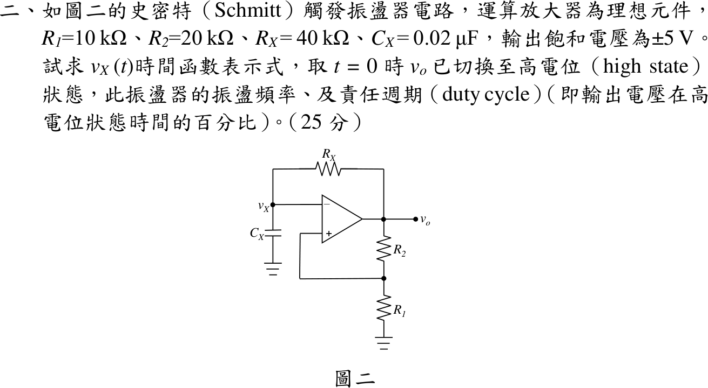
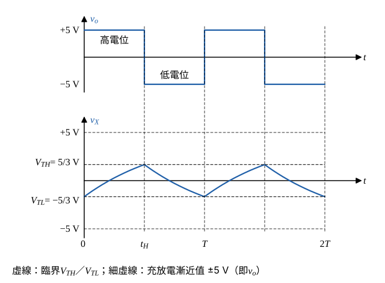

# 112 年電子學第 2 題｜Schmitt 鬆弛振盪器

## 已知與所求

理想運放；$v_X$ 接反相端，經 $R_X=40\,\mathrm{k}\Omega$ 接 $v_o$、經 $C_X=0.02\,\mu\mathrm F$ 接地；非反相端 $v_+$ 由 $R_2=20\,\mathrm{k}\Omega$（接 $v_o$）與 $R_1=10\,\mathrm{k}\Omega$（接地）分壓；$v_o=\pm5\,\mathrm V$。$t=0$ 時 $v_o$ 剛切至高電位。求 $v_X(t)$、振盪頻率 $f$、責任週期 $D$（高電位時間百分比），共 25 分。

## 考場標準作答

**解題邏輯**：前提：理想運放（輸入端不取電流）在正回授下當比較器用，$v_o$ 只有 $\pm5\,\mathrm V$ 兩種狀態，$v_X$ 一越過 $v_+$ 就瞬間翻轉；因此 $R_1$–$R_2$ 是單純分壓、$R_X$–$C_X$ 是單純 RC 充放電。先由分壓求上、下臨界電壓 $V_{TH}$、$V_{TL}$ 與時間常數 $\tau$；再以 RC 一階暫態公式寫出高電位段（$v_X$ 由 $V_{TL}$ 朝 $+5\,\mathrm V$ 充電）與低電位段（由 $V_{TH}$ 朝 $-5\,\mathrm V$ 放電）的 $v_X(t)$，由「到達臨界即翻轉」解出 $t_H$、$t_L$，最後 $f=1/(t_H+t_L)$、$D=t_H/T$。

### 步驟 1：臨界電壓

$v_+$ 由 $R_1$、$R_2$ 對 $v_o$ 分壓（非反相端不取電流）：
\[
\beta=\frac{R_1}{R_1+R_2}=\frac{10}{10+20}=\frac{1}{3}
\]
\[
V_{TH}=\beta\times(+5)=\frac{5}{3}\,\mathrm V\approx1.667\,\mathrm V\quad(v_o=+5\,\mathrm V\ \text{時})
\]
\[
V_{TL}=\beta\times(-5)=-\frac{5}{3}\,\mathrm V\approx-1.667\,\mathrm V\quad(v_o=-5\,\mathrm V\ \text{時})
\]
$v_o=+5\,\mathrm V$ 時 $v_X$ 要升到 $V_{TH}$ 才翻成 $-5\,\mathrm V$；$v_o=-5\,\mathrm V$ 時 $v_X$ 要降到 $V_{TL}$ 才翻回 $+5\,\mathrm V$。

### 步驟 2：時間常數與初值

反相端不取電流，$C_X$ 只經 $R_X$ 由 $v_o$ 充放電：
\[
\tau=R_XC_X=40\times10^{3}\times0.02\times10^{-6}=8\times10^{-4}\,\mathrm s=800\,\mu\mathrm s
\]
$t=0$ 時 $v_o$ 剛由 $-5$ 切到 $+5\,\mathrm V$，表示 $v_X$ 剛降到下臨界（電容電壓不能突變）：
\[
v_X(0)=V_{TL}=-\frac{5}{3}\,\mathrm V
\]

### $v_X(t)$ 時間函數

**邏輯**：每一段 $v_o$ 為定值，$v_X$ 以 $\tau$ 指數趨向該段的 $v_o$（一階 RC：$v_X(t)=v_\infty+[v_X(t_0)-v_\infty]e^{-(t-t_0)/\tau}$）；段的終點是 $v_X$ 碰到臨界電壓的時刻。

高電位段（$v_o=+5\,\mathrm V$，$t_0=0$，$v_\infty=5\,\mathrm V$）：
\[
v_X(t)=5+\left(-\frac{5}{3}-5\right)e^{-t/\tau}=5-\frac{20}{3}e^{-t/\tau}\ \mathrm V
\]
到達 $V_{TH}$ 的時刻 $t_H$：
\[
5-\frac{20}{3}e^{-t_H/\tau}=\frac{5}{3}
\]
\[
\frac{20}{3}e^{-t_H/\tau}=5-\frac{5}{3}=\frac{10}{3}
\]
\[
e^{-t_H/\tau}=\frac{10/3}{20/3}=\frac{1}{2}\ \Rightarrow\ t_H=\tau\ln2
\]
\[
t_H=800\,\mu\mathrm s\times0.693147=554.52\,\mu\mathrm s
\]
低電位段（$v_o=-5\,\mathrm V$，$t_0=t_H$，$v_X(t_H)=\tfrac53\,\mathrm V$，$v_\infty=-5\,\mathrm V$）：
\[
v_X(t)=-5+\left(\frac{5}{3}+5\right)e^{-(t-t_H)/\tau}=-5+\frac{20}{3}e^{-(t-t_H)/\tau}\ \mathrm V
\]
到達 $V_{TL}$ 時 $-5+\tfrac{20}{3}e^{-t_L/\tau}=-\tfrac53$，同理得 $e^{-t_L/\tau}=\tfrac12$：
\[
t_L=\tau\ln2=554.52\,\mu\mathrm s
\]
之後 $v_X$ 回到 $-\tfrac53\,\mathrm V$、狀態與 $t=0$ 相同，波形以 $T=t_H+t_L$ 重複（$\tau=800\,\mu\mathrm s$、$t_H=554.52\,\mu\mathrm s$）：
\[
\boxed{v_X(t)=\begin{cases}5-\dfrac{20}{3}e^{-t/800\,\mu\mathrm s}\ \mathrm V, & 0\le t<t_H\\[6pt]-5+\dfrac{20}{3}e^{-(t-t_H)/800\,\mu\mathrm s}\ \mathrm V, & t_H\le t<T\end{cases},\quad v_X(t+T)=v_X(t)}
\]

### 振盪頻率

**邏輯**：一週期由高、低兩段組成，$T=t_H+t_L$，頻率是週期的倒數。

\[
T=t_H+t_L=2\tau\ln2=2\times800\,\mu\mathrm s\times0.693147=1109.04\,\mu\mathrm s
\]
\[
f=\frac{1}{T}=\frac{1}{1109.04\times10^{-6}\,\mathrm s}
\]
\[
\boxed{f=901.68\,\mathrm{Hz}}
\]

### 責任週期

**邏輯**：責任週期定義為高電位時間占週期的比例；上下臨界對稱（$\pm\tfrac53\,\mathrm V$）、飽和電壓對稱（$\pm5\,\mathrm V$），兩段時間相等。

\[
D=\frac{t_H}{T}=\frac{554.52\,\mu\mathrm s}{1109.04\,\mu\mathrm s}=0.50
\]
\[
\boxed{D=50\%}
\]

## 驗算

- 通式 $T=2\tau\ln\dfrac{1+\beta}{1-\beta}$，$\beta=\tfrac13$：$\dfrac{1+1/3}{1-1/3}=\dfrac{4/3}{2/3}=2$，$T=2\tau\ln2$，與上相同。
- 代回：$v_X(t_H)=5-\tfrac{20}{3}\times\tfrac12=5-\tfrac{10}{3}=\tfrac53\,\mathrm V=V_{TH}$，翻轉點正確。
- 以比較器規則逐步模擬 $dv_X/dt=(v_o-v_X)/\tau$，得頻率 $901.68\,\mathrm{Hz}$、高電位占比 $50\%$。

## 失分點

- 起點取 $v_X(0)=0$；$t=0$ 剛切換，電容電壓應在下臨界 $-\tfrac53\,\mathrm V$，第一段才會是完整的半週期。
- 分壓比寫成 $R_2/(R_1+R_2)=\tfrac23$，臨界值錯成 $\pm\tfrac{10}{3}\,\mathrm V$，$T=2\tau\ln5$、$f=388.33\,\mathrm{Hz}$。
- 指數式的趨向值寫成臨界電壓；$v_X$ 是趨向 $v_o=\pm5\,\mathrm V$，到臨界就翻轉。
