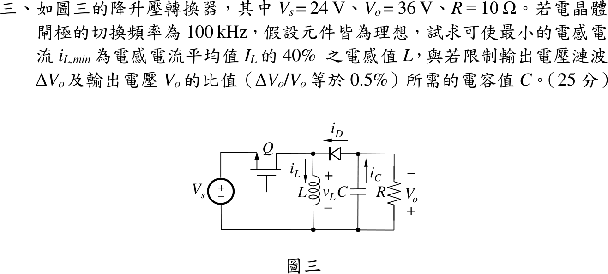

# 112 年電子學第 3 題｜降升壓轉換器的 L 與 C

## 已知與所求

$V_s=24\,\mathrm V$，$V_o=36\,\mathrm V$（題圖輸出端上負下正，即上端對共地為 $V_o=-36\,\mathrm V$ 的反相輸出），$R=10\,\Omega$，$f_s=100\,\mathrm{kHz}$（$T_s=10\,\mu\mathrm s$），理想、CCM。求使 $i_{L,\min}=0.4I_L$ 的 $L$，及 $\Delta V_o/V_o=0.5\%$ 的 $C$。

## 考場標準作答

### 責任週期與平均電感電流

CCM 下電感一週期伏秒平衡：導通時 $v_L=V_s$（歷時 $DT_s$），關斷時電感經二極體對輸出放電，$v_L=-V_o$（歷時 $(1-D)T_s$），由此解 $D$；電容電荷平衡則給平均電感電流。

伏秒平衡 $V_sD=V_o(1-D)$：
\[
D=\frac{V_o}{V_s+V_o}=\frac{36}{24+36}=\frac{36}{60}=0.60,\qquad I_o=\frac{V_o}{R}=\frac{36}{10}=3.60\,\mathrm A
\]
二極體只在 $(1-D)T_s$ 把 $i_L$ 送往負載，電容電荷平衡使其平均值等於 $I_o$：
\[
I_L(1-D)=I_o\ \Rightarrow\ I_L=\frac{3.60}{1-0.60}=9\,\mathrm A
\]

### 電感值

三角形電流波的平均值在峰谷中間，故由谷值規格求出峰對峰漣波，再用導通期電感方程式 $v_L=L\,\Delta i_L/(DT_s)$ 解 $L$。

谷值與峰對峰漣波：
\[
i_{L,\min}=0.4I_L=0.4(9)=3.60\,\mathrm A,\qquad
\Delta i_L=2(I_L-i_{L,\min})=2(9-3.60)=10.80\,\mathrm A
\]
導通時 $v_L=V_s$，$\Delta i_L=V_sDT_s/L$：
\[
L=\frac{V_sDT_s}{\Delta i_L}=\frac{24(0.60)(10\times10^{-6})}{10.80}=\frac{1.44\times10^{-4}}{10.80}
\]
\[
\boxed{L=13.33\,\mu\mathrm H}
\]

### 電容值

導通期間二極體截止，電容獨自供應負載電流 $I_o$，輸出漣波為此段電荷損失除以 $C$：
\[
\Delta V_o=\frac{I_oDT_s}{C}\ \Rightarrow\ \frac{\Delta V_o}{V_o}=\frac{I_oDT_s}{CV_o}=\frac{D}{RCf_s}
\]
令比值為 $0.5\%=0.005$，解 $C$：
\[
C=\frac{D}{Rf_s(\Delta V_o/V_o)}=\frac{0.60}{10(10^{5})(0.005)}=\frac{0.60}{5000}
\]
\[
\boxed{C=120\,\mu\text{F}}
\]
（此時 $\Delta V_o=0.005\times36=0.18\ \mathrm V$。）

## 驗算

- 關斷區 $v_L=-V_o$：下降量 $36(0.40)(10\times10^{-6})/(13.33\times10^{-6})=10.80\,\mathrm A$，與上升量相等；$i_L$ 在 $3.60\sim14.40\,\mathrm A$，谷值 $>0$，CCM 成立。
- 功率守恆：$P_o=36^2/10=129.60\,\mathrm W$，輸入平均電流 $DI_L=0.60(9)=5.40\,\mathrm A$，$24\times5.40=129.60\,\mathrm W$。

## 失分點

- 把「最小值為平均值 40%」當成 $\Delta i_L=0.4I_L$，得 $L=40\,\mu\mathrm H$。
- 平均電感電流誤取 $I_o=3.60\,\mathrm A$，漏除 $(1-D)$。
- 套 Boost 增益 $1/(1-D)$ 得 $D=1/3$。
