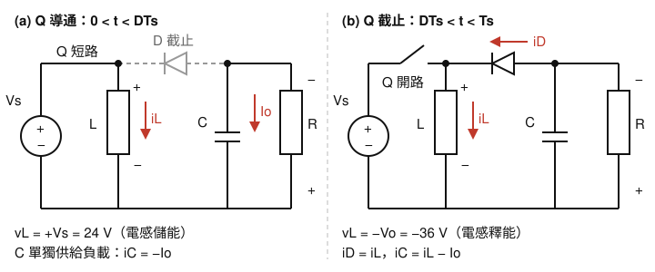
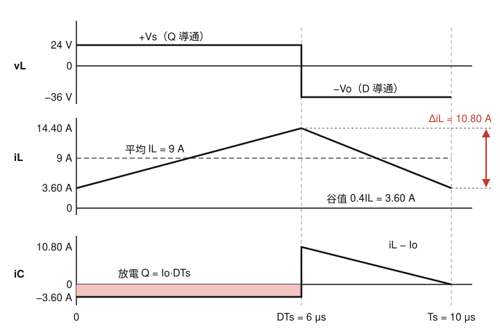

# 112 年電子學第 3 題｜降升壓轉換器的 L 與 C

## 已知與所求

$V_s=24\,\mathrm V$，$V_o=36\,\mathrm V$（題圖輸出端上負下正，即上端對共地為 $V_o=-36\,\mathrm V$ 的反相輸出），$R=10\,\Omega$，$f_s=100\,\mathrm{kHz}$，理想、CCM。參考方向依題圖：$i_L$ 向下流過 $L$、$v_L$ 上正下負，$i_D$ 由輸出上端經二極體流向 $L$ 上端，$i_C$ 由電容向上流出。求使 $i_{L,\min}=0.4I_L$ 的 $L$，及 $\Delta V_o/V_o=0.5\%$ 的 $C$。

## 考場標準作答

### 步驟 1：兩個開關狀態的等效電路

設 CCM 穩態。

- **Q 導通（$0<t<DT_s$）**：$V_s$ 直接跨在 $L$ 上，$v_L=+V_s=24\,\mathrm V$，$i_L$ 上升。$L$ 上端為 $+24\,\mathrm V$、輸出上端為 $-36\,\mathrm V$，二極體逆偏截止，$C$ 單獨供給負載，$i_C=-I_o$。
- **Q 截止（$DT_s<t<T_s$）**：$i_L$ 不能突變，迫使二極體導通，$L$ 上端接到輸出上端，$v_L=-V_o=-36\,\mathrm V$，$i_L$ 下降；此時 $i_D=i_L$，輸出上端節點 KCL 得 $i_C=i_L-I_o$。

### 步驟 2：伏秒平衡求 $D$

穩態下 $i_L$ 一週期淨變化為零，即 $v_L$ 一週期平均為零：
\[
V_s\cdot DT_s+(-V_o)(1-D)T_s=0\ \Rightarrow\ V_sD=V_o(1-D)
\]
\[
D=\frac{V_o}{V_s+V_o}=\frac{36}{24+36}=\frac{36}{60}=0.60
\]
\[
T_s=\frac{1}{f_s}=\frac{1}{100\ \mathrm{kHz}}=10\,\mu\mathrm s,\qquad DT_s=0.60\times10=6\,\mu\mathrm s,\qquad (1-D)T_s=4\,\mu\mathrm s
\]

### 步驟 3：電荷平衡求 $I_L$

負載電流：
\[
I_o=\frac{V_o}{R}=\frac{36}{10}=3.60\,\mathrm A
\]
穩態下電容一週期淨電荷為零（$i_C$ 平均為零），故二極體電流平均值等於 $I_o$。二極體只在截止段導通且 $i_D=i_L$；$i_L$ 在該段為直線，其平均值等於峰谷中點 $I_L$：
\[
\langle i_D\rangle=(1-D)I_L=I_o
\]
\[
I_L=\frac{I_o}{1-D}=\frac{3.60}{1-0.60}=\frac{3.60}{0.40}=9\,\mathrm A
\]

### 電感值 $L$

三角波的平均值位於峰谷正中，由谷值規格得峰對峰漣波 $\Delta i_L$。

谷值與峰對峰漣波：
\[
i_{L,\min}=0.4I_L=0.4\times9=3.60\,\mathrm A
\]
\[
\Delta i_L=2(I_L-i_{L,\min})=2(9-3.60)=2\times5.40=10.80\,\mathrm A
\]
（峰值 $i_{L,\max}=I_L+\Delta i_L/2=9+5.40=14.40\,\mathrm A$。）

導通段電流上升量：
\[
\Delta i_L=\frac{V_s}{L}\,DT_s\ \Rightarrow\ L=\frac{V_sDT_s}{\Delta i_L}
\]
代入：
\[
V_sDT_s=24\ \mathrm V\times6\ \mu\mathrm s=144\ \mathrm V\cdot\mu\mathrm s
\]
\[
L=\frac{144\ \mathrm V\cdot\mu\mathrm s}{10.80\ \mathrm A}=13.33\,\mu\mathrm H
\]
\[
\boxed{L=\tfrac{40}{3}\,\mu\mathrm H\approx13.33\,\mu\mathrm H}
\]

### 電容值 $C$

導通段二極體截止，電容獨自以 $I_o$ 放電 $DT_s$（圖 2 陰影），這段電荷損失即 $C\Delta V_o$。

放電電荷：
\[
\Delta Q=I_oDT_s=3.60\ \mathrm A\times6\ \mu\mathrm s=21.60\,\mu\mathrm C
\]
允許漣波（$0.5\%$ 即 $5\times10^{-3}$）：
\[
\Delta V_o=5\times10^{-3}\times36=0.18\,\mathrm V
\]
\[
C=\frac{\Delta Q}{\Delta V_o}=\frac{21.60\ \mu\mathrm C}{0.18\ \mathrm V}=120\,\mu\mathrm F
\]
\[
\boxed{C=120\,\mu\text{F}}
\]
（合併成公式：$\dfrac{\Delta V_o}{V_o}=\dfrac{I_oDT_s}{CV_o}=\dfrac{D}{RCf_s}$，$C=\dfrac{0.60}{10\times10^{5}\times5\times10^{-3}}=\dfrac{0.60}{5000}=120\,\mu\mathrm F$，同值。）

## 驗算

- 截止段下降量：$\dfrac{V_o(1-D)T_s}{L}=\dfrac{36\ \mathrm V\times4\ \mu\mathrm s}{13.33\ \mu\mathrm H}=10.80\,\mathrm A$，與導通段上升量相等；$i_L$ 在 $3.60\sim14.40\,\mathrm A$，谷值 $>0$，CCM 成立。
- 功率守恆：$P_o=36^2/10=129.60\,\mathrm W$；輸入平均電流 $DI_L=0.60\times9=5.40\,\mathrm A$，$P_s=24\times5.40=129.60\,\mathrm W$，相等。
- 截止段充電電荷：$i_C=i_L-I_o$ 由 $14.40-3.60=10.80\,\mathrm A$ 線性降到 $3.60-3.60=0$，面積 $\tfrac12\times10.80\ \mathrm A\times4\ \mu\mathrm s=21.60\,\mu\mathrm C$，等於導通段放電量，電荷平衡成立。

## 失分點

- 把「最小值為平均值 40%」當成 $\Delta i_L=0.4I_L$，得 $L=40\,\mu\mathrm H$。
- 平均電感電流誤取 $I_o=3.60\,\mathrm A$，漏除 $(1-D)$。
- 套 Boost 增益 $1/(1-D)$ 得 $D=1/3$。
