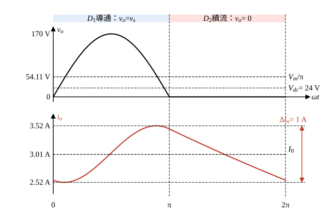

# 112 年電子學第 4 題｜飛輪二極體半波整流的平滑電感

## 已知與所求

$v_s=170\sin(377t)\,\mathrm V$，$D_1$ 串聯、$D_2$ 為飛輪二極體，負載 $L$–$R$–$V_{dc}$ 串聯，$R=10\,\Omega$、$V_{dc}=24\,\mathrm V$，元件理想。以傅立葉級數求使 $\Delta i_o\le1\,\mathrm A$ 的 $L$、$V_{dc}$ 吸收功率、$R$ 吸收功率。

## 考場標準作答

### 步驟 1：負載端電壓波形

- $0<\omega t<\pi$：$v_s>0$，$D_1$ 導通，$v_o=v_s=170\sin\omega t$，$D_2$ 逆偏。
- $\pi<\omega t<2\pi$：$v_s<0$ 使 $D_1$ 逆偏，$i_o>0$ 不能中斷，經 $D_2$ 續流，$v_o=0$。

（$i_o$ 恆正的前提在（一）求出 $L$ 後驗證。）

### 步驟 2：傅立葉級數與平均電流

$V_m=170\,\mathrm V$、$\omega=377\,\mathrm{rad/s}$，半波正弦的級數：
\[
v_o(t)=\frac{V_m}{\pi}+\frac{V_m}{2}\sin\omega t-\sum_{k=1}^{\infty}\frac{2V_m}{\pi(4k^2-1)}\cos 2k\omega t
\]
直流項：
\[
V_0=\frac{V_m}{\pi}=\frac{170}{3.14159}=54.1127\,\mathrm V
\]
電感對直流短路，平均電流由 $R$ 與 $V_{dc}$ 決定：
\[
I_0=\frac{V_0-V_{dc}}{R}=\frac{54.1127-24}{10}=\frac{30.1127}{10}=3.01127\,\mathrm A
\]
各次諧波電壓振幅：
\[
V_1=\frac{V_m}{2}=\frac{170}{2}=85\,\mathrm V
\]
\[
V_2=\frac{2V_m}{3\pi}=\frac{340}{9.4248}=36.075\,\mathrm V
\]
\[
V_4=\frac{2V_m}{15\pi}=\frac{340}{47.124}=7.2150\,\mathrm V
\]
（6 次以上更小且阻抗更大，影響可略。）

### （一）電感值 $L$

**基頻估算**（$\Delta i_o\approx2I_1$）：
\[
2I_1=\frac{2V_1}{|R+j\omega L|}=1\ \Rightarrow\ |Z_1|=2\times85=170\,\Omega
\]
\[
(\omega L)^2=|Z_1|^2-R^2=170^2-10^2=28\,900-100=28\,800
\]
\[
\omega L=\sqrt{28\,800}=169.71\,\Omega
\]
\[
L=\frac{169.71}{377}=0.4502\,\mathrm H
\]
此 $L$ 下的 2 次諧波：
\[
|Z_2|=\sqrt{10^2+(2\times169.71)^2}=\sqrt{100+115\,206}=339.57\,\Omega
\]
\[
I_2=\frac{V_2}{|Z_2|}=\frac{36.075}{339.57}=0.1062\,\mathrm A
\]
2 次諧波與基頻的峰值不同相，疊加後實際峰對峰約 $1.10\,\mathrm A$，超過限制，$L$ 須加大。

**諧波疊加求 $L$**：以 $i_o(\omega t)=I_0+\sum_n \mathrm{Re}\{\bar V_n e^{jn\omega t}/(R+jn\omega L)\}$ 逐點取最大、最小，試算使 $\max i_o-\min i_o=1\,\mathrm A$，得 $L=0.49617\,\mathrm H$。在此 $L$ 下各次阻抗與電流：

\[
\omega L=377\times0.49617=187.056\,\Omega
\]
\[
|Z_1|=\sqrt{10^2+187.056^2}=\sqrt{100+34\,990}=187.32\,\Omega,\qquad \angle Z_1=\tan^{-1}\frac{187.056}{10}=86.94^\circ
\]
\[
I_1=\frac{85}{187.32}=0.4538\,\mathrm A
\]
\[
|Z_2|=\sqrt{10^2+374.112^2}=\sqrt{100+139\,960}=374.25\,\Omega,\qquad \angle Z_2=\tan^{-1}\frac{374.112}{10}=88.47^\circ
\]
\[
I_2=\frac{36.075}{374.25}=0.09639\,\mathrm A
\]
\[
|Z_4|=\sqrt{10^2+748.224^2}=\sqrt{100+559\,839}=748.29\,\Omega,\qquad \angle Z_4=\tan^{-1}\frac{748.224}{10}=89.23^\circ
\]
\[
I_4=\frac{7.2150}{748.29}=0.009642\,\mathrm A
\]
疊加後最大值約在 $\omega t\approx159.6^\circ$、$i_{o,\max}=3.517\,\mathrm A$；最小值約在 $\omega t\approx16.8^\circ$、$i_{o,\min}=2.517\,\mathrm A$：
\[
\Delta i_o=3.517-2.517=1.000\,\mathrm A
\]
\[
\boxed{L=496.17\,\mathrm{mH}}
\]
$i_o$ 在約 $2.52\sim3.52\,\mathrm A$ 之間恆正，電流連續，步驟 1 的半波正弦前提成立。

### （二）dc 電源 $V_{dc}$ 吸收的功率

直流源電壓恆定，與諧波電流乘積的一週期平均為零，只有平均電流作功：

\[
P_{V_{dc}}=V_{dc}I_0=24\times3.01127=72.27\,\mathrm W
\]
\[
\boxed{P_{V_{dc}}=72.27\,\mathrm W}
\]

### （三）電阻 $R$ 吸收的功率

不同頻率的電流分量在一週期內正交，$I_{rms}^2=I_0^2+\sum_n I_n^2/2$（Parseval）。

\[
I_0^2=3.01127^2=9.06775\,\mathrm A^2
\]
\[
\frac{I_1^2}{2}=\frac{0.4538^2}{2}=\frac{0.2059}{2}=0.1030\,\mathrm A^2
\]
\[
\frac{I_2^2}{2}=\frac{0.09639^2}{2}=\frac{0.009291}{2}=0.004646\,\mathrm A^2
\]
\[
\frac{I_4^2}{2}=\frac{0.009642^2}{2}=\frac{9.297\times10^{-5}}{2}=4.648\times10^{-5}\,\mathrm A^2
\]
\[
I_{rms}^2=9.06775+0.1030+0.004646+0.00004648=9.1754\,\mathrm A^2
\]
\[
P_R=RI_{rms}^2=10\times9.1754=91.75\,\mathrm W
\]
\[
\boxed{P_R=91.75\,\mathrm W}
\]
## 驗算

- 時域：以 $L\,di/dt+Ri=v_o(t)-V_{dc}$ 逐段精確積分至週期穩態，得峰對峰 $1.00\,\mathrm A$、平均 $3.01\,\mathrm A$、$R\overline{i^2}=91.75\,\mathrm W$，與級數一致。
- 功率守恆：理想電感與二極體不耗能，電源送出平均功率 $=72.27+91.75=164.02\,\mathrm W$。

## 失分點

- 只用基頻得 $L\approx0.45\,\mathrm H$ 是常見教科書作法，但嚴格峰對峰約 $1.10\,\mathrm A$；考場寫 0.45 H 時應註明 2 次諧波使 $L$ 需略增（約 0.50 H）。
- $P_{V_{dc}}$ 用 $V_{dc}I_{rms}$；直流源只與平均電流作功。
- $P_R$ 只算 $I_0^2R=90.68\,\mathrm W$，漏掉諧波電流的功率。
