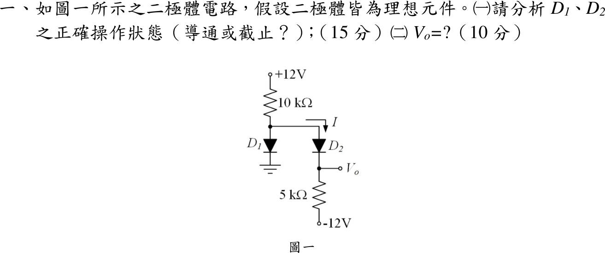
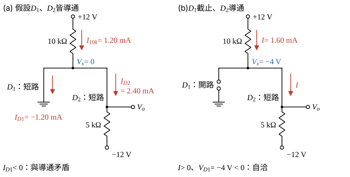

# 113 年電子學第 1 題｜理想二極體狀態判斷

## 已知與所求

$+12\,\mathrm V$ 經 $10\,\mathrm{k}\Omega$ 到節點 $x$；$D_1$ 陽極接 $x$、陰極接地；$D_2$ 陽極接 $x$、陰極接 $V_o$；$V_o$ 經 $5\,\mathrm{k}\Omega$ 接 $-12\,\mathrm V$。二極體理想。求（一）$D_1,D_2$ 狀態（15 分）；（二）$V_o$（10 分）。

## 考場標準作答

### （一）操作狀態（15 分）

理想二極體導通時為短路（$V_D=0$，須 $I_D\ge0$），截止時為開路（$I_D=0$，須 $V_D\le0$）；先假設狀態、解線性電路，再驗條件，矛盾即換下一組。

**試探 1：$D_1$、$D_2$ 皆導通**（圖 1 左）。兩者短路，節點 $x$ 被 $D_1$ 拉到地，$V_o$ 經 $D_2$ 等於 $V_x$：
\[
V_x=0,\qquad V_o=V_x=0
\]
上電阻電流（向下流入節點 $x$）：
\[
I_{10k}=\frac{12-V_x}{10\ \mathrm{k}\Omega}=\frac{12-0}{10\ \mathrm{k}\Omega}=1.20\ \mathrm{mA}
\]
$D_2$ 電流（等於下電阻向下流往 $-12\,\mathrm V$ 的電流）：
\[
I_{D_2}=\frac{V_o-(-12)}{5\ \mathrm{k}\Omega}=\frac{0+12}{5\ \mathrm{k}\Omega}=2.40\ \mathrm{mA}
\]
節點 $x$ 的 KCL（流入 = 流出）：
\[
I_{10k}=I_{D_1}+I_{D_2}
\]
\[
I_{D_1}=I_{10k}-I_{D_2}=1.20-2.40=-1.20\ \mathrm{mA}<0
\]
導通二極體電流不可為負，假設矛盾，$D_1$ 必截止。

**試探 2：$D_1$ 截止、$D_2$ 導通**（圖 1 右）。$D_1$ 開路，$+12\,\mathrm V\to10\,\mathrm k\Omega\to D_2(0\,\mathrm V)\to5\,\mathrm k\Omega\to-12\,\mathrm V$ 成單一串聯迴路：
\[
I=\frac{12-(-12)}{10\ \mathrm{k}\Omega+5\ \mathrm{k}\Omega}=\frac{24}{15\ \mathrm{k}\Omega}=1.60\ \mathrm{mA}>0
\]
上電阻壓降：
\[
I\times10\ \mathrm{k}\Omega=1.60\times10=16\ \mathrm V
\]
\[
V_x=12-16=-4\ \mathrm V
\]
檢查 $D_1$（陽極 $x$、陰極接地）：
\[
V_{D_1}=V_x-0=-4\ \mathrm V<0\quad(\text{逆偏，截止成立})
\]
$D_2$ 電流 $I=1.60\,\mathrm{mA}$ 由陽極流向陰極、為正，導通成立。兩條件都滿足：
\[
\boxed{D_1\ \text{截止},\ D_2\ \text{導通}}
\]

### （二）輸出電壓（10 分）

$D_2$ 理想導通、壓降為零，$V_o=V_x$；另由 $-12\,\mathrm V$ 端沿 $5\,\mathrm{k}\Omega$ 往上量一次確認。

下電阻壓降（電流 $I$ 由 $V_o$ 流向 $-12\,\mathrm V$）：
\[
I\times5\ \mathrm{k}\Omega=1.60\times5=8\ \mathrm V
\]
\[
V_o=-12+8=-4\ \mathrm V
\]
\[
\boxed{V_o=-4.00\ \mathrm V}
\]
與（一）的 $V_x=-4\,\mathrm V$ 相同，$D_2$ 壓降 $V_x-V_o=0$。

## 驗算

- 其餘兩組假設皆矛盾：$D_1$ 導通、$D_2$ 截止時 $V_x=0$、$V_o=-12\ \mathrm V$，$D_2$ 承受 $+12\ \mathrm V$ 正偏；兩者皆截止時 $V_x=+12\ \mathrm V$，$D_1$ 正偏。
- KVL 繞全迴路：$12-1.60(10)-0-1.60(5)=-12\ \mathrm V$，等於下端電源。

## 失分點

- 先假設 $D_1$ 導通便直接得 $V_o=0$，未檢查 $I_{D_1}=-1.20\,\mathrm{mA}$ 為負。
- 只比較節點電位、未驗 $D_2$ 電流 $I=1.60\,\mathrm{mA}>0$ 與 $D_1$ 電壓 $V_{D_1}=-4\,\mathrm V<0$，狀態判斷即不完整。
