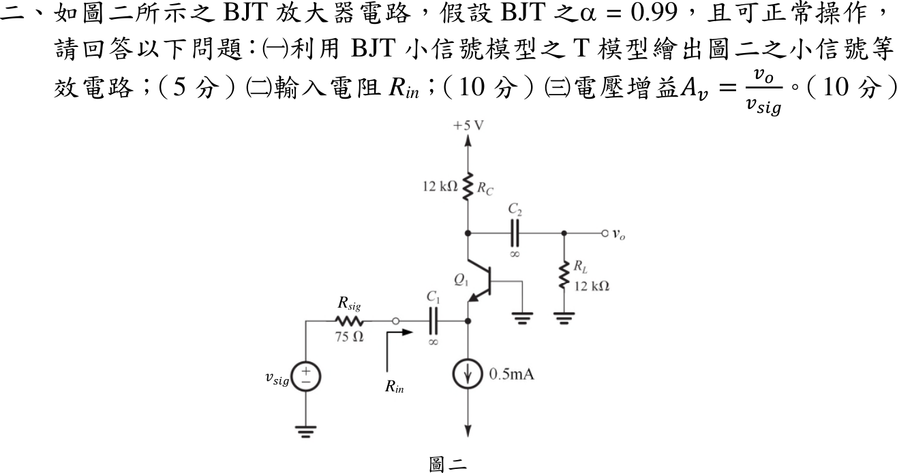
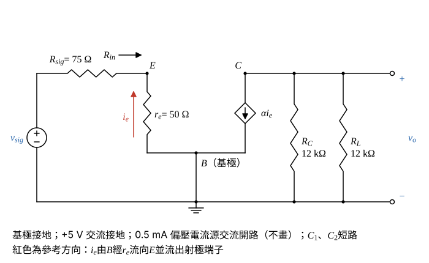

# 113 年電子學第 2 題｜共基極放大器 T 模型

## 已知與所求

$\alpha=0.99$；射極偏壓由 $0.5\,\mathrm{mA}$ 理想電流源提供（$I_E=0.5\,\mathrm{mA}$）；$R_{sig}=75\,\Omega$ 經 $C_1=\infty$ 接射極，基極接地，集極 $R_C=12\,\mathrm{k}\Omega$ 接 $+5\,\mathrm V$，經 $C_2=\infty$ 接 $R_L=12\,\mathrm{k}\Omega$。求（一）T 模型小信號等效電路；（二）$R_{in}$；（三）$A_v=v_o/v_{sig}$。官方題面未明示接面溫度或 $V_T$，參考書主解取 $V_T=25\,\mathrm{mV}$。

## 考場標準作答

### （一）T 模型小信號等效電路（5 分）

設 BJT 在主動區（題設「可正常操作」）、$V_A=\infty$（無 $r_o$），$V_T=25\,\mathrm{mV}$（題面未給，依參考書主解）；$+5\,\mathrm V$ 交流接地、偏壓電流源交流開路、$C_1,C_2$ 交流短路。

$r_e$（射極偏壓電流 $I_E=0.5\,\mathrm{mA}$）：
\[
r_e=\frac{V_T}{I_E}=\frac{25\,\mathrm{mV}}{0.5\,\mathrm{mA}}=50\,\Omega
\]

- $v_{sig}$ 串 $R_{sig}$ 經 $C_1$（短路）接射極 $E$；偏壓電流源交流開路，不出現在圖中。
- $r_e$ 接在 $E$ 與基極 $B$ 之間，$B$ 接地；參考方向 $i_e$ 由 $B$ 經 $r_e$ 流向 $E$ 並流出射極端子（流向 $R_{sig}$）。
- 受控電流源 $\alpha i_e$ 由集極 $C$ 流向 $B$；$R_C$（上端 $+5\,\mathrm V$ 交流接地）與 $R_L$（經 $C_2$ 短路）都接在 $C$ 對地，$v_o$ 取在 $C$。
\[
\boxed{r_e=50\,\Omega,\qquad i_c=\alpha i_e\ \text{（$C\to B$）}}
\]

### （二）輸入電阻（10 分）

$R_{in}$ 為 $C_1$ 右側（射極端）看入的電阻，不含 $R_{sig}$；受控源在集極側，不影響射極電壓。

射極節點：$v_e=v_B-i_er_e=0-i_er_e$，而由射極端子流入電晶體的電流為 $-i_e$：
\[
R_{in}=\frac{v_e}{-i_e}=\frac{-i_er_e}{-i_e}=r_e=\frac{V_T}{I_E}=\frac{25\,\mathrm{mV}}{0.5\,\mathrm{mA}}
\]
\[
\boxed{R_{in}=50\,\Omega}
\]

### （三）電壓增益（10 分）

交流負載：
\[
R_L'=R_C\parallel R_L=\frac{12\,\mathrm{k}\Omega\times12\,\mathrm{k}\Omega}{12\,\mathrm{k}\Omega+12\,\mathrm{k}\Omega}=6\,\mathrm{k}\Omega
\]
輸入迴路 KVL（沿 $i_e$ 參考方向，$v_{sig}=v_e-i_eR_{sig}$、$v_e=-i_er_e$）：
\[
v_{sig}=-i_e(R_{sig}+r_e)\ \Rightarrow\ i_e=-\frac{v_{sig}}{R_{sig}+r_e}=-\frac{v_{sig}}{75+50}=-\frac{v_{sig}}{125\,\Omega}
\]
（$v_{sig}>0$ 時 $i_e<0$，實際電流由 $R_{sig}$ 流入射極，與參考方向相反。）

集極節點 KCL（離開 $C$ 的電流和為零）：
\[
\alpha i_e+\frac{v_o}{R_L'}=0\ \Rightarrow\ v_o=-\alpha i_eR_L'
\]
代入 $i_e$：
\[
v_o=-\alpha\left(-\frac{v_{sig}}{R_{sig}+r_e}\right)R_L'=\frac{\alpha R_L'}{R_{sig}+r_e}\,v_{sig}
\]
\[
A_v=\frac{\alpha R_L'}{R_{sig}+r_e}=\frac{0.99\times6000\,\Omega}{125\,\Omega}=\frac{5940}{125}
\]
\[
\boxed{A_v=47.52\ \mathrm{V/V}}
\]
共基極不反相。

## 驗算

分段相乘：輸入分壓 $v_e/v_{sig}=r_e/(R_{sig}+r_e)=50/125=0.40$，射極到集極 $v_o/v_e=\alpha R_L'/r_e=0.99\times6000/50=118.80$，$0.40\times118.80=47.52$；與一次電流法相同。

## 失分點

- 漏掉 $R_{sig}$ 分壓，答成 $v_o/v_e=118.80$。
- 負載只取 $R_C$（$12\,\mathrm{k}\Omega$），得 $95.04\,\mathrm{V/V}$。
- 把偏壓電流源當交流短路，$R_{in}$ 變 0。

## 條件與疑義

| $V_T$ | $r_e=R_{in}$ | $A_v$（V/V） |
|---|---:|---:|
| $25\,\mathrm{mV}$（參考書主解） | $50.00\,\Omega$ | $47.520000$ |
| $25.85\,\mathrm{mV}$（室溫） | $51.70\,\Omega$ | $46.882399$ |
| $26\,\mathrm{mV}$ | $52.00\,\Omega$ | $46.771654$ |
