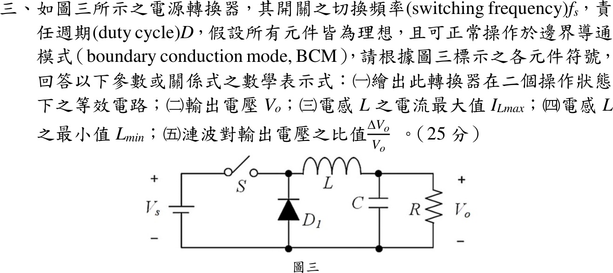
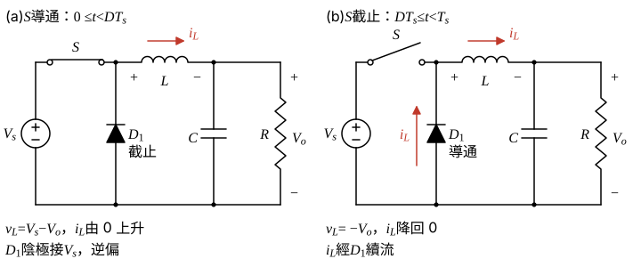
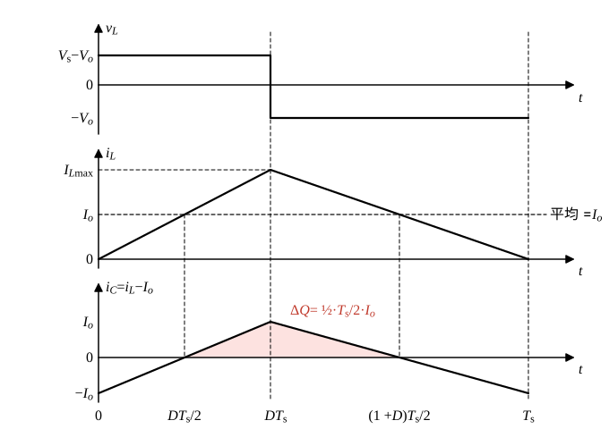

# 113 年電子學第 3 題｜Buck 轉換器的 BCM

## 已知與所求

$V_s$ 正端經串聯開關 $S$ 到切換節點，再經 $L$ 到輸出 $C\parallel R$；$D_1$ 陽極接共地、陰極接切換節點，故為 Buck（降壓）。切換頻率 $f_s$（$T_s=1/f_s$）、責任週期 $D$，理想元件、BCM。求（一）兩狀態等效電路；（二）$V_o$；（三）$I_{L\max}$；（四）$L_{\min}$；（五）$\Delta V_o/V_o$（峰對峰）。

## 考場標準作答

### （一）兩個操作狀態

- $0\le t<DT_s$：$S$ 導通、$D_1$ 逆偏截止，$V_s\to S\to L\to C\parallel R$；$L$ 左端電位 $V_s$、右端 $V_o$，$i_L$ 由 0 線性上升。
- $DT_s\le t<T_s$：$S$ 截止、$D_1$ 導通續流，共地 $\to D_1\to L\to C\parallel R$；$L$ 左端電位 0、右端 $V_o$，$i_L$ 線性降回 0（BCM 剛好在 $T_s$ 歸零）。

\[
\boxed{\text{ON：}v_L=V_s-V_o,\qquad \text{OFF：}v_L=-V_o}
\]

### （二）輸出電壓

穩態下 $i_L$ 一週期淨變化為零，故伏秒平衡：

\[
(V_s-V_o)DT_s+(-V_o)(1-D)T_s=0
\]
兩邊除以 $T_s$ 並展開：
\[
V_sD-V_oD-V_o+V_oD=0
\]
\[
V_sD-V_o=0
\]
\[
\boxed{V_o=DV_s}
\]

### （三）電感電流最大值

BCM 下 $i_L$ 每週期由 0 起算，ON 段終點即最大值：

\[
I_{L\max}=\frac{V_s-V_o}{L}\,DT_s=\frac{(V_s-V_o)D}{Lf_s}
\]
代入 $V_o=DV_s$，$V_s-V_o=V_s(1-D)$：
\[
I_{L\max}=\frac{V_sD(1-D)}{Lf_s}
\]
三角波（底 $T_s$、高 $I_{L\max}$）平均值為 $I_{L\max}/2$，須等於負載電流 $I_o=V_o/R=DV_s/R$（見（四））：
\[
\frac{I_{L\max}}{2}=I_o\ \Rightarrow\ I_{L\max}=2I_o=\frac{2DV_s}{R}
\]
\[
\boxed{I_{L\max}=\frac{(V_s-V_o)D}{Lf_s}=\frac{V_sD(1-D)}{Lf_s}=2I_o=\frac{2DV_s}{R}}
\]

### （四）最小電感

電容一週期平均電流為零，負載電流全由電感平均電流供給；BCM 為電流剛好在週期末降到 0 的臨界，故此時的 $L$ 即 $L_{\min}$。

\[
\frac{I_{L\max}}{2}=\frac{V_o}{R}
\]
代入（三）的 $I_{L\max}$ 與 $V_o=DV_s$：
\[
\frac{V_sD(1-D)}{2Lf_s}=\frac{DV_s}{R}
\]
兩邊同除 $DV_s$：
\[
\frac{1-D}{2Lf_s}=\frac{1}{R}
\]
\[
L=\frac{(1-D)R}{2f_s}
\]
\[
\boxed{L_{\min}=\frac{(1-D)R}{2f_s}}
\]
本題在 BCM 即 $L=L_{\min}$；$L<L_{\min}$ 進入 DCM。

### （五）漣波比

$i_C=i_L-I_o$ 為正的期間電容充電，$\Delta Q$ 即圖 2 陰影三角形面積。

$I_{L\max}=2I_o$，故 $i_L$ 在 $DT_s/2$ 上升穿越 $I_o$、在 $(1+D)T_s/2$ 下降穿越 $I_o$；陰影三角形的底與高：
\[
\text{底}=\frac{(1+D)T_s}{2}-\frac{DT_s}{2}=\frac{T_s}{2},\qquad \text{高}=I_{L\max}-I_o=2I_o-I_o=I_o
\]
\[
\Delta Q=\frac12\cdot\frac{T_s}{2}\cdot I_o=\frac{I_oT_s}{4}
\]
\[
\Delta V_o=\frac{\Delta Q}{C}=\frac{I_o}{4Cf_s}
\]
除以 $V_o$，並用 $I_o/V_o=1/R$：
\[
\frac{\Delta V_o}{V_o}=\frac{I_o}{4Cf_sV_o}=\frac{1}{4RCf_s}
\]
\[
\boxed{\frac{\Delta V_o}{V_o}=\frac{1}{4RCf_s}}\quad\left(=\frac{1-D}{8LCf_s^2}\ \text{於}\ L=L_{\min}\right)
\]

## 驗算

取示例 $V_s=12\,\mathrm V$、$D=0.40$、$R=10\,\Omega$、$f_s=25\,\mathrm{kHz}$、$C=100\,\mu\mathrm F$（僅供回代）：$V_o=4.80\,\mathrm V$、$L_{\min}=120\,\mu\mathrm H$。ON 上升 $(7.20)(0.40)/(120\,\mu\mathrm H\cdot25\,\mathrm{kHz})=0.96\,\mathrm A$，OFF 下降 $(4.80)(0.60)/(3)=0.96\,\mathrm A$，等於 $2I_o=0.96\,\mathrm A$；漣波 $1/(4\cdot10\cdot10^{-4}\cdot25000)=1\%$，即 $48.00\,\mathrm{mV}$。

## 失分點

- 把串聯開關的 Buck 誤判為 Boost，寫出 $V_o=V_s/(1-D)$。
- BCM 峰值寫成平均值，漏掉三角波的因子 2。
- 漣波只算 ON 區 $I_oDT_s/C$；正確作法是積分 $i_C=i_L-I_o$ 的正面積。
