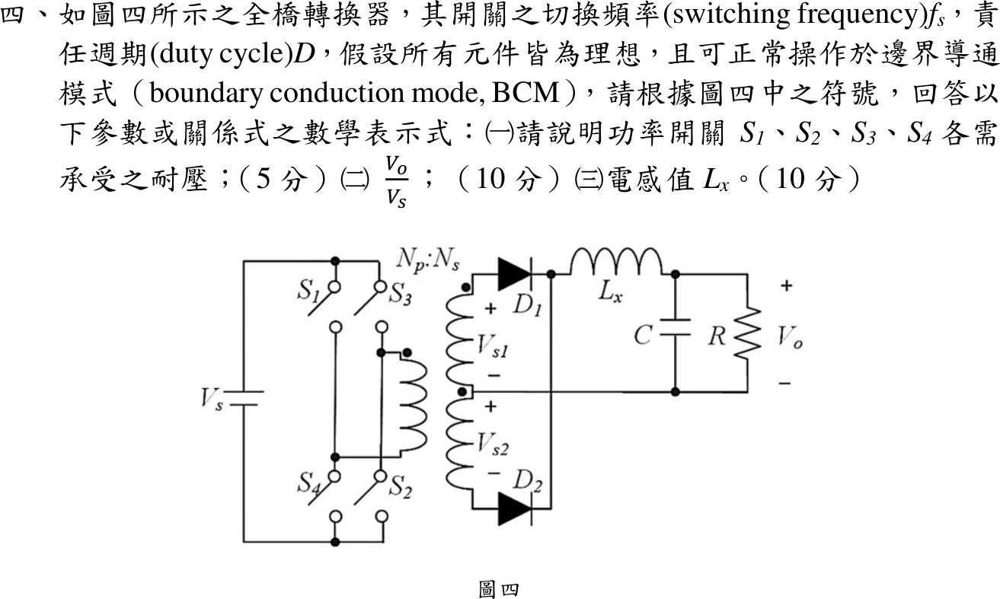
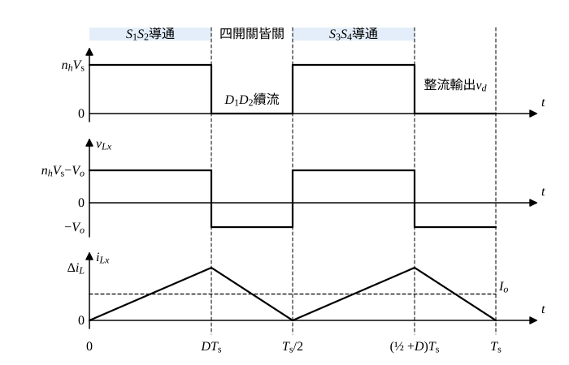

# 113 年電子學第 4 題｜全橋轉換器的 BCM

## 已知與所求

直流 $V_s$ 供全橋 $S_1\sim S_4$（左臂 $S_1/S_4$、右臂 $S_3/S_2$，對角組 $S_1S_2$、$S_3S_4$），變壓器 $N_p:N_s$，中心抽頭次級 $V_{s1},V_{s2}$ 經 $D_1,D_2$ 全波整流，再經 $L_x$ 到 $C\parallel R$。切換頻率 $f_s$、責任週期 $D$，理想、BCM。求（一）各開關耐壓；（二）$V_o/V_s$；（三）$L_x$。

本解約定：每組對角開關在一個 $T_s$ 內導通 $DT_s$（$0<D<0.5$），兩組交替；$n_h$ 為每個半繞組對一次側的匝比。

## 考場標準作答

**解題邏輯**：一個切換週期內兩組對角開關各導通 $DT_s$，變壓器正、負各送一次電壓，中心抽頭全波整流後在 $L_x$ 前得到兩個寬 $DT_s$、高 $n_hV_s$ 的脈波（$v_d$）；其餘時間四開關皆關，$D_1D_2$ 同時續流使 $v_d=0$。（一）看關斷開關跨在何處；（二）對 $L_x$ 作整週期伏秒平衡；（三）BCM 下 $i_{Lx}$ 每半週由 0 升到峰值再降回 0，平均值 = 負載電流，解 $L_x$。共用前提：$n_h$ 為每個半繞組對一次側的匝比，$0<D<0.5$。

### 步驟 1：一週期的 $v_d$、$v_{Lx}$、$i_{Lx}$

- $0<t<DT_s$（$S_1S_2$ 導通）：一次側電壓 $+V_s$，上半繞組感應 $n_hV_s$ 使 $D_1$ 導通，$v_d=n_hV_s$，$v_{Lx}=n_hV_s-V_o$。
- $DT_s<t<T_s/2$（四開關皆關）：一次側無電壓，$i_{Lx}$ 由 $D_1$、$D_2$ 平分續流，次級兩半繞組被短接，$v_d=0$，$v_{Lx}=-V_o$。
- $T_s/2<t<T_s$：$S_3S_4$ 導通、一次側 $-V_s$，改由下半繞組經 $D_2$ 供電，波形與前半週相同。

故電感看到的是週期 $T_s/2$（頻率 $2f_s$）的波形：每半週導通 $DT_s$、續流 $(1/2-D)T_s$。

### （一）開關耐壓（5 分）

**邏輯**：同一臂的上、下開關串接在 $V_s$ 兩端；一個導通時，另一個承受整個母線電壓。

$S_1S_2$ 導通時，左臂中點被 $S_1$ 拉到 $V_s$，$S_4$ 兩端為 $V_s-0=V_s$；右臂中點被 $S_2$ 拉到 0，$S_3$ 兩端為 $V_s-0=V_s$。$S_3S_4$ 導通時同理 $S_1$、$S_2$ 各承受 $V_s$。四開關皆關時，同臂兩開關分擔 $V_s$，各自不超過 $V_s$（對稱時約 $V_s/2$）。
\[
\boxed{V_{S1,\max}=V_{S2,\max}=V_{S3,\max}=V_{S4,\max}=V_s}
\]
（理想值，不含漏感尖峰與裕度。）

### （二）電壓轉換比（10 分）

**邏輯**：穩態下 $i_{Lx}$ 一週期淨變化為零，$v_{Lx}$ 整週期平均為零；一週期有兩個導通脈波。

\[
2(n_hV_s-V_o)DT_s+(-V_o)(1-2D)T_s=0
\]
兩邊除以 $T_s$ 並展開：
\[
2n_hV_sD-2V_oD-V_o+2V_oD=0
\]
\[
2n_hV_sD-V_o=0
\]
\[
\boxed{\frac{V_o}{V_s}=2Dn_h}
\]
依圖四符號、$N_s$ 取每個半繞組（中心抽頭教科書慣例），$n_h=N_s/N_p$，即 $V_o/V_s=2DN_s/N_p$。

### （三）BCM 電感（10 分）

**邏輯**：BCM 時 $i_{Lx}$ 每半週由 0 上升、在半週末剛好降回 0，三角波平均值 $=\Delta i_L/2$；電容平均電流為零，故此平均值等於 $I_o=V_o/R$。用續流段求 $\Delta i_L$（只含 $V_o$，不受匝比口徑影響）。

續流段 $v_{Lx}=-V_o$、歷時 $(1/2-D)T_s$，電流由峰值降到 0：
\[
\Delta i_L=\frac{V_o}{L_x}\Bigl(\frac12-D\Bigr)T_s=\frac{V_o(1/2-D)}{L_xf_s}
\]
平均值等於負載電流：
\[
\frac{\Delta i_L}{2}=\frac{V_o}{R}
\]
\[
\frac{V_o(1/2-D)}{2L_xf_s}=\frac{V_o}{R}
\]
兩邊同除 $V_o$ 後解 $L_x$：
\[
L_x=\frac{(1/2-D)R}{2f_s}
\]
\[
\boxed{L_x=\frac{(1-2D)R}{4f_s}}
\]
此式與匝比口徑無關。

## 驗算

- 上升段 $(n_hV_s-V_o)DT_s/L_x=n_hV_sD(1-2D)T_s/L_x$，下降段 $V_o(1/2-D)T_s/L_x=n_hV_sD(1-2D)T_s/L_x$，兩者相等，BCM 自洽。
- 示例 $D=0.20$、$R=10\,\Omega$、$f_s=20\,\mathrm{kHz}$：$L_x=\dfrac{(1-0.40)(10)}{4(20\,000)}=\dfrac{0.60\times10}{80\,000}=75\,\mu\mathrm H$；$D\to0.5$ 時續流區消失，$L_x\to0$。

## 失分點

- 把全橋當單脈波：一週期有兩個整流脈波，漏掉因子 2 得 $V_o/V_s=Dn_h$。
- 套 Buck 的 $L_{\min}=(1-D)R/(2f_s)$；電感看到的頻率是 $2f_s$、續流時間是 $(1/2-D)T_s$。

## 條件與疑義

官方圖只標 $N_p:N_s$，未指明 $N_s$ 為半繞組或端對端總匝數。若 $N_s$ 指端對端總匝數，$n_h=N_s/(2N_p)$，$V_o/V_s=DN_s/N_p$，與上式差一倍；$L_x$ 不受影響。題幹以 $D$ 為開關責任週期，同臂開關不可同時導通，故 $0<D<0.5$。
