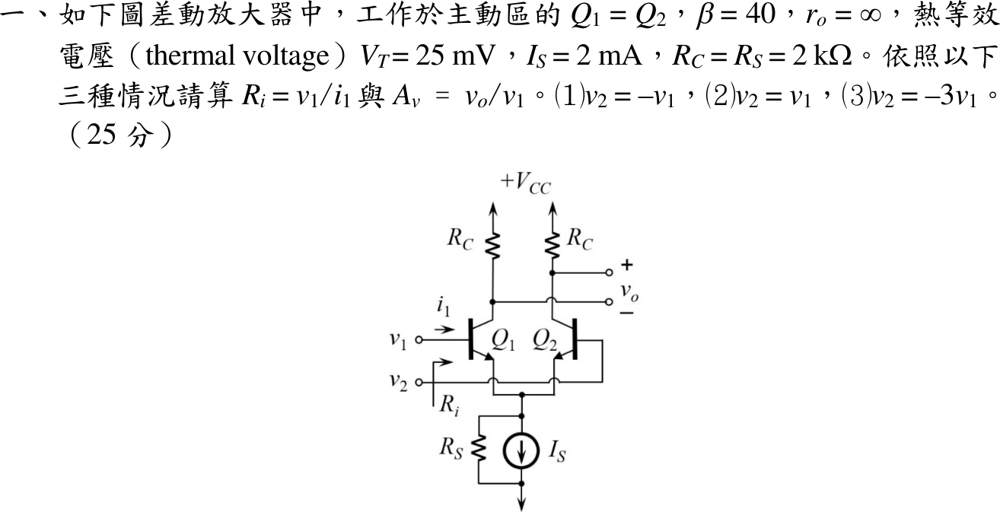
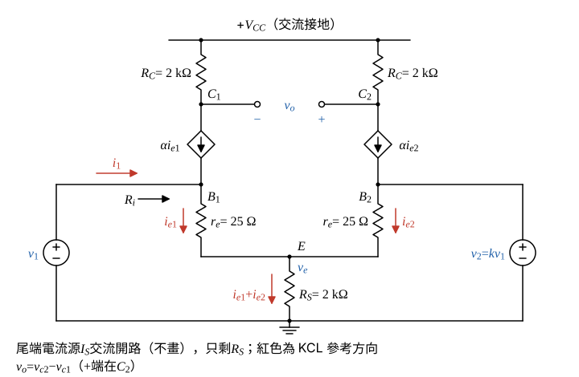

# 114 年電子學第 1 題｜BJT 差動放大器

## 已知與所求

$Q_1=Q_2$ 工作於主動區，$\beta=40$、$r_o=\infty$、$V_T=25\,\mathrm{mV}$；尾端為 $I_S=2\,\mathrm{mA}$ 電流源並聯 $R_S=2\,\mathrm{k}\Omega$，$R_C=2\,\mathrm{k}\Omega$。$Q_1$ 基極接 $v_1$、$Q_2$ 基極接 $v_2$，$v_o$ 正端在 $Q_2$ 集極、負端在 $Q_1$ 集極。求 $v_2=-v_1,\ v_1,\ -3v_1$ 三種情況的 $R_i=v_1/i_1$ 與 $A_v=v_o/v_1$。

**數值答案的偏壓前提：**題圖沒有負電源、基極直流電位或 $V_{BE}$，若 $R_S$ 在直流還有分流，就無法唯一求出 $I_C$。本解取 $I_S$ 為總尾射極電流、$R_S$ 只代表尾源的小訊號並聯電阻，每支 $I_E=1\,\mathrm{mA}$；若 $R_S$ 確有未知直流分流，下列數字都不是唯一精確答案。

## 考場標準作答

**解題邏輯**：前提：兩管對稱且在主動區，$r_o=\infty$，小訊號線性；直流上 $I_S$ 為總尾射極電流（見上方偏壓前提），兩管平分得 $I_E=1\,\mathrm{mA}$；交流上 $+V_{CC}$ 接地、$I_S$ 開路，只剩 $R_S$ 接在共射極節點與地之間。先由 $I_E$ 求 $\alpha$、$r_e$、$r_\pi$、$g_mR_C$（步驟 1）；畫 T 模型並令 $v_2=kv_1$，對共射極節點寫一次 KCL 得 $v_e$，再由 $i_1=i_{e1}/(\beta+1)$ 得 $R_i$、由兩集極電壓相減得 $A_v$ 的通式（步驟 2）；三小題只是代入 $k=-1,\ 1,\ -3$。

### 步驟 1：偏壓與小訊號參數

每管射極電流（對稱平分）：
\[
I_E=\frac{I_S}{2}=\frac{2\,\mathrm{mA}}{2}=1\,\mathrm{mA}
\]
\[
\alpha=\frac{\beta}{\beta+1}=\frac{40}{41}\approx0.9756
\]
\[
I_C=\alpha I_E=\frac{40}{41}\times1\,\mathrm{mA}=975.61\,\mu\mathrm A
\]
\[
g_m=\frac{I_C}{V_T}=\frac{975.61\,\mu\mathrm A}{25\,\mathrm{mV}}=39.02\,\mathrm{mS}
\]
\[
r_e=\frac{V_T}{I_E}=\frac{25\,\mathrm{mV}}{1\,\mathrm{mA}}=25\,\Omega
\]
\[
r_\pi=(\beta+1)r_e=41\times25=1025\,\Omega
\]
增益會用到的乘積（保留分數，避免 $g_m$ 四捨五入後再乘造成末位誤差）：
\[
g_mR_C=\frac{I_CR_C}{V_T}=\frac{\tfrac{40}{41}\,\mathrm{mA}\times2\,\mathrm{k}\Omega}{25\,\mathrm{mV}}=\frac{80/41}{0.025}=\frac{3200}{41}=78.0488
\]

### 步驟 2：T 模型、射極節點 KCL 與通式

- 每管換成 T 模型：基極 $B$ 到共射極節點 $E$ 之間為 $r_e$，集極 $C$ 到 $B$ 之間為受控電流源 $\alpha i_e$；$R_C$ 上端 $+V_{CC}$ 交流接地。
- $I_S$ 交流開路，$E$ 只經 $R_S$ 到地；$E$ 的電壓為 $v_e$。
- 參考方向：$i_{e1}$、$i_{e2}$ 由各自基極經 $r_e$ 流入 $E$，兩者之和向下流過 $R_S$；$i_1$ 由 $v_1$ 流入 $Q_1$ 基極。

令 $v_2=kv_1$。射極節點 KCL（流入 $E$ = 流出 $E$）：
\[
i_{e1}+i_{e2}=\frac{v_e}{R_S},\qquad i_{e1}=\frac{v_1-v_e}{r_e},\quad i_{e2}=\frac{kv_1-v_e}{r_e}
\]
\[
\frac{v_1-v_e}{r_e}+\frac{kv_1-v_e}{r_e}=\frac{v_e}{R_S}
\]
兩邊乘 $r_e$：
\[
(1+k)v_1-2v_e=\frac{r_e}{R_S}v_e\ \Rightarrow\ v_e=\frac{(1+k)v_1}{2+r_e/R_S}
\]
\[
\frac{r_e}{R_S}=\frac{25}{2000}=0.0125,\qquad v_e=\frac{1+k}{2.0125}\,v_1
\]
基極 $B_1$ 的 KCL：流入的 $i_1$ 加上受控源送入的 $\alpha i_{e1}$ 等於流出的 $i_{e1}$，故 $i_1=(1-\alpha)i_{e1}=\dfrac{i_{e1}}{\beta+1}$：
\[
i_1=\frac{v_1-v_e}{(\beta+1)r_e}=\frac{v_1-v_e}{r_\pi}\ \Rightarrow\ R_i=\frac{v_1}{i_1}=\frac{r_\pi v_1}{v_1-v_e}
\]
其中
\[
v_1-v_e=\left(1-\frac{1+k}{2.0125}\right)v_1=\frac{1.0125-k}{2.0125}\,v_1
\]
集極電壓：受控源 $\alpha i_e$ 由 $C$ 往下流，電流只能由 $R_C$ 從交流地供給，$v_{c1}=-\alpha i_{e1}R_C$、$v_{c2}=-\alpha i_{e2}R_C$：
\[
v_o=v_{c2}-v_{c1}=\alpha R_C(i_{e1}-i_{e2})=\alpha R_C\frac{(v_1-v_e)-(kv_1-v_e)}{r_e}=\frac{\alpha}{r_e}R_C(1-k)v_1
\]
$\dfrac{\alpha}{r_e}=\dfrac{\alpha I_E}{V_T}=\dfrac{I_C}{V_T}=g_m$，$v_e$ 在相減時消去：
\[
A_v=\frac{v_o}{v_1}=g_mR_C(1-k)=78.0488\,(1-k)
\]

### （1）$v_2=-v_1$

**邏輯**：$k=-1$ 為純差模，兩管射極電流變化大小相等、方向相反，$R_S$ 中無訊號電流，射極節點為交流虛地。

\[
v_e=\frac{1+(-1)}{2.0125}\,v_1=0
\]
\[
R_i=\frac{r_\pi v_1}{v_1-0}=r_\pi
\]
\[
A_v=78.0488\times[1-(-1)]=78.0488\times2=156.0976
\]
\[
\boxed{R_i=1025\,\Omega},\qquad \boxed{A_v=156.10\ \mathrm{V/V}}
\]

### （2）$v_2=v_1$

**邏輯**：$k=1$ 為純共模，兩管電流同向全部流過 $R_S$，$v_e$ 幾乎跟隨 $v_1$，$v_1-v_e$ 很小所以 $R_i$ 很大；差動輸出 $(1-k)=0$。

\[
v_e=\frac{1+1}{2.0125}\,v_1=0.9938\,v_1
\]
\[
v_1-v_e=\frac{1.0125-1}{2.0125}\,v_1=\frac{0.0125}{2.0125}\,v_1
\]
\[
R_i=r_\pi\times\frac{2.0125}{0.0125}=1025\times161
\]
\[
A_v=78.0488\times(1-1)=0
\]
\[
\boxed{R_i=165025\,\Omega},\qquad \boxed{A_v=0}
\]

### （3）$v_2=-3v_1$

**邏輯**：$k=-3$ 可拆成差模 $v_d=v_1-v_2=4v_1$ 與共模 $v_{cm}=\tfrac{v_1+v_2}{2}=-v_1$（疊加）：差動輸出只放大 $v_d$，但共模成分使 $v_e\neq0$，$R_i$ 要用通式算。

\[
v_e=\frac{1+(-3)}{2.0125}\,v_1=-0.9938\,v_1
\]
\[
v_1-v_e=\frac{1.0125-(-3)}{2.0125}\,v_1=\frac{4.0125}{2.0125}\,v_1
\]
\[
R_i=r_\pi\times\frac{2.0125}{4.0125}=\frac{1025\times2.0125}{4.0125}=\frac{2062.8125}{4.0125}
\]
\[
A_v=78.0488\times[1-(-3)]=78.0488\times4=312.1952
\]
\[
\boxed{R_i=514.10\,\Omega},\qquad \boxed{A_v=312.20\ \mathrm{V/V}}
\]

## 驗算

- 共模（2）用半電路：$R_S$ 拆成兩個 $2R_S$ 並聯，每側射極電阻 $2R_S$，$R_i=(\beta+1)(r_e+2R_S)=41\times(25+4000)=41\times4025=165025\,\Omega$，與通式一致。
- （3）射極 KCL 代回（多留一位）：$v_e=-0.99379\,v_1$，$v_1-v_e=1.99379\,v_1$、$v_2-v_e=(-3+0.99379)v_1=-2.00621\,v_1$；左邊 $\dfrac{(1.99379-2.00621)v_1}{25}=\dfrac{-0.01242\,v_1}{25}\approx-4.97\times10^{-4}\,v_1$，右邊 $\dfrac{v_e}{R_S}=\dfrac{-0.99379\,v_1}{2000}\approx-4.97\times10^{-4}\,v_1$，相等。
- 以 hybrid-$\pi$ 模型（$r_\pi$、$g_mv_\pi$）對射極節點聯立求解，三組 $(R_i,A_v)$ 相同。

## 失分點

- 把尾電流 $2\,\mathrm{mA}$ 整個當成單管 $I_C$，會得 $g_m=0.08\,\mathrm S$、增益加倍。
- 共模時把 $v_e=v_1$ 視為精確而得 $R_i=\infty$；$R_S$ 有限，$R_i=165025\,\Omega$。
- $v_o$ 正端在 $Q_2$ 集極；若取 $v_{c1}-v_{c2}$，三個增益全部變號。

## 條件與疑義

- 若改採 $I_C\approx I_E=1\,\mathrm{mA}$ 的考場近似（$g_m=0.04\,\mathrm S$、$r_\pi=1\,\mathrm{k}\Omega$），三組 $(R_i,A_v)$ 為 $(1.000\,\mathrm{k}\Omega,160)$、$(165.0\,\mathrm{k}\Omega,0)$、$(501.52\,\Omega,320)$，與上列差約 2.5%。
