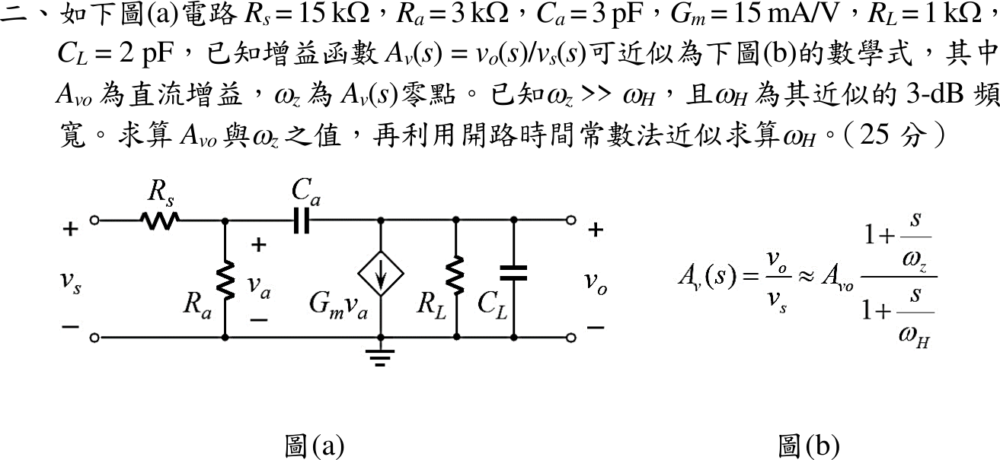
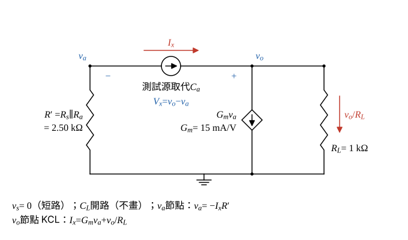

# 114 年電子學第 2 題｜零點與開路時間常數

## 已知與所求

$R_s=15\,\mathrm{k}\Omega$、$R_a=3\,\mathrm{k}\Omega$、$C_a=3\,\mathrm{pF}$（跨接 $v_a$ 與 $v_o$ 節點）、$G_m=15\,\mathrm{mA/V}$（電流 $G_mv_a$ 由 $v_o$ 節點向下流到地）、$R_L=1\,\mathrm{k}\Omega$、$C_L=2\,\mathrm{pF}$。$A_v(s)\approx A_{vo}\dfrac{1+s/\omega_z}{1+s/\omega_H}$，求 $A_{vo}$、$\omega_z$，並以開路時間常數法求 $\omega_H$。

## 考場標準作答

### $A_{vo}$

設線性小訊號模型。$s=0$ 時 $C_a$、$C_L$ 開路，輸入側只剩 $R_s$、$R_a$ 分壓；受控電流 $G_mv_a$ 由 $v_o$ 節點向下流，負載電流只能由地經 $R_L$ 向上補，故 $v_o=-G_mv_aR_L$（反相）。

\[
v_a=v_s\frac{R_a}{R_s+R_a}=v_s\frac{3}{15+3}=\frac{v_s}{6}
\]
\[
v_o=-G_mv_aR_L
\]
\[
A_{vo}=\frac{v_o}{v_s}=-G_mR_L\frac{R_a}{R_s+R_a}=-(15\,\mathrm{mA/V})(1\,\mathrm{k}\Omega)\times\frac{3}{18}=-15\times\frac16
\]
\[
\boxed{A_{vo}=-2.50\ \mathrm{V/V}}
\]

### $\omega_z$

零點為使 $v_o=0$ 的複頻率；$v_o=0$ 時 $R_L$、$C_L$ 無電流。

輸出節點 KCL（離開 $v_o$ 節點的電流和為零）：
\[
(v_o-v_a)sC_a+G_mv_a+\frac{v_o}{R_L}+sC_Lv_o=0
\]
\[
(G_m-sC_a)v_a+\left[\frac1{R_L}+s(C_a+C_L)\right]v_o=0
\]
令 $v_o=0$（$v_a\ne0$）：
\[
G_m-sC_a=0\ \Rightarrow\ s=\frac{G_m}{C_a}=\frac{15\times10^{-3}\,\mathrm{A/V}}{3\times10^{-12}\,\mathrm F}=+5.00\times10^{9}\ \mathrm{rad/s}
\]
零點在右半平面。題圖 (b) 的形式為 $1+s/\omega_z$，該因子在 $s=+5.00\times10^9\,\mathrm{rad/s}$ 時為零，故
\[
\omega_z=-\frac{G_m}{C_a}
\]
\[
\boxed{\omega_z=-5.00\times10^{9}\ \mathrm{rad/s}}
\]
即 $A_v(s)\approx-2.50\,(1-s/5.00\times10^9)/(1+s/\omega_H)$；若只問大小，$|\omega_z|=5.00\times10^9\,\mathrm{rad/s}$。

### $\omega_H$（開路時間常數）

因 $\omega_z\gg\omega_H$（題設），$\omega_H$ 由主極點決定，以開路時間常數法近似：$v_s=0$，各電容所見電阻（其他電容開路）乘電容得 $\tau_i$，$\omega_H\simeq1/\sum\tau_i$；$C_a$ 所見電阻含米勒項 $G_mR'R_L$，以測試源求。

$v_s=0$ 時 $R_s$ 與 $R_a$ 並聯接在 $v_a$ 節點對地：
\[
R'=R_s\parallel R_a=\frac{15\times3}{15+3}\,\mathrm{k}\Omega=\frac{45}{18}\,\mathrm{k}\Omega=2.50\ \mathrm{k}\Omega
\]

$C_a$ 所見電阻：在 $C_a$ 位置接測試電流源 $I_x$，由 $v_a$ 端抽出、注入 $v_o$ 端（$V_x=v_o-v_a$）。

$v_a$ 節點（$I_x$ 被抽出，只能由 $R'$ 自地補入）：
\[
v_a=-I_xR'
\]
$v_o$ 節點 KCL（$I_x$ 流入，分成 $G_mv_a$ 與 $v_o/R_L$ 流出）：
\[
I_x=G_mv_a+\frac{v_o}{R_L}\ \Rightarrow\ v_o=R_L(I_x-G_mv_a)=R_L(I_x+G_mR'I_x)
\]
\[
V_x=v_o-v_a=R_LI_x+G_mR'R_LI_x+R'I_x
\]
\[
R_a^{o}=\frac{V_x}{I_x}=R'+R_L+G_mR'R_L
\]
\[
G_mR'R_L=15\,\mathrm{mA/V}\times2.50\,\mathrm{k}\Omega\times1\,\mathrm{k}\Omega=37.50\ \mathrm{k}\Omega
\]
\[
R_a^{o}=2.50+1+37.50=41\ \mathrm{k}\Omega
\]
\[
\tau_a=C_aR_a^{o}=3\,\mathrm{pF}\times41\,\mathrm{k}\Omega=123\ \mathrm{ns}
\]
$C_L$ 所見電阻（$C_a$ 開路）：$v_a$ 節點只接 $R'$ 且無電流源，$v_a=0$，受控源 $G_mv_a=0$，只剩 $R_L$：
\[
\tau_L=R_LC_L=1\,\mathrm{k}\Omega\times2\,\mathrm{pF}=2\ \mathrm{ns}
\]
合成：
\[
\omega_H\simeq\frac{1}{\tau_a+\tau_L}=\frac{1}{123+2\ \mathrm{ns}}=\frac{1}{125\ \mathrm{ns}}
\]
\[
\boxed{\omega_H\simeq8.00\times10^{6}\ \mathrm{rad/s}}
\]

## 驗算

完整轉移函數分母 $D(s)=1+1.25\times10^{-7}s+1.50\times10^{-17}s^2$（$s^1$ 係數即 $\tau_a+\tau_L=125\,\mathrm{ns}$），兩根為 $8.01\times10^6$ 與 $8.33\times10^9\,\mathrm{rad/s}$；主極點與 OCTC 結果差 0.1%，且 $|\omega_z|/\omega_H=5.00\times10^9/8.00\times10^6=625\gg1$，符合題設。

## 失分點

- $\tau_a$ 只取 $C_a(R'+R_L)=10.50\,\mathrm{ns}$，漏掉 $G_mR'R_L=37.50\,\mathrm{k}\Omega$ 的米勒效應項，$\omega_H$ 會高估約 10 倍。
- 直流時把 $C_a$ 當短路，分壓與 $A_{vo}$ 都錯。
- 零點寫成 $1/(R_LC_a)$；零點只由 $C_a$ 前饋電流與 $G_mv_a$ 相消決定。
