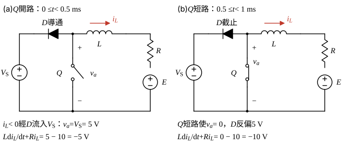

# 114 年電子學第 3 題｜切換 R-L 電路的電感電流

## 已知與所求

$L=25\,\mathrm{mH}$、$R=0.5\,\Omega$、$V_S=5\,\mathrm V$、$E=10\,\mathrm V$，$\tau=L/R$。二極體陽極接開關節點 $a$、陰極接 $V_S$ 正端；$i_L$ 由 $a$ 經 $L,R$ 流入 $E$ 正端。圖 (b)：$0\le t<0.5\,\mathrm{ms}$ 為 $v_Q=0$（$Q$ 開路），$0.5\le t<1\,\mathrm{ms}$ 為 $v_Q=V_Q$（$Q$ 短路），週期 1 ms，故**先開路、後短路**。求 $0\le t\le1\,\mathrm{ms}$ 的 $i_L(t)$。

## 考場標準作答

**解題邏輯**：$Q$ 只切換節點 $a$ 的電壓，每段內都是一階 $R$–$L$ 電路受定電壓驅動，解為「終值 + (初值 − 終值)$e^{-t/\tau}$」。先判斷兩段的 $v_a$（$Q$ 開路時二極體導通把 $v_a$ 箝在 $V_S$；$Q$ 短路時 $v_a=0$），寫出兩段的指數解；題面沒有給初始電流，故以週期穩態 $i_L(1\,\mathrm{ms})=i_L(0)$ 與電感電流連續解出兩個邊界值，最後依題給近似把指數展成直線。

### 步驟 1：時間常數與題給近似

\[
\tau=\frac{L}{R}=\frac{25\times10^{-3}}{0.5}=0.05\,\mathrm s=50\,\mathrm{ms}
\]
每段歷時 $0.5\,\mathrm{ms}$，指數的自變數：
\[
x=\frac{0.5\,\mathrm{ms}}{\tau}=\frac{0.5}{50}=0.01\ll1
\]
\[
a=e^{-0.01}\approx1-0.01=0.99
\]
\[
a^2\approx1-2(0.01)=0.98
\]

### 步驟 2：兩段的等效電路與微分方程

圖 (b) 的 $v_Q$ 在 $0\sim0.5\,\mathrm{ms}$ 為 0、$0.5\sim1\,\mathrm{ms}$ 為 $V_Q$，故**先開路、後短路**。

- **第一段 $0\le t<0.5\,\mathrm{ms}$（$Q$ 開路）**：週期穩態下 $i_L<0$（稍後驗證），電流由 $E$ 經 $R,L$ 流回節點 $a$，唯一去路是經二極體（陽極 $a$、陰極 $V_S$ 正端）流入 $V_S$，二極體導通，$v_a=V_S=5\,\mathrm V$。沿 $a\to L\to R\to E$ 寫 KVL：
\[
L\dot i_L+Ri_L=V_S-E=-5
\]
- **第二段 $0.5\le t<1\,\mathrm{ms}$（$Q$ 短路）**：$v_a=0$，二極體陽極 $0\,\mathrm V$、陰極 $5\,\mathrm V$，反偏截止：
\[
L\dot i_L+Ri_L=-E=-10
\]

### 步驟 3：兩段的指數解

第一段終值（$\dot i_L=0$）：
\[
i_{L,\infty1}=\frac{-5}{0.5}=-10\,\mathrm A
\]
\[
i_L(t)=-10+(i_0+10)e^{-t/\tau},\qquad i_0=i_L(0)
\]
$t=0.5\,\mathrm{ms}$ 時的值（電感電流連續，即第二段初值）：
\[
i_m=i_L(0.5\,\mathrm{ms})=-10+(i_0+10)a
\]
第二段終值：
\[
i_{L,\infty2}=\frac{-10}{0.5}=-20\,\mathrm A
\]
\[
i_L(t)=-20+(i_m+20)e^{-(t-0.5\,\mathrm{ms})/\tau}
\]

### 步驟 4：週期穩態求邊界值

**邏輯**：題面沒有給初始電流，穩態下一週期結束時電流回到起點，$i_L(1\,\mathrm{ms})=i_L(0)$，與步驟 3 的連續條件聯立即可消去 $i_m$。

\[
i_0=-20+(i_m+20)a
\]
代入 $i_m+20=10+(i_0+10)a$：
\[
i_0=-20+\bigl[10+(i_0+10)a\bigr]a=-20+10a+10a^2+i_0a^2
\]
\[
(1-a^2)\,i_0=-20+10a+10a^2
\]
左邊係數：
\[
1-a^2=1-0.98=0.02
\]
右邊：
\[
-20+10(0.99)+10(0.98)=-20+9.90+9.80=-0.30
\]
\[
i_0=\frac{-0.30}{0.02}=-15\,\mathrm A
\]
切換瞬間的電流：
\[
i_0+10=-15+10=-5\,\mathrm A
\]
\[
i_m=-10+(-5)(0.99)=-10-4.95=-14.95\,\mathrm A
\]

### 步驟 5：以 $e^{-x}\approx1-x$ 展開成時間函數

**邏輯**：每段 $t/\tau\le0.01$，題給近似把指數換成直線，斜率 $=(\text{初值}-\text{終值})/\tau$ 取負號。

$1/\tau=1/0.05=20\,\mathrm{s^{-1}}$（$t$ 以 s 計）。

第一段：
\[
i_L\approx-10+(-5)\Bigl(1-\frac{t}{\tau}\Bigr)=-10-5+5(20)t=-15+100t
\]
第二段，$i_m+20=-14.95+20=5.05\,\mathrm A$：
\[
i_L\approx-20+5.05\Bigl(1-\frac{t-0.5\,\mathrm{ms}}{\tau}\Bigr)=-20+5.05-5.05(20)(t-0.5\,\mathrm{ms})
\]
\[
=-14.95-101\,(t-0.5\times10^{-3})
\]
\[
\boxed{i_L(t)=\begin{cases}-15+100t\ \ \mathrm A, & 0\le t\le0.5\,\mathrm{ms}\\[4pt]-14.95-101\,(t-0.5\times10^{-3})\ \ \mathrm A, & 0.5\le t\le1\,\mathrm{ms}\end{cases}}
\]
端點檢查：$t=0.5\,\mathrm{ms}$ 第一段給 $-15+100(5\times10^{-4})=-15+0.05=-14.95\,\mathrm A$，與第二段起點相同；$t=1\,\mathrm{ms}$ 第二段給 $-14.95-101(5\times10^{-4})=-14.95-0.0505=-15.00\,\mathrm A$，回到 $i_0$。電流全程為負，第一段二極體持續導通的假設成立。

## 驗算

- 斜率法：$\dot i_L=(v_a-Ri_L-E)/L$。以 $i_L\approx-15\,\mathrm A$ 代入，第一段 $(5+7.50-10)\,\mathrm V/25\,\mathrm{mH}=+100\,\mathrm{A/s}$、第二段 $(0+7.50-10)\,\mathrm V/25\,\mathrm{mH}=-100\,\mathrm{A/s}$，與上式斜率一致（第二段 $101$ 來自起點 $-14.95\,\mathrm A$）。
- 平均值：$\bar v_a=0.5\times5=2.50\,\mathrm V$，$\bar i_L=(\bar v_a-E)/R=-15\,\mathrm A$。
- 不作近似的精確週期解 $i_0=-10(2+a)/(1+a)=-15.02\,\mathrm A$、$i_m=-14.98\,\mathrm A$，與近似答案差 $25\,\mathrm{mA}$（0.17%），漣波同為 $0.05\,\mathrm A$。

## 失分點

- 把 $0\sim0.5\,\mathrm{ms}$ 讀成短路，兩段方程順序顛倒。
- $Q$ 開路時仍令 $v_a=0$，漏掉二極體把節點箝在 $V_S=5\,\mathrm V$。
- 自設 $i_L(0)=0$；題面沒有此條件，且第二段初值須用電感電流連續 $i_L(0.5\,\mathrm{ms}^-)=i_L(0.5\,\mathrm{ms}^+)$。

## 條件與疑義

若不取週期穩態，須另給 $i_0$；上列含 $i_0$ 的通解只在第一段 $i_L<0$（二極體導通）時成立。
