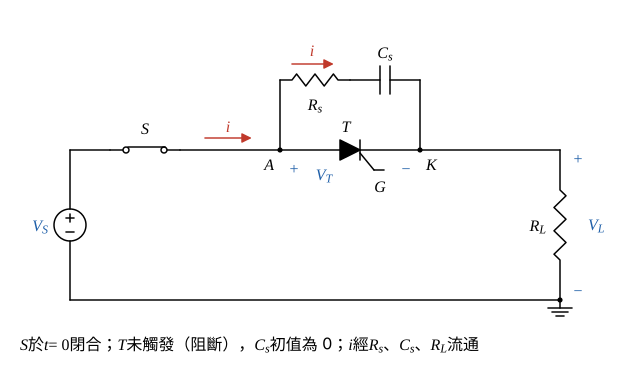
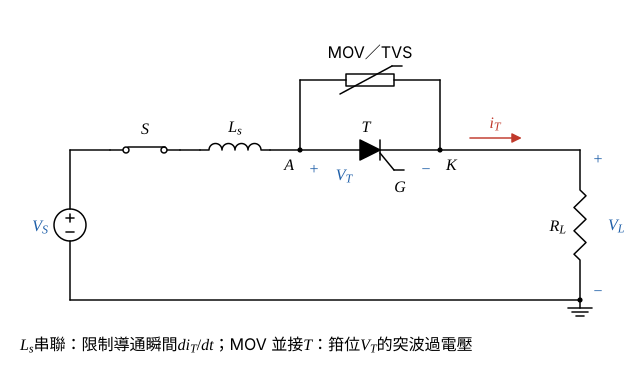

# 114 年電子學第 4 題｜閘流體 dv/dt 與 di/dt 保護

## 已知與所求

直流源 $V_S$、理想開關 $S$、閘流體 $T$（$+V_T-$）與負載（$+V_L-$）串聯，無數值。求（1）$S$ 閉合瞬間可能損毀 $T$ 的原因；（2）保護電路設計與各元件功能；（3）另兩種保護方法與概念。

## 考場標準作答

**解題邏輯**：前提：$S$ 為理想開關（瞬間閉合）、$T$ 閉合當時未加閘極訊號（阻斷態），配線電感忽略；估算時負載取電阻 $R_L$（題圖負載未指定型式）。（1）由串聯迴路 KVL 判斷閉合瞬間 $V_T$ 由 0 跳到 $V_S$，$dV_T/dt$ 極大，經接面電容的位移電流造成誤觸發，進而 $di/dt$ 局部過熱；（2）在 $T$ 兩端並 RC 緩衝器，寫阻斷態迴路的一階 RC 暫態求 $V_T(0^+)$ 與 $dV_T/dt$，得設計條件；（3）以串聯電感限 $di_T/dt$、並接 MOV 箝位過電壓，各用一條關係式說明。

### （1）損毀原因

**邏輯**：串聯迴路 KVL $V_S=V_T+V_L$ 決定兩元件如何分壓；$T$ 阻斷時迴路幾乎無電流，電壓全落在 $T$ 上，且是瞬間加上，故問題在 $dV_T/dt$。

迴路 KVL（沿 $V_S\to S\to T\to$ 負載）：
\[
V_S=V_T+V_L
\]
$S$ 閉合前 $T$ 兩端無電源，$V_T=0$。閉合瞬間 $T$ 未觸發、處於阻斷，只有微小漏電流，負載電壓 $V_L=R_Li\approx0$，代入 KVL：
\[
V_T=V_S-V_L\approx V_S
\]
即 $V_L\approx0$、$V_T\approx V_S$：$V_T$ 在開關動作的極短時間 $\Delta t$ 內由 0 跳到 $V_S$，
\[
\frac{dV_T}{dt}\approx\frac{V_S}{\Delta t}\ \xrightarrow{\ \Delta t\to0\ }\ \text{極大}
\]
阻斷時中間接面 $J_2$ 逆偏，相當於接面電容 $C_j$，電壓變化產生位移電流：
\[
\boxed{i_j=C_j\frac{dV_T}{dt}}
\]
$i_j$ 流經 $J_2$ 的效果等同注入閘極的觸發電流；$dV_T/dt$ 超過額定 $(dv/dt)_{cr}$ 時，$T$ 在沒有閘極訊號下誤導通。誤導通時導通區只從局部開始，電流若以很大 $di/dt$ 上升，電流密度集中在小面積形成熱點而燒毀（$di/dt$ 損壞）。

### （2）RC 緩衝器（snubber）

**邏輯**：在 $T$ 兩端並聯 $R_s$ 串 $C_s$，閉合瞬間電容電壓不能突變，$V_T$ 改為依 RC 時間常數上升；由阻斷態迴路的一階暫態求 $dV_T/dt$ 最大值（在 $0^+$），令其小於 $(dv/dt)_{cr}$ 即為設計條件。

- $C_s$：$S$ 閉合時由 $C_s$ 承接電壓步階，使 $V_T$ 緩升，限制 $dV_T/dt$。
- $R_s$：$T$ 觸發導通時，已充到 $V_S$ 的 $C_s$ 會經 $T$ 放電，$R_s$ 把放電尖峰限制在 $V_S/R_s$（避免放電 $di/dt$ 過大）；同時阻尼配線電感與 $C_s$ 的振盪。

阻斷態迴路（$T$ 視為開路，$v_{C_s}(0)=0$）的 KVL：
\[
V_S=R_Li+R_si+v_{C_s},\qquad \tau=(R_L+R_s)C_s
\]
一階 RC 充電，電流由初值指數衰減：
\[
i(t)=\frac{V_S}{R_L+R_s}e^{-t/\tau}
\]
$T$ 兩端電壓（KVL：$V_T=V_S-V_L$，$V_L=R_Li$）：
\[
V_T(t)=V_S-R_Li(t)=V_S-\frac{R_LV_S}{R_L+R_s}e^{-t/\tau}
\]
初值（$t=0^+$，$e^{0}=1$）：
\[
V_T(0^+)=V_S-\frac{R_LV_S}{R_L+R_s}=\frac{R_sV_S}{R_L+R_s}
\]
對時間微分：
\[
\frac{dV_T}{dt}=\frac{R_LV_S}{R_L+R_s}\cdot\frac{1}{\tau}e^{-t/\tau}=\frac{R_LV_S}{(R_L+R_s)^2C_s}e^{-t/\tau}
\]
最大值在 $t=0^+$，設計條件：
\[
\boxed{\left.\frac{dV_T}{dt}\right|_{0^+}=\frac{R_LV_S}{(R_L+R_s)^2C_s}<\left(\frac{dv}{dt}\right)_{cr}}
\]
$C_s$ 加大則斜率變小；$R_s$ 不可過大，否則 $V_T(0^+)$ 的初始步階變大，也不可過小，否則導通時放電電流 $V_S/R_s$ 過大。

### （3）另兩種方法

**邏輯**：（2）處理的是 $dv/dt$；導通後主回路電流上升率 $di_T/dt$ 由串聯電感限制（電感電流不能突變），外來突波過電壓則由並接的非線性箝位元件吸收，兩者對應另外兩種損壞機制。

1. **串聯限流電感 $L_s$（$di/dt$ 保護）**：$T$ 導通後 $V_T\approx0$，迴路 KVL 與初值 $i_T(0^+)=0$（電感電流連續）：
\[
V_S=L_s\frac{di_T}{dt}+R_Li_T
\]
\[
\left.\frac{di_T}{dt}\right|_{0^+}=\frac{V_S-R_L\times0}{L_s}
\]
\[
\boxed{\left.\frac{di_T}{dt}\right|_{0^+}=\frac{V_S}{L_s}<\left(\frac{di}{dt}\right)_{cr}}
\]
讓導通區有時間擴散到整個晶片；常與 RC 緩衝器搭配（$L_s$ 限 $di/dt$、$R_sC_s$ 限 $dv/dt$）。
2. **過電壓箝位（MOV／TVS）**：MOV／TVS 並接 $T$，正常電壓下近似開路；突波使 $V_T$ 超過箝位電壓時即導通吸收能量，使 $V_T$ 不超過 $T$ 的重複峰值阻斷電壓 $V_{DRM}$。（另可串快速熔絲作過電流保護，其 $I^2t$ 須小於 $T$ 的 $I^2t$ 額定。）

## 驗算

- 終值：$t\to\infty$ 時 $i\to0$、$C_s$ 充至 $V_S$，$V_T\to V_S$、$V_L\to0$，與阻斷態 KVL 一致。
- 單位：$\dfrac{R_LV_S}{(R_L+R_s)^2C_s}$ 為 $\mathrm{V}/(\Omega\cdot\mathrm F)=\mathrm{V/s}$；$V_S/L_s$ 為 $\mathrm{V/H}=\mathrm{A/s}$。
- 極限：$R_s\to0$ 時斜率為 $V_S/(R_LC_s)$；無緩衝器（$C_s\to0$）時斜率趨於無限大，即（1）的步階。

## 失分點

- 只寫「突波」，未指出接面電容位移電流 $C_j\,dV_T/dt$ 造成誤觸發的機制。
- 緩衝器只並一顆電容而無 $R_s$：$T$ 導通瞬間 $C_s$ 直接經 $T$ 短路放電，反而造成極大 $di/dt$；主回路 $di/dt$ 也不是 RC 能限制，須靠串聯 $L_s$。
- 寫成 $S$ 閉合時 $T$ 與負載都承受 $V_S$；由 $V_S=V_T+V_L$，兩者不能同時各取 $V_S$，阻斷時是 $V_T\approx V_S$。
