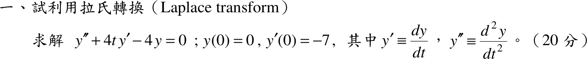

# 104 年第 1 題｜以拉氏轉換解變係數 ODE

## 已知與所求

\(y''+4t\,y'-4y=0\)，\(y(0)=0\)，\(y'(0)=-7\)（20 分），以拉氏轉換求 \(y(t)\)。係數 \(4t\) 含 \(t\)，不是常係數。

## 考場標準作答

### 步驟 1：逐項取拉氏轉換

設 \(y(t)\) 為指數階、拉氏轉換存在（取 \(s>0\)）。令 \(Y(s)=\mathcal L\{y\}\)，\(Y'=\dfrac{dY}{ds}\)。導數的轉換公式，代入 \(y(0)=0\)、\(y'(0)=-7\)：
\[
\mathcal L\{y''\}=s^2Y-sy(0)-y'(0)=s^2Y-s(0)-(-7)=s^2Y+7
\]
\[
\mathcal L\{y'\}=sY-y(0)=sY-0=sY
\]
\(s\) 域微分性質 \(\mathcal L\{t\,g(t)\}=-G'(s)\)，取 \(g=y'\)、\(G=sY\)：
\[
\mathcal L\{t\,y'\}=-\frac{d}{ds}\bigl(sY\bigr)
\]
乘積法則 \(\dfrac{d}{ds}(sY)=1\cdot Y+s\,Y'\)：
\[
\mathcal L\{t\,y'\}=-\bigl(Y+sY'\bigr)=-Y-sY'
\]

### 步驟 2：化成 \(Y(s)\) 的一階線性 ODE

代入 \(\mathcal L\{y''\}+4\,\mathcal L\{t\,y'\}-4\,\mathcal L\{y\}=0\)：
\[
s^2Y+7+4\bigl(-Y-sY'\bigr)-4Y=0
\]
展開括號：
\[
s^2Y+7-4Y-4sY'-4Y=0
\]
合併 \(Y\) 項：
\[
-4sY'+(s^2-8)Y+7=0
\]
兩邊除以 \(-4s\)：
\[
Y'-\frac{s^2-8}{4s}\,Y-\frac{7}{4s}=0
\]
拆分係數 \(\dfrac{s^2-8}{4s}=\dfrac s4-\dfrac2s\)，常數項移到右邊，得標準式 \(Y'+P(s)Y=Q(s)\)：
\[
Y'-\left(\frac s4-\frac2s\right)Y=\frac{7}{4s}
\]

### 步驟 3：積分因子求 \(Y(s)\) 通解

此處 \(P(s)=-\left(\dfrac s4-\dfrac2s\right)\)，積分因子 \(\mu=e^{\int P\,ds}\)：
\[
\int\left(\frac s4-\frac2s\right)ds=\frac{s^2}{8}-2\ln s
\]
\[
\mu(s)=e^{-s^2/8+2\ln s}=s^2e^{-s^2/8}
\]
兩邊乘 \(\mu\)，左邊成為 \((\mu Y)'\)：
\[
\frac{d}{ds}\Bigl(s^2e^{-s^2/8}\,Y\Bigr)=s^2e^{-s^2/8}\cdot\frac{7}{4s}=\frac74\,s\,e^{-s^2/8}
\]
右邊積分，令 \(w=s^2/8\)（\(dw=\tfrac s4\,ds\)，即 \(s\,ds=4\,dw\)）：
\[
\int\frac74\,s\,e^{-s^2/8}\,ds=\frac74\cdot4\int e^{-w}\,dw=7\int e^{-w}\,dw
\]
\[
7\int e^{-w}\,dw=-7e^{-w}+C=-7e^{-s^2/8}+C
\]
所以
\[
s^2e^{-s^2/8}\,Y=-7e^{-s^2/8}+C
\]
兩邊除以 \(s^2e^{-s^2/8}\)：
\[
Y(s)=-\frac{7}{s^2}+C\,\frac{e^{s^2/8}}{s^2}
\]

### 求 \(y(t)\)（20 分）

拉氏轉換必滿足 \(\lim_{s\to\infty}Y(s)=0\)。兩項在 \(s\to\infty\) 的極限：
\[
\lim_{s\to\infty}\left(-\frac{7}{s^2}\right)=0,\qquad \lim_{s\to\infty}\frac{e^{s^2/8}}{s^2}=\infty
\]
\[
\Rightarrow\ C=0,\qquad Y(s)=-\frac{7}{s^2}
\]
查表 \(\mathcal L^{-1}\{1/s^2\}=t\)：
\[
y(t)=-7\,\mathcal L^{-1}\left\{\frac{1}{s^2}\right\}=-7\cdot t
\]
\[
\boxed{y(t)=-7t}
\]

## 驗算

回代：\(y''=0\)，\(4t\,y'=4t(-7)=-28t\)，\(-4y=-4(-7t)=28t\)，三項和 \(0-28t+28t=0\)；\(y(0)=0\)、\(y'(0)=-7\)。數值積分該 IVP 得 \(y(2)=-14\)，與 \(-7(2)=-14\) 吻合。

## 失分點

- \(\mathcal L\{t\,y'\}=-\dfrac{d}{ds}\bigl(sY-y(0)\bigr)\)，是對 \(sY\) 整體微分，且帶負號；漏掉 \(-Y\) 項會得錯的 \(Y'\) 方程。
- 轉換後是 \(Y\) 的一階 ODE，通解含 \(Ce^{s^2/8}/s^2\)，必須以 \(s\to\infty\) 趨零（轉換條件）捨去。
- \(\mathcal L\{y''\}\) 中 \(-y'(0)=-(-7)=+7\)，符號抄錯會得 \(y=7t\)。
