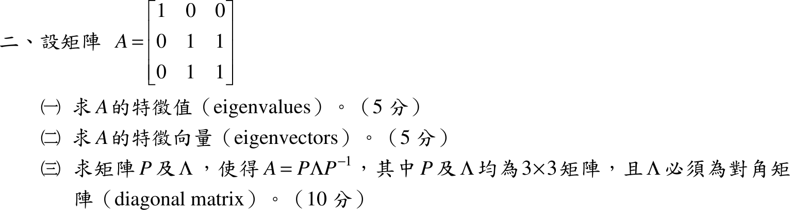

# 104 年第 2 題｜特徵值、特徵向量與對角化

## 已知與所求

\(A=\begin{bmatrix}1&0&0\\0&1&1\\0&1&1\end{bmatrix}\)。求（一）特徵值（5 分）；（二）特徵向量（5 分）；（三）\(3\times3\) 矩陣 \(P\) 與對角矩陣 \(\Lambda\)，使 \(A=P\Lambda P^{-1}\)（10 分）。

## 考場標準作答

**解題邏輯**：特徵值是特徵方程 \(\det(A-\lambda I)=0\) 的根；對每個特徵值 \(\lambda_i\) 解齊次方程 \((A-\lambda_iI)\mathbf{x}=\mathbf 0\) 得特徵向量 \(\mathbf p_i\)；三個特徵值相異時三個特徵向量線性獨立，以它們為欄組成 \(P\)、對應特徵值依同順序放進 \(\Lambda\) 的對角線，即 \(AP=P\Lambda\Rightarrow A=P\Lambda P^{-1}\)。\(A\) 的第一列、第一行除對角元外全為 0，沿第一列展開行列式最省事。

### （一）特徵值（5 分）

**邏輯**：\(A\mathbf x=\lambda\mathbf x\) 有非零解 \(\iff\) \(A-\lambda I\) 奇異 \(\iff\) \(\det(A-\lambda I)=0\)。

\[
A-\lambda I=\begin{bmatrix}1-\lambda&0&0\\0&1-\lambda&1\\0&1&1-\lambda\end{bmatrix}
\]
沿第一列展開（第一列只有 \((1,1)\) 元非零）：
\[
\det(A-\lambda I)=(1-\lambda)\det\begin{bmatrix}1-\lambda&1\\1&1-\lambda\end{bmatrix}=(1-\lambda)\bigl[(1-\lambda)^2-1\bigr]
\]
展開括號內：
\[
(1-\lambda)^2-1=\lambda^2-2\lambda+1-1=\lambda^2-2\lambda=\lambda(\lambda-2)
\]
代回得特徵方程：
\[
\det(A-\lambda I)=(1-\lambda)\,\lambda\,(\lambda-2)=0
\]
\[
\boxed{\lambda_1=0,\ \lambda_2=1,\ \lambda_3=2}
\]

### （二）特徵向量（5 分）

**邏輯**：對每個 \(\lambda_i\) 解 \((A-\lambda_iI)\mathbf x=\mathbf 0\)，\(\mathbf x=(x_1,x_2,x_3)^T\)；三個特徵值都是單根，各有一維特徵空間，取一個非零代表向量（可乘任意非零常數）。

\(\lambda_1=0\)：\(A-0I=A\)，三列方程為
\[
x_1=0,\qquad x_2+x_3=0,\qquad x_2+x_3=0
\]
令 \(x_2=1\)，則 \(x_3=-x_2=-1\)：
\[
\boxed{\mathbf p_1=(0,\ 1,\ -1)^T}
\]

\(\lambda_2=1\)：\(A-I=\begin{bmatrix}0&0&0\\0&0&1\\0&1&0\end{bmatrix}\)，三列方程為
\[
0=0,\qquad x_3=0,\qquad x_2=0
\]
\(x_1\) 自由，令 \(x_1=1\)：
\[
\boxed{\mathbf p_2=(1,\ 0,\ 0)^T}
\]

\(\lambda_3=2\)：\(A-2I=\begin{bmatrix}-1&0&0\\0&-1&1\\0&1&-1\end{bmatrix}\)，三列方程為
\[
-x_1=0,\qquad -x_2+x_3=0,\qquad x_2-x_3=0
\]
得 \(x_1=0\)、\(x_2=x_3\)，令 \(x_3=1\)：
\[
\boxed{\mathbf p_3=(0,\ 1,\ 1)^T}
\]

### （三）對角化 \(A=P\Lambda P^{-1}\)（10 分）

**邏輯**：\(A\mathbf p_i=\lambda_i\mathbf p_i\)（\(i=1,2,3\)）逐欄合寫成 \(AP=P\Lambda\)；只要 \(P\) 可逆（\(\det P\ne0\)），右乘 \(P^{-1}\) 即得 \(A=P\Lambda P^{-1}\)。\(P\) 的欄序必須與 \(\Lambda\) 的對角元順序一致。

以 \(\mathbf p_1,\mathbf p_2,\mathbf p_3\) 為欄、\(\lambda_1,\lambda_2,\lambda_3\) 依同順序為對角元：
\[
\boxed{P=\begin{bmatrix}0&1&0\\1&0&1\\-1&0&1\end{bmatrix},\quad \Lambda=\begin{bmatrix}0&0&0\\0&1&0\\0&0&2\end{bmatrix}}
\]
\(P\) 可逆：沿第一列展開（只有 \((1,2)\) 元非零，餘因子符號為 \((-1)^{1+2}=-1\)）：
\[
\det P=-1\cdot\det\begin{bmatrix}1&1\\-1&1\end{bmatrix}=-1\cdot\bigl[(1)(1)-(1)(-1)\bigr]=-1\cdot2=-2\ne0
\]
求 \(P^{-1}\)：\(A\) 對稱，三個欄向量兩兩正交（\(\mathbf p_1\cdot\mathbf p_2=0\)、\(\mathbf p_1\cdot\mathbf p_3=0+1-1=0\)、\(\mathbf p_2\cdot\mathbf p_3=0\)），故 \(P^{-1}\) 的第 \(i\) 列為 \(\mathbf p_i^T/\lVert\mathbf p_i\rVert^2\)；\(\lVert\mathbf p_1\rVert^2=2\)、\(\lVert\mathbf p_2\rVert^2=1\)、\(\lVert\mathbf p_3\rVert^2=2\)：
\[
P^{-1}=\begin{bmatrix}0&\tfrac12&-\tfrac12\\1&0&0\\0&\tfrac12&\tfrac12\end{bmatrix}
\]

## 驗算

直接相乘 \(P\Lambda P^{-1}\)。先算 \(P\Lambda\)（\(P\) 的第 \(i\) 欄乘 \(\lambda_i\)）：
\[
P\Lambda=\begin{bmatrix}0&1&0\\0&0&2\\0&0&2\end{bmatrix}
\]
再右乘 \(P^{-1}\)：第 1 列 \((0,1,0)\) 取出 \(P^{-1}\) 第 2 列 \((1,0,0)\)；第 2、3 列 \((0,0,2)\) 都是 \(2\times\)\(P^{-1}\) 第 3 列 \(=(0,1,1)\)：
\[
P\Lambda P^{-1}=\begin{bmatrix}1&0&0\\0&1&1\\0&1&1\end{bmatrix}=A
\]
另：\(\operatorname{tr}A=1+1+1=3=0+1+2\)；\(\det A=1\cdot(1\cdot1-1\cdot1)=0=0\cdot1\cdot2\)，與特徵值和、積一致。

## 失分點

- \(P\) 的欄順序必須與 \(\Lambda\) 對角元順序一致；換欄時 \(\Lambda\) 也要跟著換。
- \(\lambda=0\) 的特徵向量是 \((0,1,-1)^T\)，不是 \((0,1,1)^T\)（那是 \(\lambda=2\)）。
- \(\lambda=1\) 時 \(A-I\) 的第一列全為 0，\(x_1\) 是自由變數；把它也解成 0 會得到零向量（不是特徵向量）。
