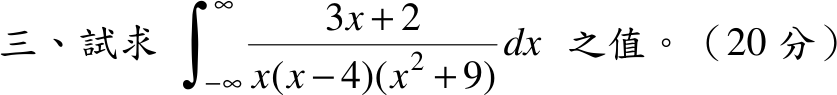

# 104 年第 3 題｜實軸極點的廣義積分（主值）

## 已知與所求

\[
I=\int_{-\infty}^{\infty}\frac{3x+2}{x(x-4)(x^2+9)}\,dx\quad(20\text{ 分})
\]

求 \(I\) 之值；被積函數在 \(x=0\) 與 \(x=4\) 有實軸一階極點。

## 考場標準作答

**解題邏輯**：被積函數在實軸上 \(x=0\)、\(x=4\) 各有一階極點，先判斷普通廣義積分是否收斂（步驟 1）；不收斂時依工程數學留數題慣例取 Cauchy 主值（PV，前提：兩極點兩側對稱挖洞、無窮遠以 \(\pm R\) 對稱截斷）。作法：部分分式拆成 \(\frac1x\)、\(\frac1{x-4}\)、\(\frac{x}{x^2+9}\)、\(\frac1{x^2+9}\) 四類（步驟 2），前三類的對稱主值都是 0，只剩 \(\frac1{x^2+9}\) 一項用反正切積分。

### 步驟 1：收斂性判斷

在 \(x=0\) 附近，其餘因子取 \(x=0\) 的值：
\[
f(x)\approx\frac{3(0)+2}{(0-4)(0^2+9)}\cdot\frac1x=\frac{2}{-36}\cdot\frac1x=-\frac1{18x}
\]
在 \(x=4\) 附近，其餘因子取 \(x=4\) 的值：
\[
f(x)\approx\frac{3(4)+2}{4\,(4^2+9)}\cdot\frac1{x-4}=\frac{14}{100}\cdot\frac1{x-4}=\frac{7}{50(x-4)}
\]
\(\int_0^{\delta}\frac{dx}{x}=\lim_{\varepsilon\to0^+}\bigl(\ln\delta-\ln\varepsilon\bigr)=\infty\)，\(\frac1{x-4}\) 同理，故**普通廣義積分不存在（發散）**。以下求 Cauchy 主值 \(\operatorname{PV}I\)。無窮遠處 \(f(x)\sim\frac{3}{x^3}\)，在 \(\pm\infty\) 可積，以 \(\pm R\) 對稱截斷後令 \(R\to\infty\) 不影響結果。

### 步驟 2：部分分式

設
\[
\frac{3x+2}{x(x-4)(x^2+9)}=\frac{a}{x}+\frac{b}{x-4}+\frac{cx+d}{x^2+9}
\]
\(a\)、\(b\) 用遮蓋法（即步驟 1 的兩個係數）：
\[
a=\left.\frac{3x+2}{(x-4)(x^2+9)}\right|_{x=0}=\frac{2}{(-4)(9)}=-\frac1{18}
\]
\[
b=\left.\frac{3x+2}{x(x^2+9)}\right|_{x=4}=\frac{14}{(4)(25)}=\frac{7}{50}
\]
通分後分子恆等：
\[
3x+2=a(x-4)(x^2+9)+b\,x(x^2+9)+(cx+d)\,x(x-4)
\]
比較 \(x^3\) 係數（左邊為 0）：
\[
0=a+b+c\quad\Longrightarrow\quad c=-a-b=\frac1{18}-\frac7{50}=\frac{25}{450}-\frac{63}{450}=-\frac{38}{450}=-\frac{19}{225}
\]
比較 \(x^2\) 係數（\(a\) 項貢獻 \(-4a\)、\(b\) 項無 \(x^2\)、\((cx+d)(x^2-4x)\) 貢獻 \(-4c+d\)）：
\[
0=-4a-4c+d\quad\Longrightarrow\quad d=4a+4c=-\frac{2}{9}-\frac{76}{225}=-\frac{50}{225}-\frac{76}{225}=-\frac{126}{225}
\]
以 \(x^1\) 係數核對：\(9a+9b-4d=-\frac12+\frac{63}{50}+\frac{504}{225}=-\frac{25}{50}+\frac{63}{50}+\frac{56}{25}=\frac{19}{25}+\frac{56}{25}=3\)，與左邊 \(3x\) 一致。故
\[
f(x)=-\frac1{18x}+\frac7{50(x-4)}-\frac{19x+126}{225(x^2+9)}
\]

### 求 \(\operatorname{PV}I\)（20 分）

**邏輯**：主值對線性組合可逐項取；\(\frac1x\)、\(\frac1{x-4}\) 的對稱主值為 0，\(\frac{x}{x^2+9}\) 是奇函數、在 \([-R,R]\) 上積分為 0，只剩 \(\frac{-126/225}{x^2+9}\) 一項。拆開後的 \(\frac1{x-4}\)、\(\frac{x}{x^2+9}\) 各自在 \(\pm\infty\) 不可積，故逐項都必須在同一個 \([-R,R]\) 上計算，相加後才令 \(R\to\infty\)。

\(\frac1x\) 項（在 0 兩側挖 \(\varepsilon\)）：
\[
\operatorname{PV}\!\int_{-R}^{R}\frac{dx}{x}=\lim_{\varepsilon\to0^+}\Bigl(\bigl[\ln|x|\bigr]_{-R}^{-\varepsilon}+\bigl[\ln|x|\bigr]_{\varepsilon}^{R}\Bigr)=\lim_{\varepsilon\to0^+}\bigl[(\ln\varepsilon-\ln R)+(\ln R-\ln\varepsilon)\bigr]=0
\]
\(\frac1{x-4}\) 項（在 4 兩側挖 \(\varepsilon\)）：
\[
\operatorname{PV}\!\int_{-R}^{R}\frac{dx}{x-4}=\lim_{\varepsilon\to0^+}\bigl[(\ln\varepsilon-\ln(R+4))+(\ln(R-4)-\ln\varepsilon)\bigr]=\ln\frac{R-4}{R+4}
\]
\[
\lim_{R\to\infty}\ln\frac{R-4}{R+4}=\ln1=0
\]
\(\frac{x}{x^2+9}\) 項（奇函數、對稱區間）：
\[
\int_{-R}^{R}\frac{x\,dx}{x^2+9}=0
\]
\(\frac1{x^2+9}\) 項：
\[
\int_{-\infty}^{\infty}\frac{dx}{x^2+9}=\frac13\Bigl[\tan^{-1}\frac x3\Bigr]_{-\infty}^{\infty}=\frac13\Bigl[\frac\pi2-\Bigl(-\frac\pi2\Bigr)\Bigr]=\frac\pi3
\]
四項合併：
\[
\operatorname{PV}I=-\frac1{18}(0)+\frac7{50}(0)-\frac{19}{225}(0)-\frac{126}{225}\cdot\frac\pi3
\]
約分 \(\frac{126}{225}=\frac{14}{25}\)（分子分母同除 9）：
\[
\operatorname{PV}I=-\frac{14}{25}\cdot\frac\pi3=-\frac{14\pi}{75}
\]
\[
\boxed{\operatorname{PV}I=-\frac{14\pi}{75}}\approx-0.59
\]
（作答時先寫「普通廣義積分不存在」，再給主值。）

## 驗算

留數法（上半平面圍道，兩實軸極點以上方小半圓繞過）：\(\operatorname{PV}I=2\pi i\operatorname{Res}_{z=3i}+\pi i\bigl(\operatorname{Res}_{z=0}+\operatorname{Res}_{z=4}\bigr)\)。實軸兩留數即步驟 2 的 \(a=-\frac1{18}\)、\(b=\frac7{50}\)，和為 \(-\frac{25}{450}+\frac{63}{450}=\frac{19}{225}\)。
\[
\operatorname{Res}_{z=3i}=\frac{3(3i)+2}{3i(3i-4)(6i)}=\frac{2+9i}{-18(3i-4)}=\frac{2+9i}{72-54i}=\frac{(2+9i)(72+54i)}{72^2+54^2}=\frac{-342+756i}{8100}=-\frac{19}{450}+\frac{7}{75}i
\]
\[
\operatorname{PV}I=2\pi i\Bigl(-\frac{19}{450}+\frac{7}{75}i\Bigr)+\pi i\cdot\frac{19}{225}=-\frac{19\pi i}{225}-\frac{14\pi}{75}+\frac{19\pi i}{225}=-\frac{14\pi}{75}
\]
虛部抵銷、實部一致。數值：\(-\frac{14\pi}{75}=-0.5864\)；在 \(0\)、\(4\) 兩側各挖去 \(10^{-9}\) 對稱小區間的數值積分亦得 \(-0.5864\)。

## 失分點

- 未先指出普通廣義積分發散就直接給數值；本題答案必須以「Cauchy 主值」為前提。
- \(\int_{-\infty}^{\infty}\frac{dx}{x^2+9}=\frac\pi3\)，係數 \(-\frac{126}{225}\) 約分為 \(-\frac{14}{25}\)，乘 \(\frac\pi3\) 得分母 \(75\)，不是 \(225\)。
- 留數法中實軸極點只貢獻 \(\pi i\operatorname{Res}\)（半留數），不是 \(2\pi i\operatorname{Res}\)。

## 條件與疑義

官方題幹未標示 Cauchy 主值（PV）。若按普通廣義積分，因 \(x=0,4\) 的單極點，積分發散；上列 \(-\frac{14\pi}{75}\) 僅為採對稱主值的條件答案，作答時宜先寫「普通廣義積分不存在」再給主值。
