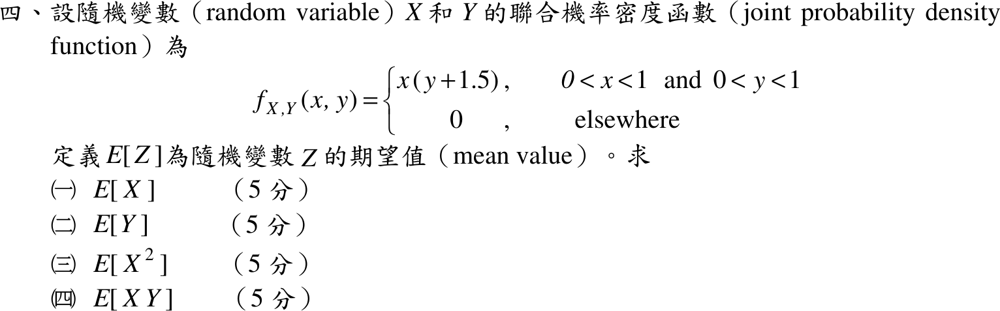
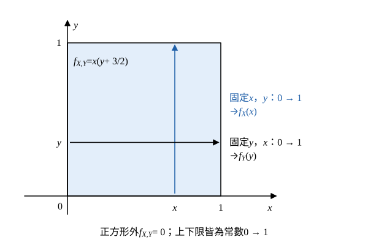

# 104 年第 4 題｜二維聯合機率密度的期望值

## 已知與所求

\(f_{X,Y}(x,y)=x\left(y+\tfrac32\right)\)（題目寫 \(y+1.5\)；\(0<x<1,\ 0<y<1\)），其他為 \(0\)。求（一）\(E[X]\)、（二）\(E[Y]\)、（三）\(E[X^2]\)、（四）\(E[XY]\)，各 5 分。

## 考場標準作答

### 步驟 1：支撐區與正規化檢查

支撐區 \(0<x<1,\ 0<y<1\)，區外密度為 0，所有積分上下限都是 \(0\to1\)。求 \(f_X(x)\) 時固定 \(x\)、對 \(y\) 積分；求 \(f_Y(y)\) 時固定 \(y\)、對 \(x\) 積分。

正規化檢查（被積函數可分離、上下限為常數，重積分 = 兩個單變數積分相乘）：
\[
\int_0^1\!\!\int_0^1x\left(y+\frac32\right)dy\,dx=\int_0^1x\,dx\cdot\int_0^1\left(y+\frac32\right)dy=\frac12\cdot\left(\frac12+\frac32\right)=\frac12\cdot2=1
\]

### 步驟 2：邊際密度與獨立性（四問共用）

先求邊際密度，對 \(y\) 積分（\(x\) 視為常數提出）：
\[
f_X(x)=\int_0^1x\left(y+\frac32\right)dy=x\left[\frac{y^2}2+\frac32y\right]_0^1
\]
\[
=x\left(\frac12+\frac32\right)=2x
\]
對 \(x\) 積分（\(y+\tfrac32\) 視為常數提出）：
\[
f_Y(y)=\int_0^1x\left(y+\frac32\right)dx=\left(y+\frac32\right)\left[\frac{x^2}2\right]_0^1
\]
\[
=\frac12\left(y+\frac32\right)
\]
以上分別適用於 \(0<x<1\)、\(0<y<1\)，區間外為零。

相乘檢查：
\[
f_X(x)f_Y(y)=2x\cdot\frac12\left(y+\frac32\right)=x\left(y+\frac32\right)=f_{X,Y}(x,y)
\]
在支撐區上成立、區外兩邊皆為 0，故 \(X,Y\) 獨立。

### （一）\(E[X]\)（5 分）

\[
E[X]=\int_0^1x\cdot2x\,dx=\int_0^12x^2\,dx
\]
\[
=2\left[\frac{x^3}3\right]_0^1=2\cdot\frac13
\]
\[
\boxed{E[X]=\frac23\approx0.67}
\]

### （二）\(E[Y]\)（5 分）

\[
E[Y]=\int_0^1y\cdot\frac12\left(y+\frac32\right)dy=\frac12\int_0^1\left(y^2+\frac32y\right)dy
\]
逐項積分：
\[
\int_0^1y^2\,dy=\frac13,\qquad \int_0^1\frac32y\,dy=\frac32\cdot\frac12=\frac34
\]
相加（公分母 12）：
\[
\frac13+\frac34=\frac4{12}+\frac9{12}=\frac{13}{12}
\]
乘上 \(\tfrac12\)：
\[
E[Y]=\frac12\cdot\frac{13}{12}
\]
\[
\boxed{E[Y]=\frac{13}{24}\approx0.54}
\]

### （三）\(E[X^2]\)（5 分）

\[
E[X^2]=\int_0^1x^2\cdot2x\,dx=\int_0^12x^3\,dx
\]
\[
=2\left[\frac{x^4}4\right]_0^1=2\cdot\frac14
\]
\[
\boxed{E[X^2]=\frac12=0.50}
\]

### （四）\(E[XY]\)（5 分）

因步驟 2 已證 \(f_{X,Y}=f_Xf_Y\)，重積分可拆成兩個單變數積分相乘：
\[
E[XY]=\int_0^1\!\!\int_0^1xy\,f_X(x)f_Y(y)\,dx\,dy=\int_0^1x\,f_X(x)\,dx\cdot\int_0^1y\,f_Y(y)\,dy=E[X]E[Y]
\]
代入：
\[
E[XY]=\frac23\cdot\frac{13}{24}=\frac{26}{72}
\]
約分（同除 2）：
\[
\boxed{E[XY]=\frac{13}{36}\approx0.36}
\]

## 驗算

不用獨立性，直接由原聯合密度核對交叉動差：
\[
E[XY]=\int_0^1\!\!\int_0^1x^2y\left(y+\frac32\right)dy\,dx=\frac13\left(\frac13+\frac34\right)=\frac13\cdot\frac{13}{12}=\frac{13}{36}
\]
另有 \(\operatorname{Var}(X)=E[X^2]-E[X]^2=\tfrac12-\tfrac49=1/18>0\)，二階動差大於平均值平方，量級合理。

## 失分點

- \(E[X^2]\) 的被積式是 \(x^2f_X(x)\)，答案 \(\tfrac12\)，不是 \(E[X]^2=\tfrac49\)。
- 獨立性要先由 \(f_{X,Y}=f_Xf_Y\) 驗證才能用 \(E[XY]=E[X]E[Y]\)；本題的 \(\tfrac32\) 常數使邊際 \(f_Y\) 的係數為 \(\tfrac12\)，不是 \(1\)。
