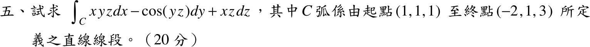
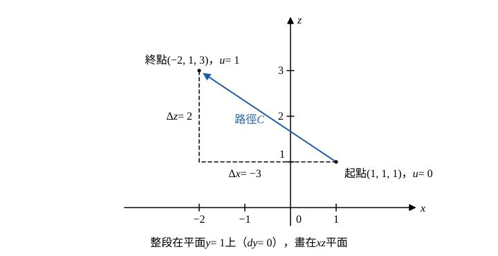

# 104 年第 5 題｜直線段線積分

## 已知與所求

求 \(\displaystyle I=\int_Cxyz\,dx-\cos(yz)\,dy+xz\,dz\)，\(C\) 為由起點 \((1,1,1)\) 至終點 \((-2,1,3)\) 的直線段（20 分）。

## 考場標準作答

**解題邏輯**：被積場 \((xyz,\,-\cos(yz),\,xz)\) 的旋度 \(x\) 分量為 \(\frac{\partial(xz)}{\partial y}-\frac{\partial(-\cos yz)}{\partial z}=0-y\sin(yz)\ne0\)，不是保守場，積分與路徑有關，必須沿題給直線段計算。
1. 直接參數化：直線段寫成 \(\mathbf r(u)=P_0+u(P_1-P_0)\)，\(0\le u\le1\)，\(u\) 由 0 增到 1 對應「起點 → 終點」的方向。
2. 把 \(x,y,z\) 與 \(dx,dy,dz\) 全換成 \(u\) 的函數。
3. 路徑上 \(y\) 恆為 1，\(dy=0\)，含 \(\cos(yz)\) 的項整項為零。
4. 化成對 \(u\) 的定積分。

### 步驟 1：直線段參數化

方向向量 = 終點 − 起點（各座標的變化量 \(\Delta x,\Delta y,\Delta z\)）：
\[
(\Delta x,\ \Delta y,\ \Delta z)=P_1-P_0=(-2-1,\ 1-1,\ 3-1)=(-3,\ 0,\ 2)
\]
參數式：
\[
\mathbf r(u)=(1,1,1)+u(-3,0,2)=(1-3u,\ 1,\ 1+2u),\qquad 0\le u\le1
\]
即 \(x=1-3u\)、\(y=1\)、\(z=1+2u\)。對 \(u\) 微分：
\[
dx=-3\,du,\qquad dy=0\,du=0,\qquad dz=2\,du
\]

### 步驟 2：三項各換成 \(u\)

第一項（\(y=1\)）：
\[
xyz\,dx=(1-3u)(1)(1+2u)(-3\,du)=-3(1-3u)(1+2u)\,du
\]
第二項：因 \(dy=0\)，
\[
-\cos(yz)\,dy=-\cos(1+2u)\cdot0=0
\]
第三項：
\[
xz\,dz=(1-3u)(1+2u)(2\,du)=2(1-3u)(1+2u)\,du
\]
共同因式展開（分配律）：
\[
(1-3u)(1+2u)=1+2u-3u-6u^2=1-u-6u^2
\]

### 線積分 \(I\)（20 分）

**邏輯**：三項都化成 \(du\) 的式子後相加，前後兩項是同一多項式 \(1-u-6u^2\) 的倍數，先合併係數，再用冪次積分 \(\int_0^1u^n\,du=\frac1{n+1}\) 逐項積分。

代入步驟 2：
\[
I=\int_0^1\Bigl[-3(1-u-6u^2)+0+2(1-u-6u^2)\Bigr]du
\]
合併係數 \(-3+2=-1\)：
\[
I=-\int_0^1(1-u-6u^2)\,du
\]
逐項積分：
\[
\int_0^1 1\,du=1,\qquad \int_0^1u\,du=\frac12,\qquad \int_0^1 6u^2\,du=6\cdot\frac13=2
\]
相減：
\[
\int_0^1(1-u-6u^2)\,du=1-\frac12-2=-\frac32
\]
代回：
\[
I=-\left(-\frac32\right)=\boxed{\frac32}=1.50
\]

## 驗算

\(xyz\,dx+xz\,dz\) 在 \(y=1\) 時為 \(xz\,(dx+dz)=xz\,d(x+z)\)，而 \(x+z=2-u\)，\(d(x+z)=-du\)，故 \(I=-\int_0^1xz\,du=-\int_0^1(1-3u)(1+2u)\,du=-\left(-\tfrac32\right)=\tfrac32\)，一致。

## 失分點

- 參數方向反了（由終點走到起點），答案變號成 \(-\tfrac32\)。
- \(dx=-3\,du\) 漏了負號，係數變成 \(3+2=5\)，得 \(-\tfrac{15}{2}\)。
- 把 \(-\cos(yz)\,dy\) 當成 \(-\cos(1+2u)\,du\) 積分；\(dy=0\) 使整項為零。
