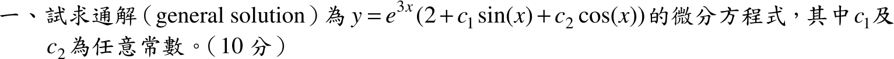

# 105 年第 1 題｜由通解反推微分方程

## 已知與所求

通解 \(y=e^{3x}\bigl(2+c_1\sin x+c_2\cos x\bigr)\)，\(c_1\)、\(c_2\) 為任意常數。求此通解所對應的微分方程式（10 分）。

## 考場標準作答

### 步驟 1：拆成齊次解與特解

\[
y=\underbrace{e^{3x}\bigl(c_1\sin x+c_2\cos x\bigr)}_{y_h}+\underbrace{2e^{3x}}_{y_p}
\]
- \(y_h\) 是 \(e^{\alpha x}(c_1\sin\beta x+c_2\cos\beta x)\) 型，對應共軛複根 \(r=\alpha\pm i\beta\)，此處 \(\alpha=3\)、\(\beta=1\)。
- \(y_p=2e^{3x}\) 不含任意常數，是非齊次項造成的特解。

### 求微分方程式（10 分）

由特徵根組特徵多項式：
\[
\bigl(r-(3+i)\bigr)\bigl(r-(3-i)\bigr)=\bigl((r-3)-i\bigr)\bigl((r-3)+i\bigr)
\]
平方差公式：
\[
=(r-3)^2-i^2=(r-3)^2+1
\]
展開：
\[
=r^2-6r+9+1=r^2-6r+10
\]
故左邊為 \(y''-6y'+10y\)。

特解的導數：
\[
y_p=2e^{3x},\qquad y_p'=6e^{3x},\qquad y_p''=18e^{3x}
\]
特解須滿足原方程，代入左邊即得 \(g(x)\)：
\[
g(x)=y_p''-6y_p'+10y_p=18e^{3x}-6(6e^{3x})+10(2e^{3x})
\]
\[
=18e^{3x}-36e^{3x}+20e^{3x}=2e^{3x}
\]
\[
\boxed{y''-6y'+10y=2e^{3x}}
\]

## 驗算

指數平移：令 \(y=e^{3x}h(x)\)，\(h=2+c_1\sin x+c_2\cos x\)。由 \(y'=e^{3x}(h'+3h)\)、\(y''=e^{3x}(h''+6h'+9h)\)：
\[
y''-6y'+10y=e^{3x}\bigl[(h''+6h'+9h)-6(h'+3h)+10h\bigr]=e^{3x}(h''+h)
\]
\(h''=-c_1\sin x-c_2\cos x\)，故 \(h''+h=2\)，得 \(y''-6y'+10y=2e^{3x}\)，對任意 \(c_1,c_2\) 都成立，一致。

## 失分點

- 常數項 \(2\) 不屬於齊次解，不能漏掉右側 \(2e^{3x}\)，否則得 \(y''-6y'+10y=0\)。
- 虛部 \(\beta=1\)（\(\sin x,\cos x\)），特徵式末項為 \(10=3^2+1^2\)，不是 \(13\)。
