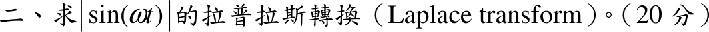
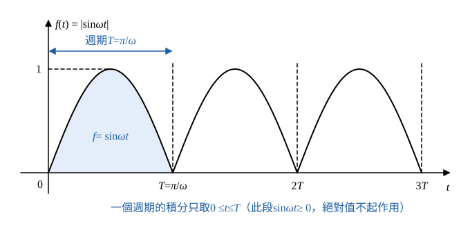

# 105 年第 2 題｜全波整流正弦的拉普拉斯轉換

## 已知與所求

\(f(t)=|\sin\omega t|\)（取 \(\omega>0\)，\(t\ge0\)），求 \(\mathcal L\{f\}\)（20 分）。\(f\) 是週期 \(T=\pi/\omega\) 的週期函數，且在 \(0\le t<T\) 內 \(f=\sin\omega t\)。

## 考場標準作答

### 步驟 1：週期與一個週期內的函數

- 平移半個正弦週期：\(\sin\omega\!\left(t+\tfrac{\pi}{\omega}\right)=\sin(\omega t+\pi)=-\sin\omega t\)，取絕對值後 \(\left|\sin\omega\!\left(t+\tfrac{\pi}{\omega}\right)\right|=|\sin\omega t|\)，所以週期 \(T=\pi/\omega\)（不是 \(2\pi/\omega\)）。
- \(0\le t\le\pi/\omega\) 時 \(0\le\omega t\le\pi\)，\(\sin\omega t\ge0\)，所以這一段 \(f(t)=\sin\omega t\)。

### 步驟 2：一個週期的積分 \(I(s)\)

\[
I(s)=\int_0^{T}e^{-st}f(t)\,dt=\int_0^{\pi/\omega}e^{-st}\sin\omega t\,dt
\]
原函數（分部積分兩次的結果）：
\[
\int e^{-st}\sin\omega t\,dt=-\frac{e^{-st}(s\sin\omega t+\omega\cos\omega t)}{s^2+\omega^2}
\]
對 \(t\) 微分驗證（乘積法則）：
\[
\frac{d}{dt}\Bigl[-e^{-st}(s\sin\omega t+\omega\cos\omega t)\Bigr]=se^{-st}(s\sin\omega t+\omega\cos\omega t)-e^{-st}(s\omega\cos\omega t-\omega^2\sin\omega t)
\]
展開並合併（\(\pm s\omega\cos\omega t\) 相消）：
\[
=e^{-st}\bigl(s^2\sin\omega t+s\omega\cos\omega t-s\omega\cos\omega t+\omega^2\sin\omega t\bigr)
\]
\[
=(s^2+\omega^2)e^{-st}\sin\omega t
\]
除以 \(s^2+\omega^2\) 即被積函數，原函數正確。

上限 \(t=\pi/\omega\)（\(\sin\pi=0\)、\(\cos\pi=-1\)）：
\[
-\frac{e^{-\pi s/\omega}\bigl(s\cdot0+\omega\cdot(-1)\bigr)}{s^2+\omega^2}=\frac{\omega e^{-\pi s/\omega}}{s^2+\omega^2}
\]
下限 \(t=0\)（\(\sin0=0\)、\(\cos0=1\)）：
\[
-\frac{e^{0}\bigl(s\cdot0+\omega\cdot1\bigr)}{s^2+\omega^2}=-\frac{\omega}{s^2+\omega^2}
\]
上限減下限：
\[
I(s)=\frac{\omega e^{-\pi s/\omega}}{s^2+\omega^2}-\left(-\frac{\omega}{s^2+\omega^2}\right)
\]
\[
I(s)=\frac{\omega\left(1+e^{-\pi s/\omega}\right)}{s^2+\omega^2}
\]

### 求 \(\mathcal L\{|\sin\omega t|\}\)（20 分）

\[
F(s)=\frac{1}{1-e^{-sT}}\int_0^Te^{-st}f(t)\,dt=\frac{I(s)}{1-e^{-\pi s/\omega}}
\]
代入 \(I(s)\)：
\[
F(s)=\frac{\omega}{s^2+\omega^2}\cdot\frac{1+e^{-\pi s/\omega}}{1-e^{-\pi s/\omega}}
\]
指數比的分子、分母同乘 \(e^{\pi s/(2\omega)}\)：
\[
\frac{1+e^{-\pi s/\omega}}{1-e^{-\pi s/\omega}}=\frac{e^{\pi s/(2\omega)}+e^{-\pi s/(2\omega)}}{e^{\pi s/(2\omega)}-e^{-\pi s/(2\omega)}}
\]
由 \(\coth x=\dfrac{e^{x}+e^{-x}}{e^{x}-e^{-x}}\)，取 \(x=\dfrac{\pi s}{2\omega}\)：
\[
\frac{e^{\pi s/(2\omega)}+e^{-\pi s/(2\omega)}}{e^{\pi s/(2\omega)}-e^{-\pi s/(2\omega)}}=\coth\frac{\pi s}{2\omega}
\]
\[
\boxed{\mathcal L\{|\sin\omega t|\}=\frac{\omega}{s^2+\omega^2}\coth\!\left(\frac{\pi s}{2\omega}\right),\quad \operatorname{Re}s>0}
\]

## 驗算

不同方法：極限檢查。\(s\to\infty\) 時 \(f\approx\omega t\)（\(t\) 小），\(F\to\omega/s^2\)，公式中 \(\coth\to1\) 吻合。\(s\to0^+\) 時 \(sF(s)\to\) 平均值：\(\coth(x)\approx1/x\)，\(sF\to \dfrac{\omega}{\omega^2}\cdot\dfrac{2\omega}{\pi}=\dfrac2\pi\)，正是 \(|\sin|\) 的平均值 \(\dfrac1\pi\int_0^\pi\sin\theta\,d\theta=\dfrac2\pi\)。

## 失分點

- 本題是 \(|\sin\omega t|\)，不是 \(\sin\omega t\)；直接寫 \(\omega/(s^2+\omega^2)\) 會整題失分。
- 週期是 \(\pi/\omega\)（不是 \(2\pi/\omega\)），分母才是 \(1-e^{-\pi s/\omega}\)。
- 一個週期的積分用 \(0\) 到 \(\pi/\omega\) 的 \(\sin\)，不須分段處理絕對值。
