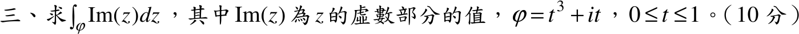

# 105 年第 3 題｜複變線積分

## 已知與所求

路徑 \(\varphi:\ z(t)=t^3+it\)，\(0\le t\le1\)（由 \(z=0\) 到 \(z=1+i\)）。求 \(\displaystyle\int_\varphi\operatorname{Im}(z)\,dz\)（10 分），\(\operatorname{Im}(z)\) 為 \(z\) 的虛部。

## 考場標準作答

**解題邏輯**：先判斷被積函數是否解析：\(\operatorname{Im}(z)\) 不滿足 Cauchy–Riemann 方程，線積分與路徑有關，不能用原函數或柯西積分定理，只能把路徑參數化，以 \(\int_\varphi f(z)\,dz=\int_0^1 f\bigl(z(t)\bigr)\,z'(t)\,dt\) 化成對 \(t\) 的普通積分，再把實部、虛部分開積分。

### 步驟 1：解析性判斷與參數化

令 \(z=x+iy\)，\(f(z)=\operatorname{Im}(z)=y\)，即 \(u(x,y)=y\)、\(v(x,y)=0\)。C–R 方程第二式：
\[
u_y=1,\qquad -v_x=0,\qquad u_y\ne-v_x
\]
故 \(f\) 處處不解析，必須沿給定路徑參數化。由 \(z(t)=t^3+it\)：
\[
x(t)=t^3,\qquad y(t)=t\quad\Longrightarrow\quad\operatorname{Im}\bigl(z(t)\bigr)=t
\]
\[
z'(t)=3t^2+i\quad\Longrightarrow\quad dz=(3t^2+i)\,dt
\]

### 求 \(\displaystyle\int_\varphi\operatorname{Im}(z)\,dz\)（10 分）

**邏輯**：參數化公式把複變線積分化為 \(t\in[0,1]\) 上的實變積分；被積函數展開後實部、虛部各自用冪次積分。

代入參數化：
\[
\int_\varphi\operatorname{Im}(z)\,dz=\int_0^1 t\,(3t^2+i)\,dt
\]
乘開被積函數：
\[
=\int_0^1\bigl(3t^3+it\bigr)\,dt=\int_0^1 3t^3\,dt+i\int_0^1 t\,dt
\]
實部：
\[
\int_0^1 3t^3\,dt=\Bigl[\frac34t^4\Bigr]_0^1=\frac34-0=\frac34
\]
虛部：
\[
\int_0^1 t\,dt=\Bigl[\frac12t^2\Bigr]_0^1=\frac12-0=\frac12
\]
相加：
\[
\boxed{\int_\varphi\operatorname{Im}(z)\,dz=\frac34+\frac i2}=0.75+0.50i
\]

## 驗算

改以 \(y\) 為參數：路徑即 \(x=y^3\)，\(0\le y\le1\)，\(dz=dx+i\,dy=3y^2\,dy+i\,dy\)：
\[
\int_\varphi y\,dz=\int_0^1 y\cdot3y^2\,dy+i\int_0^1 y\,dy=\frac34+\frac i2
\]
一致。另：若改走直線 \(z=(1+i)s\)，得 \(\int_0^1 s(1+i)\,ds=\frac12+\frac i2\ne\frac34+\frac i2\)，證實積分與路徑有關、必須沿題給路徑計算。

## 失分點

- \(\operatorname{Im}(z)=t\) 是實數，不是 \(it\)；多乘 \(i\) 會使實虛部互換且符號錯。
- \(dz\) 要用 \(z'(t)\,dt=(3t^2+i)\,dt\)，不可只寫 \(dt\)。
- 誤以為有原函數而只用端點 \(0\)、\(1+i\) 計算；\(\operatorname{Im}(z)\) 不解析，此法不成立。
