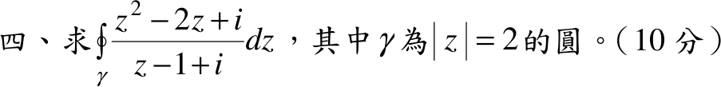
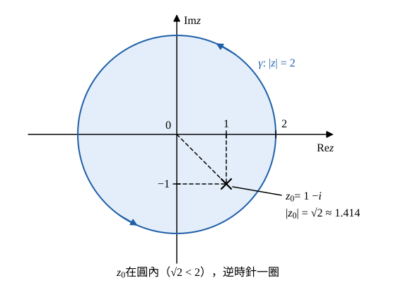

# 105 年第 4 題｜圓周複變積分

## 已知與所求

\(\displaystyle I=\oint_\gamma\frac{z^2-2z+i}{z-1+i}\,dz\)，\(\gamma\) 為圓 \(|z|=2\)。求 \(I\)（10 分）。

## 考場標準作答

**解題邏輯**：分母 \(z-1+i=z-(1-i)\)，被積函數可寫成 \(\dfrac{f(z)}{z-z_0}\)，\(f(z)=z^2-2z+i\) 為多項式（處處解析）、\(z_0=1-i\)。先確認 \(z_0\) 在 \(\gamma\) 內（步驟 1），再用柯西積分公式 \(\oint_\gamma\frac{f(z)}{z-z_0}dz=2\pi i\,f(z_0)\)。前提：題未標方向，閉曲線積分依慣例取正向（逆時針一圈）。

### 步驟 1：奇點位置

唯一奇點為分母零點 \(z_0=1-i\)。其模長：
\[
|z_0|=\sqrt{1^2+(-1)^2}=\sqrt2=1.414
\]
\[
1.414<2\quad\Longrightarrow\quad z_0\ \text{在}\ \gamma\ \text{內部}
\]

### 求 \(I\)（10 分）

**邏輯**：\(f(z)\) 在 \(\gamma\) 上及其內部解析、\(z_0\) 在 \(\gamma\) 內，柯西積分公式成立，積分只由 \(f(z_0)\) 決定。

\[
I=\oint_\gamma\frac{f(z)}{z-z_0}\,dz=2\pi i\,f(z_0)
\]
代入 \(z_0=1-i\)：
\[
f(1-i)=(1-i)^2-2(1-i)+i
\]
平方項（\(i^2=-1\)）：
\[
(1-i)^2=1-2i+i^2=1-2i-1=-2i
\]
一次項：
\[
-2(1-i)=-2+2i
\]
合併：
\[
f(1-i)=-2i+(-2+2i)+i=-2+i
\]
乘 \(2\pi i\)：
\[
I=2\pi i(-2+i)=-4\pi i+2\pi i^2=-4\pi i-2\pi
\]
\[
\boxed{I=-2\pi-4\pi i}\approx-6.28-12.57i
\]

## 驗算

多項式除法：\(z^2-2z+i=(z-z_0)\bigl(z+(z_0-2)\bigr)+r\)，其中 \(z_0-2=-1-i\)，餘數
\[
r=i+(-1-i)(1-i)=i+(-1+i-i+i^2)=i-2
\]
與 \(f(z_0)=-2+i\) 相同。商式 \(z-1-i\) 為多項式，\(\oint_\gamma(z-1-i)\,dz=0\)；餘項 \(\oint_\gamma\frac{r}{z-z_0}dz=2\pi i\,r\)，故 \(I=2\pi i(-2+i)=-2\pi-4\pi i\)。以 \(z=2e^{i\theta}\)（\(0\le\theta\le2\pi\)）做數值圍線積分亦得 \(-6.28-12.57i\)，一致。

## 失分點

- 分母 \(z-1+i=z-(1-i)\)，奇點是 \(1-i\)，不是 \(1+i\)；且要先寫出 \(|1-i|=\sqrt2<2\) 才能套柯西積分公式。
- \(2\pi i\cdot i=2\pi i^2=-2\pi\)，實部符號易錯。
