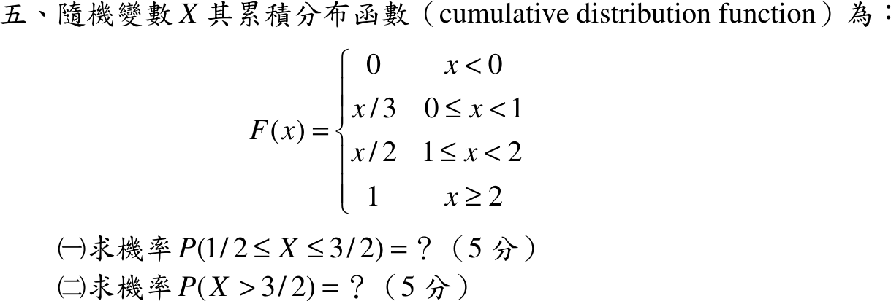
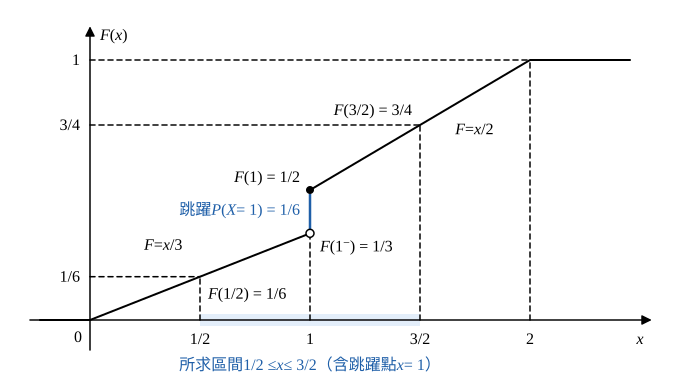

# 105 年第 5 題｜由 CDF 求區間機率

## 已知與所求

\(F(x)=0\ (x<0)\)；\(x/3\ (0\le x<1)\)；\(x/2\ (1\le x<2)\)；\(1\ (x\ge2)\)。求（一）\(P(1/2\le X\le3/2)\)（5 分）；（二）\(P(X>3/2)\)（5 分）。

## 考場標準作答

**解題邏輯**：題目給的是累積分布函數 \(F(x)=P(X\le x)\)，不是密度，區間機率直接用 \(F\) 相減，不必積分。CDF 右連續，在跳躍點有正的機率質量 \(P(X=x_0)=F(x_0)-F(x_0^-)\)（\(x_0^-\) 為左極限）；閉區間含左端點時要用 \(P(a\le X\le b)=F(b)-F(a^-)\)。步驟 1 先找出 \(F\) 的跳躍點並算出各端點的 \(F\) 值，再代入（一）、（二）。

### 步驟 1：分段交界的跳躍與端點的 \(F\) 值

各分段交界的左極限與函數值（左極限用左側那一段的式子）：

- \(x=0\)：\(F(0^-)=0\)，\(F(0)=\tfrac03=0\)，連續。
- \(x=1\)：\(F(1^-)=\lim_{x\to1^-}\tfrac x3=\tfrac13\)，\(F(1)=\tfrac12\)，不連續，跳躍高度即質量：
\[
P(X=1)=F(1)-F(1^-)=\frac12-\frac13=\frac36-\frac26=\frac16
\]
- \(x=2\)：\(F(2^-)=\tfrac22=1\)，\(F(2)=1\)，連續。

兩個區間端點：

- \(x=\tfrac12\) 落在 \(0\le x<1\) 段，且該處連續（左極限等於函數值）：
\[
F\left(\tfrac12^-\right)=F\left(\tfrac12\right)=\frac{1/2}{3}=\frac16
\]
- \(x=\tfrac32\) 落在 \(1\le x<2\) 段，取 \(F(x)=x/2\)：
\[
F\left(\tfrac32\right)=\frac{3/2}{2}=\frac34
\]

### （一）\(P(1/2\le X\le3/2)\)（5 分）

**邏輯**：\(P(a\le X\le b)=P(X\le b)-P(X<a)=F(b)-F(a^-)\)；區間 \(\bigl[\tfrac12,\tfrac32\bigr]\) 內含跳躍點 \(x=1\)，用 \(F\) 相減會自動把質量 \(\tfrac16\) 算進去。

\[
P\left(\tfrac12\le X\le\tfrac32\right)=F\left(\tfrac32\right)-F\left(\tfrac12^-\right)
\]
代入步驟 1：
\[
=\frac34-\frac16
\]
通分（公分母 \(12\)）：
\[
=\frac{9}{12}-\frac{2}{12}=\frac{7}{12}
\]
\[
\boxed{P\left(\tfrac12\le X\le\tfrac32\right)=\frac7{12}\approx0.58}
\]

### （二）\(P(X>3/2)\)（5 分）

**邏輯**：補事件 \(P(X>a)=1-P(X\le a)=1-F(a)\)；嚴格大於的補事件是「\(\le\)」，直接用 \(F\left(\tfrac32\right)\)，不需左極限（\(x=\tfrac32\) 處也無跳躍）。

\[
P\left(X>\tfrac32\right)=1-F\left(\tfrac32\right)
\]
代入步驟 1：
\[
=1-\frac34
\]
\[
\boxed{P\left(X>\tfrac32\right)=\frac14=0.25}
\]

## 驗算

不同方法：拆成連續部分加質量點。\(\left(\tfrac12,1\right)\) 段密度 \(\tfrac13\)：\(\tfrac13\cdot\tfrac12=\tfrac16\)；\(X=1\)：\(\tfrac16\)；\(\left(1,\tfrac32\right)\) 段密度 \(\tfrac12\)：\(\tfrac12\cdot\tfrac12=\tfrac14\)；合計 \(\tfrac16+\tfrac16+\tfrac14=\tfrac7{12}\)。（二）：\(\left(\tfrac32,2\right)\) 段 \(\tfrac12\cdot\tfrac12=\tfrac14\)，一致。總質量 \(\tfrac13+\tfrac16+\tfrac12=1\)。

## 失分點

- 區間含端點 \(1\)，要把 \(x=1\) 的跳躍 \(1/6\) 算進去；若各段單獨用密度積分而漏掉質量點，會得 \(\tfrac5{12}\) 而非 \(\tfrac7{12}\)。
- 用 \(F(3/2)\) 時取 \(x/2\)（\(1\le x<2\)）\(=3/4\)，不是 \(x/3\)。
