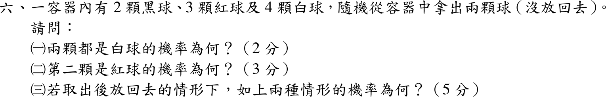
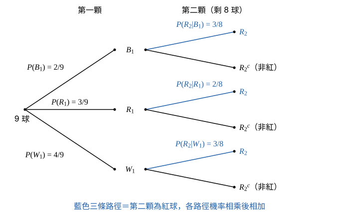

# 105 年第 6 題｜球的抽樣（不放回與放回）

## 已知與所求

2 黑、3 紅、4 白共 9 球，隨機取兩顆（不放回）。求（一）兩顆都是白球（2 分）；（二）第二顆是紅球（3 分）；（三）取出後放回的情形下，上述兩種機率（5 分）。

## 考場標準作答

### 步驟 1：盒內組成與第一顆的機率

設每顆球被取到的機會相等，記 \(B_1,R_1,W_1\) 為第一顆是黑、紅、白，\(R_2,W_2\) 為第二顆是紅、白。總數 \(2+3+4=9\)。第一顆各顏色的機率 = 該色球數 ÷ 9：
\[
P(B_1)=\frac29,\qquad P(R_1)=\frac39,\qquad P(W_1)=\frac49
\]
檢查：\(\tfrac29+\tfrac39+\tfrac49=\tfrac99=1\)。

### （一）不放回，兩顆白球（2 分）

9 球中任取 2 顆的每個組合等可能，有利組合為 4 顆白球中取 2 顆：

\[
P(W_1\cap W_2)=\frac{\binom42}{\binom92}
\]
組合數：
\[
\binom42=\frac{4\cdot3}{2}=6,\qquad \binom92=\frac{9\cdot8}{2}=36
\]
代回：
\[
P(W_1\cap W_2)=\frac{6}{36}
\]
\[
\boxed{P(W_1\cap W_2)=\frac16\approx0.17}
\]

### （二）不放回，第二顆紅球（3 分）

全機率定理：
\[
P(R_2)=P(B_1)P(R_2\mid B_1)+P(R_1)P(R_2\mid R_1)+P(W_1)P(R_2\mid W_1)
\]
條件機率（取走一顆後剩 8 球）：

- 第一顆黑：紅球仍 3 顆，\(P(R_2\mid B_1)=\tfrac38\)。
- 第一顆紅：紅球剩 \(3-1=2\) 顆，\(P(R_2\mid R_1)=\tfrac28\)。
- 第一顆白：紅球仍 3 顆，\(P(R_2\mid W_1)=\tfrac38\)。

三條路徑各自相乘（乘法律）：
\[
P(B_1)P(R_2\mid B_1)=\frac29\cdot\frac38=\frac{6}{72}
\]
\[
P(R_1)P(R_2\mid R_1)=\frac39\cdot\frac28=\frac{6}{72}
\]
\[
P(W_1)P(R_2\mid W_1)=\frac49\cdot\frac38=\frac{12}{72}
\]
相加：
\[
P(R_2)=\frac{6+6+12}{72}=\frac{24}{72}
\]
\[
\boxed{P(R_2)=\frac13\approx0.33}
\]

### （三）放回（5 分）

放回後盒內又是 2 黑、3 紅、4 白，兩次抽取獨立且機率相同，交集機率為兩次機率相乘。

兩顆白球：
\[
P(W_1\cap W_2)=P(W_1)P(W_2)=\frac49\cdot\frac49
\]
\[
\boxed{P(W_1\cap W_2)=\frac{16}{81}\approx0.20}
\]
第二顆紅球：第二次抽取不受第一次影響，直接用盒內紅球比例：
\[
P(R_2)=\frac{\text{紅球數}}{\text{總球數}}=\frac39
\]
\[
\boxed{P(R_2)=\frac39=\frac13\approx0.33}
\]
（以全機率定理核對：\(\bigl(\tfrac29+\tfrac39+\tfrac49\bigr)\cdot\tfrac39=1\cdot\tfrac39\)，相同；與不放回時一樣。）

## 驗算

依序抽取核對（一）：\(P(W_1)P(W_2\mid W_1)=\tfrac49\cdot\tfrac38=\tfrac{12}{72}=\tfrac16\)，與組合法相同。對稱性核對（二）：不放回時每顆球出現在第二位的機會均等，故 \(P(R_2)=\tfrac39=\tfrac13\)，與全機率結果相同。

## 失分點

- 不放回第二次的分母是 \(8\) 球，白球剩 \(3\) 顆。
- 第二顆為紅球時，不可把第一顆的所有情形（黑、白、紅）漏掉任何一類。
- 放回時兩白的機率是 \(\left(\tfrac49\right)^2=\tfrac{16}{81}\)，不是 \(\tfrac16\)。
