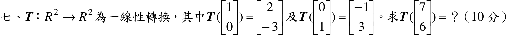

# 105 年第 7 題｜線性轉換的計算

## 已知與所求

\(\mathbf T:\mathbb R^2\to\mathbb R^2\) 為線性轉換，\(\mathbf T\begin{bmatrix}1\\0\end{bmatrix}=\begin{bmatrix}2\\-3\end{bmatrix}\)、\(\mathbf T\begin{bmatrix}0\\1\end{bmatrix}=\begin{bmatrix}-1\\3\end{bmatrix}\)。求 \(\mathbf T\begin{bmatrix}7\\6\end{bmatrix}\)（10 分）。

## 考場標準作答

**解題邏輯**：線性轉換由基底的像唯一決定。把 \((7,6)^T\) 寫成標準基底 \(\mathbf e_1=(1,0)^T\)、\(\mathbf e_2=(0,1)^T\) 的線性組合，再用線性性 \(\mathbf T(a\mathbf u+b\mathbf v)=a\mathbf T(\mathbf u)+b\mathbf T(\mathbf v)\) 把題給的兩個像組合起來。

### 步驟 1：以標準基底表示輸入向量

\[
\begin{bmatrix}7\\6\end{bmatrix}=7\begin{bmatrix}1\\0\end{bmatrix}+6\begin{bmatrix}0\\1\end{bmatrix}=7\mathbf e_1+6\mathbf e_2
\]

### 求 \(\mathbf T\begin{bmatrix}7\\6\end{bmatrix}\)（10 分）

**邏輯**：\(\mathbf T\) 線性，係數 7、6 可提出，只需代入題給的 \(\mathbf T(\mathbf e_1)\)、\(\mathbf T(\mathbf e_2)\)。

線性性：
\[
\mathbf T(7\mathbf e_1+6\mathbf e_2)=7\,\mathbf T(\mathbf e_1)+6\,\mathbf T(\mathbf e_2)
\]
代入兩個像：
\[
=7\begin{bmatrix}2\\-3\end{bmatrix}+6\begin{bmatrix}-1\\3\end{bmatrix}
\]
純量乘法：
\[
=\begin{bmatrix}14\\-21\end{bmatrix}+\begin{bmatrix}-6\\18\end{bmatrix}
\]
逐分量相加：
\[
=\begin{bmatrix}14-6\\-21+18\end{bmatrix}
\]
\[
\mathbf T\begin{bmatrix}7\\6\end{bmatrix}=\boxed{\begin{bmatrix}8\\-3\end{bmatrix}}
\]

## 驗算

標準矩陣：兩個基底像依序作為欄，\([\mathbf T]=\begin{bmatrix}2&-1\\-3&3\end{bmatrix}\)。矩陣乘法：
\[
[\mathbf T]\begin{bmatrix}7\\6\end{bmatrix}=\begin{bmatrix}(2)(7)+(-1)(6)\\(-3)(7)+(3)(6)\end{bmatrix}=\begin{bmatrix}14-6\\-21+18\end{bmatrix}=\begin{bmatrix}8\\-3\end{bmatrix}
\]
一致。

## 失分點

- 標準矩陣要把基底的像放成「欄」；誤放成列 \(\begin{bmatrix}2&-3\\-1&3\end{bmatrix}\) 會得 \((-4,\ 11)^T\)。
- 第二分量 \((-3)(7)+(3)(6)=-21+18=-3\)，負號易漏。
