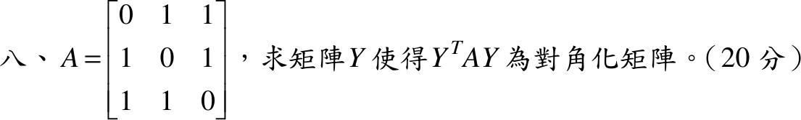

# 105 年第 8 題｜實對稱矩陣的對角化

## 已知與所求

\(A=\begin{bmatrix}0&1&1\\1&0&1\\1&1&0\end{bmatrix}\)，求 \(Y\) 使 \(Y^TAY\) 為對角矩陣（20 分）。取 \(Y\) 為正交矩陣（\(Y^T=Y^{-1}\)），則 \(Y^TAY\) 即相似對角化。

## 考場標準作答

**解題邏輯**：\(A\) 為實對稱矩陣（\(A^T=A\)），由譜定理必可找到正交矩陣 \(Y\)（\(Y^T=Y^{-1}\)）使 \(Y^TAY=Y^{-1}AY=\Lambda\) 為對角矩陣，且 \(Y\) 的各欄就是 \(A\) 的單位正交特徵向量。依序：解特徵方程 \(\det(A-\lambda I)=0\) 得特徵值 → 對每個特徵值解 \((A-\lambda I)\mathbf x=\mathbf 0\) 得特徵向量 → 二重特徵值的特徵空間內另取互相正交的兩個向量 → 全部單位化後並排成 \(Y\)。

### 步驟 1：特徵值

\[
A-\lambda I=\begin{bmatrix}-\lambda&1&1\\1&-\lambda&1\\1&1&-\lambda\end{bmatrix}
\]
沿第一列展開（餘因子符號 \(+,-,+\)）：
\[
\det(A-\lambda I)=-\lambda\bigl[(-\lambda)(-\lambda)-(1)(1)\bigr]-1\bigl[(1)(-\lambda)-(1)(1)\bigr]+1\bigl[(1)(1)-(-\lambda)(1)\bigr]
\]
化簡三個 \(2\times2\) 行列式：
\[
=-\lambda(\lambda^2-1)-(-\lambda-1)+(1+\lambda)
\]
去括號：
\[
=-\lambda^3+\lambda+\lambda+1+1+\lambda
\]
合併同類項：
\[
=-\lambda^3+3\lambda+2=-(\lambda^3-3\lambda-2)
\]
試根 \(\lambda=-1\)：\((-1)^3-3(-1)-2=-1+3-2=0\)，故 \((\lambda+1)\) 為因式；長除法：
\[
\lambda^3-3\lambda-2=(\lambda+1)(\lambda^2-\lambda-2)
\]
二次式因式分解：
\[
\lambda^2-\lambda-2=(\lambda-2)(\lambda+1)
\]
\[
\det(A-\lambda I)=-(\lambda-2)(\lambda+1)^2=0
\quad\Longrightarrow\quad
\lambda_1=2\ (\text{單根}),\qquad \lambda_2=\lambda_3=-1\ (\text{二重根})
\]

### 步驟 2：特徵向量與二重根空間的正交化

\(\lambda_1=2\)：
\[
A-2I=\begin{bmatrix}-2&1&1\\1&-2&1\\1&1&-2\end{bmatrix},\qquad
\begin{cases}-2x_1+x_2+x_3=0\\ \phantom{-2}x_1-2x_2+x_3=0\end{cases}
\]
第一式減第二式消去 \(x_3\)：
\[
-3x_1+3x_2=0\quad\Longrightarrow\quad x_2=x_1
\]
代回第一式：
\[
x_3=2x_1-x_2=2x_1-x_1=x_1
\]
令 \(x_1=1\)：\(\mathbf p_1=(1,\ 1,\ 1)^T\)。

\(\lambda_2=\lambda_3=-1\)：\(A+I\) 三列皆為 \((1,1,1)\)，只剩一條方程
\[
x_1+x_2+x_3=0
\]
兩個自由變數，特徵空間為二維。取 \(x_1=1,\ x_2=-1\)，則 \(x_3=0\)：\(\mathbf p_2=(1,\ -1,\ 0)^T\)。

第三個向量 \(\mathbf p_3=(a,b,c)^T\) 要同時在此平面上且與 \(\mathbf p_2\) 正交：
\[
a+b+c=0,\qquad \mathbf p_2\cdot\mathbf p_3=a-b=0
\]
由第二式 \(b=a\)，代入第一式：
\[
c=-a-b=-2a
\]
令 \(a=1\)：\(\mathbf p_3=(1,\ 1,\ -2)^T\)。

兩兩正交檢查（相異特徵值的特徵向量本來就正交，二重根內的已由上式保證）：
\[
\mathbf p_1\cdot\mathbf p_2=1-1+0=0,\qquad
\mathbf p_1\cdot\mathbf p_3=1+1-2=0,\qquad
\mathbf p_2\cdot\mathbf p_3=1-1+0=0
\]

### 求矩陣 \(Y\)（20 分）

**邏輯**：正交矩陣的各欄必須是單位長且兩兩正交；把步驟 2 的三個向量各除以長度即可。由 \(A\mathbf y_i=\lambda_i\mathbf y_i\) 逐欄合寫得 \(AY=Y\Lambda\)，左乘 \(Y^T\) 並用 \(Y^TY=I\) 即得 \(Y^TAY=\Lambda\)。

三個長度：
\[
\lVert\mathbf p_1\rVert=\sqrt{1^2+1^2+1^2}=\sqrt3,\qquad
\lVert\mathbf p_2\rVert=\sqrt{1^2+(-1)^2+0^2}=\sqrt2,\qquad
\lVert\mathbf p_3\rVert=\sqrt{1^2+1^2+(-2)^2}=\sqrt6
\]
單位化 \(\mathbf y_i=\mathbf p_i/\lVert\mathbf p_i\rVert\)，依 \(\lambda_1,\lambda_2,\lambda_3\) 的順序排成欄：
\[
\boxed{Y=\begin{bmatrix}\tfrac1{\sqrt3}&\tfrac1{\sqrt2}&\tfrac1{\sqrt6}\\\tfrac1{\sqrt3}&-\tfrac1{\sqrt2}&\tfrac1{\sqrt6}\\\tfrac1{\sqrt3}&0&-\tfrac2{\sqrt6}\end{bmatrix}}
\]
\(Y\) 的欄為單位正交，故 \(Y^TY=I\)；由 \(AY=Y\Lambda\)：
\[
Y^TAY=Y^TY\Lambda=I\Lambda=\Lambda
\]
\[
Y^TAY=\boxed{\begin{bmatrix}2&0&0\\0&-1&0\\0&0&-1\end{bmatrix}}
\]
\(Y\) 不唯一：二重特徵空間可取任意一組正交基底，欄的順序也可更換（對角元順序隨之改變）。

## 驗算

特徵值和與積：\(\operatorname{tr}A=0+0+0=0=2+(-1)+(-1)\)；\(\det A\) 沿第一列展開 \(=0-1(0-1)+1(1-0)=2=2\cdot(-1)\cdot(-1)\)。逐欄核對 \(A\mathbf p_1=(0+1+1,\ 1+0+1,\ 1+1+0)^T=(2,2,2)^T=2\mathbf p_1\)，\(A\mathbf p_3=(0+1-2,\ 1+0-2,\ 1+1+0)^T=(-1,-1,2)^T=-\mathbf p_3\)。數值 \(\texttt{eigh}\) 得特徵值 \(-1,-1,2\)，且 \(Y^TY=I\)。

## 失分點

- 二重根 \(\lambda=-1\) 的兩個特徵向量需彼此正交；\((1,-1,0)\) 與 \((1,0,-1)\) 不正交，須再正交化。
- 單位化漏掉 \(\sqrt6\)（\((1,1,-2)\) 長度為 \(\sqrt6\)）會使 \(Y^TY\ne I\)。
- \(Y\) 的欄序必須與 \(Y^TAY\) 對角元順序一致。
