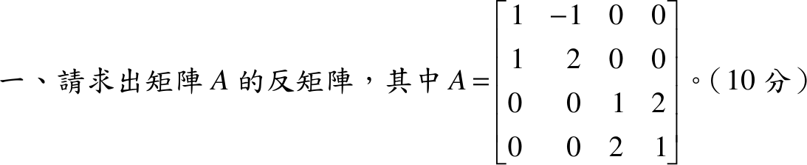

# 106 年第 1 題｜求矩陣反矩陣

## 已知與所求

\(A=\begin{bmatrix}1&-1&0&0\\1&2&0&0\\0&0&1&2\\0&0&2&1\end{bmatrix}\)，求 \(A^{-1}\)（10 分）。

## 考場標準作答

### 步驟 1：分塊與 \(2\times2\) 反矩陣公式

\[
A=\begin{bmatrix}B_1&O\\O&B_2\end{bmatrix},\qquad
B_1=\begin{bmatrix}1&-1\\1&2\end{bmatrix},\qquad
B_2=\begin{bmatrix}1&2\\2&1\end{bmatrix}
\]
兩個區塊共用的公式（\(ad-bc\ne0\)）：
\[
\begin{bmatrix}a&b\\c&d\end{bmatrix}^{-1}=\frac1{ad-bc}\begin{bmatrix}d&-b\\-c&a\end{bmatrix}
\]

### 求反矩陣 \(A^{-1}\)（10 分）

\(B_1\) 的行列式：
\[
\det B_1=(1)(2)-(-1)(1)=2+1=3
\]
\(\det B_1=3\ne0\)，\(B_1\) 可逆。
\(B_1\) 的反矩陣（對角互換 \(1\leftrightarrow2\)，非對角 \(-1,\,1\) 變號為 \(1,\,-1\)）：
\[
B_1^{-1}=\frac13\begin{bmatrix}2&1\\-1&1\end{bmatrix}
\]
\(B_2\) 的行列式：
\[
\det B_2=(1)(1)-(2)(2)=1-4=-3
\]
\(\det B_2=-3\ne0\)，\(B_2\) 可逆（兩區塊都可逆，\(A\) 才能逐塊求逆）。
\(B_2\) 的反矩陣：
\[
B_2^{-1}=\frac1{-3}\begin{bmatrix}1&-2\\-2&1\end{bmatrix}
\]
把 \(-1\) 乘進矩陣，前係數改為 \(\tfrac13\)：
\[
B_2^{-1}=\frac13\begin{bmatrix}-1&2\\2&-1\end{bmatrix}
\]
放回分塊對角位置：
\[
A^{-1}=\begin{bmatrix}B_1^{-1}&O\\O&B_2^{-1}\end{bmatrix}
\]
\[
\boxed{A^{-1}=\frac13\begin{bmatrix}2&1&0&0\\-1&1&0&0\\0&0&-1&2\\0&0&2&-1\end{bmatrix}}
\]

## 驗算

\(B_1B_1^{-1}=\tfrac13\begin{bmatrix}1\cdot2+(-1)(-1)&1\cdot1+(-1)(1)\\1\cdot2+2(-1)&1\cdot1+2\cdot1\end{bmatrix}=\tfrac13\begin{bmatrix}3&0\\0&3\end{bmatrix}=I\)，\(B_2B_2^{-1}=\tfrac13\begin{bmatrix}1(-1)+2\cdot2&1\cdot2+2(-1)\\2(-1)+1\cdot2&2\cdot2+1(-1)\end{bmatrix}=\tfrac13\begin{bmatrix}3&0\\0&3\end{bmatrix}=I\)；且 \(\det A=\det B_1\cdot\det B_2=3\cdot(-3)=-9\neq0\)，\(A\) 可逆。

## 失分點

- \(B_2\) 的行列式是 \(1-4=-3\)（負值），前係數 \(1/\det B_2=-\tfrac13\) 為負，整個 \(B_2^{-1}\) 變號；常誤取 \(+3\) 而漏掉這個變號。
- \(2\times2\) 反矩陣是「對角互換、非對角變號」，把對角元也變號會錯。
