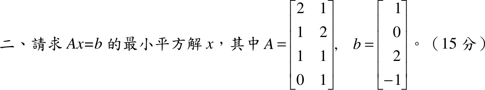

# 106 年第 2 題｜線性系統的最小平方解

## 已知與所求

\(A=\begin{bmatrix}2&1\\1&2\\1&1\\0&1\end{bmatrix}\)、\(b=(1,0,2,-1)^T\)（15 分），求 \(Ax=b\) 的最小平方解 \(x\)。

## 考場標準作答

**解題邏輯**：\(Ax=b\) 是 4 條方程、2 個未知數的超定系統，一般無解；最小平方解使 \(\lVert b-Ax\rVert^2\) 最小，等價於殘差 \(b-Ax\) 與 \(A\) 的行空間正交，即 \(A^T(b-Ax)=\mathbf 0\)，得正規方程 \(A^TAx=A^Tb\)。\(A\) 的兩行不成比例（線性獨立），\(A^TA\) 可逆，解唯一。依序算 \(A^TA\)、\(A^Tb\)、\((A^TA)^{-1}\)，再相乘。

### 步驟 1：正規方程的兩個係數

\(A^TA\) 的元素是 \(A\) 各行的內積（\(\mathbf a_1=(2,1,1,0)^T\)、\(\mathbf a_2=(1,2,1,1)^T\)）：
\[
\mathbf a_1\cdot\mathbf a_1=2^2+1^2+1^2+0^2=4+1+1+0=6
\]
\[
\mathbf a_1\cdot\mathbf a_2=(2)(1)+(1)(2)+(1)(1)+(0)(1)=2+2+1+0=5
\]
\[
\mathbf a_2\cdot\mathbf a_2=1^2+2^2+1^2+1^2=1+4+1+1=7
\]
\[
A^TA=\begin{bmatrix}6&5\\5&7\end{bmatrix}
\]
\(A^Tb\) 的元素是各行與 \(b=(1,0,2,-1)^T\) 的內積：
\[
\mathbf a_1\cdot b=(2)(1)+(1)(0)+(1)(2)+(0)(-1)=2+0+2+0=4
\]
\[
\mathbf a_2\cdot b=(1)(1)+(2)(0)+(1)(2)+(1)(-1)=1+0+2-1=2
\]
\[
A^Tb=\begin{bmatrix}4\\2\end{bmatrix}
\]

### 求最小平方解 \(x\)（15 分）

**邏輯**：解正規方程 \(A^TAx=A^Tb\)；\(A^TA\) 為 \(2\times2\) 可逆矩陣，用 \(\begin{bmatrix}a&b\\c&d\end{bmatrix}^{-1}=\frac1{ad-bc}\begin{bmatrix}d&-b\\-c&a\end{bmatrix}\) 求逆後左乘 \(A^Tb\)。

行列式：
\[
\det(A^TA)=(6)(7)-(5)(5)=42-25=17
\]
反矩陣：
\[
(A^TA)^{-1}=\frac1{17}\begin{bmatrix}7&-5\\-5&6\end{bmatrix}
\]
\[
x=(A^TA)^{-1}A^Tb=\frac1{17}\begin{bmatrix}7&-5\\-5&6\end{bmatrix}\begin{bmatrix}4\\2\end{bmatrix}
\]
矩陣乘向量（逐列內積）：
\[
=\frac1{17}\begin{bmatrix}(7)(4)+(-5)(2)\\(-5)(4)+(6)(2)\end{bmatrix}
=\frac1{17}\begin{bmatrix}28-10\\-20+12\end{bmatrix}
=\frac1{17}\begin{bmatrix}18\\-8\end{bmatrix}
\]
\[
\boxed{x=\begin{bmatrix}18/17\\-8/17\end{bmatrix}}\approx\begin{bmatrix}1.06\\-0.47\end{bmatrix}
\]

## 驗算

\(Ax=\tfrac1{17}(2\cdot18-8,\ 18-16,\ 18-8,\ -8)^T=\tfrac1{17}(28,\,2,\,10,\,-8)^T\)；殘差 \(r=b-Ax=\tfrac1{17}(17-28,\ 0-2,\ 34-10,\ -17+8)^T=\tfrac1{17}(-11,\,-2,\,24,\,-9)^T\)，\(A^Tr=\tfrac1{17}(-22-2+24,\ -11-4+24-9)^T=\mathbf 0\)，殘差與 \(A\) 的行空間正交，確為最小平方解。

## 失分點

- \(A^Tb\) 第 2 分量是 \(1+0+2-1=2\)，不是 \(1\)；漏掉 \(-1\) 項會得 \(x=(23/17,\,-14/17)\)。
- 直接取前兩列解 \(2\times2\) 方程只滿足其中兩條，不是最小平方解。
