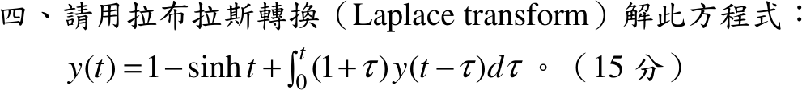

# 106 年第 4 題｜積分方程

## 已知與所求

\(y(t)=1-\sinh t+\int_0^t(1+\tau)\,y(t-\tau)\,d\tau\)（15 分），以拉氏轉換求 \(y(t)\)。

## 考場標準作答

### 步驟 1：辨識卷積並列出所需轉換

設 \(y(t)\) 的拉氏轉換存在。卷積定義 \((g*y)(t)=\int_0^tg(\tau)\,y(t-\tau)\,d\tau\)，取 \(g(\tau)=1+\tau\)：
\[
\int_0^t(1+\tau)\,y(t-\tau)\,d\tau=(g*y)(t),\qquad g(t)=1+t
\]
卷積定理 \(\mathcal L\{g*y\}=G(s)\,Y(s)\)。所需的查表轉換：
\[
\mathcal L\{1\}=\frac1s,\qquad \mathcal L\{t\}=\frac1{s^2},\qquad \mathcal L\{\sinh t\}=\frac1{s^2-1}
\]
由線性：
\[
G(s)=\mathcal L\{1+t\}=\frac1s+\frac1{s^2}
\]

### 求 \(y(t)\)（15 分）

全式取轉換：
\[
Y=\frac1s-\frac1{s^2-1}+\left(\frac1s+\frac1{s^2}\right)Y
\]
\(Y\) 項移到左邊：
\[
Y-\left(\frac1s+\frac1{s^2}\right)Y=\frac1s-\frac1{s^2-1}
\]
左邊提出 \(Y\) 並通分（分母 \(s^2\)）：
\[
Y\cdot\frac{s^2-s-1}{s^2}=\frac1s-\frac1{s^2-1}
\]
右邊通分（分母 \(s(s^2-1)\)）：
\[
\frac1s-\frac1{s^2-1}=\frac{(s^2-1)-s}{s(s^2-1)}=\frac{s^2-s-1}{s(s^2-1)}
\]
兩邊同乘 \(\dfrac{s^2}{s^2-s-1}\)：
\[
Y=\frac{s^2-s-1}{s(s^2-1)}\cdot\frac{s^2}{s^2-s-1}
\]
約去 \(s^2-s-1\)：
\[
Y=\frac{s^2}{s(s^2-1)}
\]
約去 \(s\)：
\[
Y=\frac{s}{s^2-1}
\]
查表 \(\mathcal L\{\cosh t\}=\dfrac{s}{s^2-1}\)：
\[
\boxed{y(t)=\cosh t}
\]

## 驗算

回代時域：\(\int_0^t\cosh(t-\tau)d\tau=\sinh t\)，\(\int_0^t\tau\cosh(t-\tau)d\tau=\cosh t-1\)，所以右側 \(=1-\sinh t+\sinh t+\cosh t-1=\cosh t\)，等於左側。

## 失分點

- 卷積核是 \(1+\tau\)（拉氏轉換 \(\tfrac1s+\tfrac1{s^2}\)），若只取 \(\tfrac1s\) 會少掉 \(\tau\) 項而得錯誤解。
- \(\mathcal L\{\sinh t\}=\dfrac1{s^2-1}\)，符號前有負號，通分時別與 \(\tfrac1s\) 相消。
- 兩邊出現相同因式 \(s^2-s-1\) 是本題設計，要先通分才看得出可約；未通分直接硬解容易算錯。
