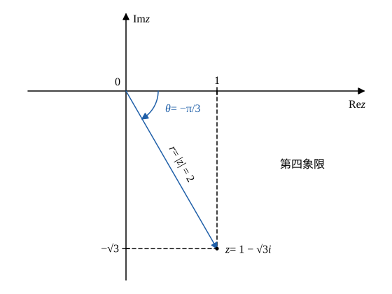

# 106 年第 5 題｜複數高次方

## 已知與所求

複數 \(z=1-\sqrt3\,i\)，求 \(z^{12}\)（15 分）。

## 考場標準作答

### 步驟 1：模長與輻角（極式）

模長：
\[
r=|z|=\sqrt{1^2+(-\sqrt3)^2}
\]
\[
=\sqrt{1+3}=\sqrt4=2
\]
輻角：實部 \(1>0\)、虛部 \(-\sqrt3<0\)，\(z\) 在第四象限（圖 1）：
\[
\tan\theta=\frac{-\sqrt3}{1}=-\sqrt3
\]
參考角 \(\tan^{-1}\sqrt3=\pi/3\)，第四象限取負角：
\[
\theta=\arg z=-\frac\pi3
\]

極式：
\[
z=2e^{-i\pi/3}
\]

### 求 \(z^{12}\)（15 分）

套用 De Moivre（\(n=12\)）：
\[
z^{12}=2^{12}e^{i\cdot12\cdot(-\pi/3)}
\]
模長與輻角分別計算：
\[
2^{12}=4096,\qquad 12\cdot\Bigl(-\frac\pi3\Bigr)=-4\pi
\]
\[
z^{12}=4096\,e^{-4\pi i}
\]
Euler 公式（\(\cos\) 為偶函數、\(\sin\) 為奇函數）：
\[
e^{-4\pi i}=\cos4\pi-i\sin4\pi=1-i\cdot0=1
\]
\[
z^{12}=4096\times1
\]
\[
\boxed{z^{12}=4096}
\]

## 驗算

直接相乘：\(z^2=(1-\sqrt3i)^2=1-2\sqrt3i+3i^2=-2-2\sqrt3\,i\)，\(z^3=z^2\cdot z=(-2-2\sqrt3i)(1-\sqrt3i)=-2+2\sqrt3i-2\sqrt3i+6i^2=-8\)，\(z^{12}=(z^3)^4=(-8)^4=4096\)。

## 失分點

- 誤取 \(\arg z=+\pi/3\)（把 \(z\) 當成第一象限）寫出 \(z=2e^{i\pi/3}\)，極式錯誤會被扣過程分，雖然 \(12\) 次方的最終值恰好相同。
- 模長 \(2\) 的 \(12\) 次方是 \(2^{12}=4096\)，不是 \(2\cdot12\)。
