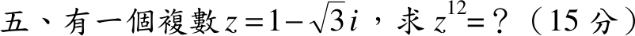

# 106 年第 5 題｜複數高次方

## 已知與所求

複數 \(z=1-\sqrt3\,i\)，求 \(z^{12}\)（15 分）。

## 考場標準作答

觀念：高次方用極式與 De Moivre 定理 \(\left(re^{i\theta}\right)^n=r^ne^{in\theta}\) 最快，不必連乘 12 次；先求模長與輻角（複數平面上 \(z\) 的點在實軸 \(+1\)、虛軸 \(-\sqrt3\)，位於第四象限）。

模長：
\[
|z|=\sqrt{1^2+(\sqrt3)^2}=\sqrt{1+3}=2
\]
輻角：\(\tan\theta=\dfrac{-\sqrt3}{1}\)，第四象限，故
\[
\theta=\arg z=-\frac\pi3\Rightarrow z=2e^{-i\pi/3}
\]
套用 De Moivre（\(n=12\)）：
\[
z^{12}=2^{12}e^{-i\cdot12\pi/3}=4096\,e^{-4\pi i}
\]
\[
e^{-4\pi i}=\cos4\pi-i\sin4\pi=1-0=1
\]
\[
\boxed{z^{12}=4096}
\]

## 驗算

直接相乘：\(z^2=-2-2\sqrt3\,i\)，\(z^3=z^2\cdot z=-2-6=-8\)，\(z^{12}=(z^3)^4=(-8)^4=4096\)。

## 失分點

- 誤取 \(\arg z=+\pi/3\)（把 \(z\) 當成第一象限）寫出 \(z=2e^{i\pi/3}\)，極式錯誤會被扣過程分，雖然 \(12\) 次方的最終值恰好相同。
- 模長 \(2\) 的 \(12\) 次方是 \(2^{12}=4096\)，不是 \(2\cdot12\)。
