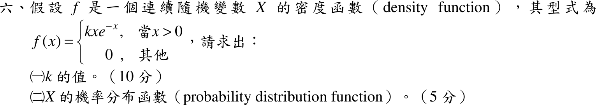

# 106 年第 6 題｜密度常數與 CDF

## 已知與所求

\(f(x)=kxe^{-x}\)（\(x>0\)），其餘為 0。求（一）\(k\)（10 分）；（二）\(X\) 的機率分布函數（5 分）。

## 考場標準作答

### （一）常數 \(k\)

觀念：密度函數必須非負且在整個實數軸上總面積為 \(1\)（歸一化條件），\(x\le0\) 處 \(f=0\)，所以只需對 \(x>0\) 積分。
\[
\int_{-\infty}^{\infty}f(x)\,dx=\int_0^\infty kxe^{-x}\,dx=1
\]
\(\int_0^\infty x^{n}e^{-x}dx=\Gamma(n+1)=n!\)，取 \(n=1\)：
\[
\int_0^\infty xe^{-x}\,dx=\Gamma(2)=1!=1
\]
代回歸一化條件：
\[
k\cdot1=1\ \Rightarrow\ \boxed{k=1}
\]

### （二）機率分布函數

觀念：分布函數 \(F(x)=P(X\le x)=\int_{-\infty}^{x}f(u)\,du\)，因 \(f\) 在 \(x=0\) 分段，須分 \(x\le0\) 與 \(x>0\) 兩段討論。

\(x\le0\)：積分區間內 \(f=0\)，故 \(F(x)=0\)。

\(x>0\)：以 \(k=1\) 代入並用分部積分（\(\int ue^{-u}du=-ue^{-u}-e^{-u}\)）：
\[
F(x)=\int_0^x ue^{-u}\,du=\bigl[-(u+1)e^{-u}\bigr]_0^x
\]
代入上下限：
\[
F(x)=-(x+1)e^{-x}-\bigl(-(0+1)e^{0}\bigr)=1-(x+1)e^{-x}
\]
合併兩段：
\[
\boxed{F(x)=\begin{cases}0,&x\le0\\[2pt]1-(x+1)e^{-x},&x>0\end{cases}}
\]

## 驗算

\(F'(x)=(x+1)e^{-x}-e^{-x}=xe^{-x}=f(x)\)；\(F(0)=0\)，\(F(\infty)=1\)，且 \(F\) 遞增，符合分布函數性質。

## 失分點

- 分部積分 \(\int ue^{-u}du=-(u+1)e^{-u}\)，代入下限 \(0\) 時別漏掉 \(+1\)。
- \(F(x)\) 要分段寫出 \(x\le0\) 的 \(0\)。
