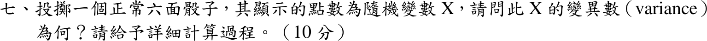

# 106 年第 7 題｜公平六面骰子的變異數

## 已知與所求

投擲一個正常六面骰子，點數為隨機變數 \(X\)。求 \(X\) 的變異數 \(\operatorname{Var}(X)\)，需列詳細計算過程（10 分）。

## 考場標準作答

### 步驟 1：機率分布

六個點數等機率：
\[
P(X=k)=\frac16,\qquad k=1,2,\ldots,6
\]
總和檢查：\(6\times\tfrac16=1\)。

### 步驟 2：一次動差 \(E[X]\)

離散期望值定義 \(E[X]=\sum_k k\,P(X=k)\)，常數 \(\tfrac16\) 提出：
\[
E[X]=\sum_{k=1}^{6}k\cdot\frac16=\frac16\sum_{k=1}^{6}k
\]
點數和：
\[
\sum_{k=1}^{6}k=1+2+3+4+5+6=21
\]
代回：
\[
E[X]=\frac{21}{6}=\frac72
\]

### 步驟 3：二次動差 \(E[X^2]\)

函數的期望值 \(E[g(X)]=\sum_k g(k)P(X=k)\)，取 \(g(k)=k^2\)：
\[
E[X^2]=\sum_{k=1}^{6}k^2\cdot\frac16=\frac16\sum_{k=1}^{6}k^2
\]
平方和：
\[
\sum_{k=1}^{6}k^2=1+4+9+16+25+36=91
\]
代回：
\[
E[X^2]=\frac{91}{6}
\]

### 變異數 \(\operatorname{Var}(X)\)（10 分）

\[
\operatorname{Var}(X)=E[X^2]-(E[X])^2
\]
代入步驟 2、3：
\[
\operatorname{Var}(X)=\frac{91}{6}-\left(\frac72\right)^2
\]
平方：
\[
\left(\frac72\right)^2=\frac{49}{4}
\]
相減（公分母 \(12\)）：
\[
\operatorname{Var}(X)=\frac{91}{6}-\frac{49}{4}=\frac{182}{12}-\frac{147}{12}=\frac{35}{12}
\]
\[
\boxed{\operatorname{Var}(X)=\frac{35}{12}\approx2.92}
\]

## 驗算

用定義 \(E[(X-\mu)^2]\)，\(\mu=\tfrac72=3.5\)：六個點數的偏差為 \(\pm0.5,\ \pm1.5,\ \pm2.5\)，
\[
\operatorname{Var}(X)=\frac16\cdot2\,(0.25+2.25+6.25)=\frac16\cdot17.5=\frac{35}{12}
\]
另以離散均勻 \(1,\ldots,n\) 的公式 \(\frac{n^2-1}{12}=\frac{36-1}{12}=\frac{35}{12}\)，一致。

## 失分點

- 把 \(E[X^2]=\tfrac{91}{6}\) 當成 \((E[X])^2=\tfrac{49}{4}\)，相減得 \(0\)。
- 平方和 \(91\) 忘了乘機率 \(\tfrac16\)，得 \(91-12.25\)。
- 用樣本變異數的除數 \(n-1=5\)（得 \(17.5/5=3.5\)）；此處是母體（機率分布）變異數，用機率加權。
