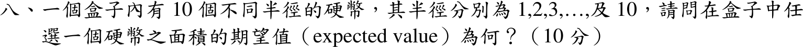

# 106 年第 8 題｜硬幣面積期望值

## 考場標準作答

觀念：任選一枚，10 種半徑各以 \(\tfrac1{10}\) 機率出現（離散均勻），面積 \(\pi R^2\) 是 \(R\) 的函數，期望值為 \(E[g(R)]=\sum g(r)P(R=r)\)，須先平方再平均，不可先求平均半徑。
\[
E[\pi R^2]=\sum_{r=1}^{10}\pi r^2\cdot\frac1{10}=\frac{\pi}{10}\sum_{r=1}^{10}r^2
\]
平方和公式 \(\sum_{r=1}^{n}r^2=\dfrac{n(n+1)(2n+1)}{6}\)，\(n=10\)：
\[
\sum_{r=1}^{10}r^2=\frac{10\cdot11\cdot21}{6}=385
\]
代回期望值：
\[
E[\pi R^2]=\frac{\pi}{10}\cdot385=\frac{77\pi}{2}=38.50\pi
\]
\[
\boxed{\frac{77\pi}{2}\approx120.95\ \text{平方單位}}
\]

## 驗算

\(E[R^2]=\operatorname{Var}(R)+E[R]^2=\frac{10^2-1}{12}+\left(\frac{11}{2}\right)^2=8.25+30.25=38.50=\frac{77}{2}\)，乘以 \(\pi\) 相同。

## 失分點

- 以 \(\pi(E[R])^2=30.25\pi\) 代替 \(\pi E[R^2]\)，少了 \(\pi\operatorname{Var}(R)=8.25\pi\)。
