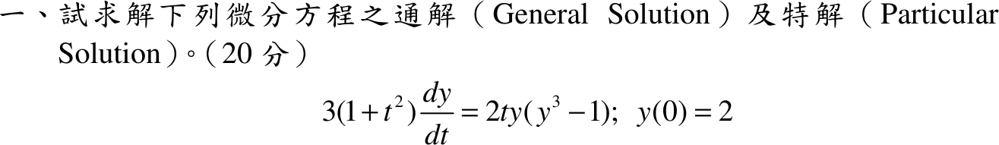

# 107 年第 1 題｜Bernoulli ODE

## 已知與所求

\(3(1+t^2)\dfrac{dy}{dt}=2ty(y^3-1)\)，\(y(0)=2\)（20 分）。求通解與滿足初值的特解。

## 考場標準作答

**解題邏輯**：右邊是 \(t\) 的函數乘 \(y\) 的函數，方程可分離變數（亦為 Bernoulli 型，驗算用代換 \(w=y^{-3}\) 交叉核對）。兩邊除以 \(3(1+t^2)\,y(y^3-1)\) 分離（前提 \(y\ne0\)、\(y^3\ne1\)，被除掉的常數解另外補回）；左邊用部分分式、兩邊用 \(u\)-代換積分，整理成隱式通解；再以 \(y(0)=2\) 定出常數，解出 \(y(t)\) 並標明定義域。

### （一）通解

**邏輯**：\(\dfrac{dy}{dt}=f(t)g(y)\) 型可分離，\(\int\dfrac{dy}{g(y)}=\int f(t)\,dt\)；\(\dfrac1{y(y^3-1)}\) 拆成部分分式後兩項都是「分子為分母導數倍數」的對數積分。

分離變數（兩邊除以 \(3(1+t^2)\,y(y^3-1)\)，乘 \(dt\)）：
\[
\frac{dy}{y(y^3-1)}=\frac{2t\,dt}{3(1+t^2)}
\]
部分分式：
\[
\frac1{y(y^3-1)}=\frac{y^2}{y^3-1}-\frac1y
\]
（通分核對：\(\dfrac{y^2\cdot y-(y^3-1)}{y(y^3-1)}=\dfrac{y^3-y^3+1}{y(y^3-1)}=\dfrac1{y(y^3-1)}\)。）

左邊第一項令 \(u=y^3-1\)，\(du=3y^2\,dy\)：
\[
\int\frac{y^2}{y^3-1}\,dy=\frac13\int\frac{du}{u}=\frac13\ln|y^3-1|
\]
左邊第二項：
\[
\int\frac1y\,dy=\ln|y|
\]
右邊令 \(w=1+t^2\)，\(dw=2t\,dt\)：
\[
\int\frac{2t}{3(1+t^2)}\,dt=\frac13\int\frac{dw}{w}=\frac13\ln(1+t^2)
\]
合併（\(c\) 為積分常數）：
\[
\frac13\ln|y^3-1|-\ln|y|=\frac13\ln(1+t^2)+c
\]
兩邊乘 \(3\)：
\[
\ln|y^3-1|-3\ln|y|=\ln(1+t^2)+3c
\]
對數律 \(3\ln|y|=\ln|y|^3\)、\(\ln a-\ln b=\ln\dfrac ab\)：
\[
\ln\left|\frac{y^3-1}{y^3}\right|=\ln(1+t^2)+3c
\]
兩邊取指數，令 \(C=\pm e^{3c}\)：
\[
\frac{y^3-1}{y^3}=C(1+t^2)
\]
左邊拆開 \(\dfrac{y^3-1}{y^3}=1-\dfrac1{y^3}\)：
\[
\boxed{1-\frac1{y^3}=C(1+t^2)}
\]
解出 \(y^3\) 的顯式：
\[
y^3=\frac1{1-C(1+t^2)}
\]
分離時除掉的常數解：\(y\equiv1\) 對應 \(C=0\)（已含在族內）；\(y\equiv0\) 代入原式兩邊皆為 0，也是解，但不在上式族內。

### （二）特解

**邏輯**：通解含一個任意常數 \(C\)，在 \(t=0\) 代入 \(y=2\) 固定 \(C\)；代回顯式解出 \(y(t)\)，並由分母須為正定出定義域。

代入 \(t=0,\ y=2\)：
\[
1-\frac1{2^3}=C(1+0^2)
\]
\[
C=1-\frac18=\frac78
\]
代回 \(y^3=\dfrac1{1-C(1+t^2)}\)，先化簡分母（通分）：
\[
1-\frac78(1+t^2)=\frac{8-7-7t^2}{8}=\frac{1-7t^2}{8}
\]
取倒數：
\[
y^3=\frac{8}{1-7t^2}
\]
開立方根（\(y(0)=2>0\)，取實根，\(\sqrt[3]{8}=2\)）：
\[
\boxed{y(t)=\frac{2}{(1-7t^2)^{1/3}}}
\]
定義域：須 \(1-7t^2>0\)，即 \(t^2<\tfrac17\)：
\[
|t|<\frac1{\sqrt7}\approx0.38
\]

## 驗算

令 \(w=y^{-3}\)（Bernoulli 代換），則 \(w'=-3y^{-4}y'=-\dfrac{2t}{1+t^2}(1-w)\)，為線性式 \(w'-\dfrac{2t}{1+t^2}w=-\dfrac{2t}{1+t^2}\)，積分因子 \(\dfrac1{1+t^2}\)，解 \(w=1+C(1+t^2)\)，與 \(1-y^{-3}=C'(1+t^2)\) 同族（\(C'=-C\)）。

回代特解：\(y^3-1=\dfrac{7(1+t^2)}{1-7t^2}\)，右側 \(\dfrac{2ty(y^3-1)}{3(1+t^2)}=\dfrac{14t\,y}{3(1-7t^2)}\)；左側 \(y'=\dfrac{28t}{3}(1-7t^2)^{-4/3}=\dfrac{14t}{3(1-7t^2)}\cdot2(1-7t^2)^{-1/3}\)，兩側相等。

## 失分點

- \(\dfrac1{y(y^3-1)}\) 的部分分式是 \(\dfrac{y^2}{y^3-1}-\dfrac1y\)，不是 \(\tfrac13\) 倍。
- 解在 \(1-7t^2\to0\) 處發散，特解僅在 \(|t|<1/\sqrt7\) 成立。
- 分離變數時除以 \(y(y^3-1)\)，會漏掉常數解 \(y\equiv0\)。
