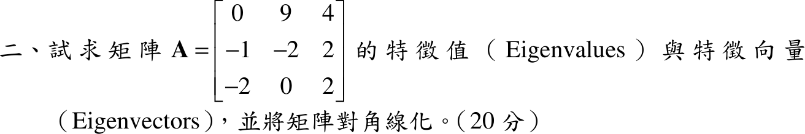

# 107 年第 2 題｜特徵值、特徵向量與對角化

## 已知與所求

\(\mathbf A=\begin{bmatrix}0&9&4\\-1&-2&2\\-2&0&2\end{bmatrix}\)。求 \(\mathbf A\) 的特徵值、特徵向量，並將 \(\mathbf A\) 對角化（共 20 分）。

## 考場標準作答

### 特徵值

\[
\mathbf A-\lambda I=\begin{bmatrix}-\lambda&9&4\\-1&-2-\lambda&2\\-2&0&2-\lambda\end{bmatrix}
\]
沿第 3 列展開（\((3,1)\)、\((3,3)\) 位置的餘因子符號皆為 \(+\)）：
\[
\det(\mathbf A-\lambda I)=(-2)\begin{vmatrix}9&4\\-2-\lambda&2\end{vmatrix}+(2-\lambda)\begin{vmatrix}-\lambda&9\\-1&-2-\lambda\end{vmatrix}
\]
第一個 \(2\times2\) 行列式：
\[
\begin{vmatrix}9&4\\-2-\lambda&2\end{vmatrix}=9(2)-4(-2-\lambda)=18+8+4\lambda=26+4\lambda
\]
第二個 \(2\times2\) 行列式：
\[
\begin{vmatrix}-\lambda&9\\-1&-2-\lambda\end{vmatrix}=(-\lambda)(-2-\lambda)-9(-1)=\lambda^2+2\lambda+9
\]
代回：
\[
\det(\mathbf A-\lambda I)=-2(26+4\lambda)+(2-\lambda)(\lambda^2+2\lambda+9)
\]
展開兩項：
\[
-2(26+4\lambda)=-52-8\lambda
\]
\[
(2-\lambda)(\lambda^2+2\lambda+9)=2\lambda^2+4\lambda+18-\lambda^3-2\lambda^2-9\lambda=-\lambda^3-5\lambda+18
\]
合併同類項：
\[
\det(\mathbf A-\lambda I)=-\lambda^3-13\lambda-34=-(\lambda^3+13\lambda+34)
\]
試根 \(\lambda=-2\)：\((-2)^3+13(-2)+34=-8-26+34=0\)，故 \((\lambda+2)\) 為因式；長除法：
\[
\lambda^3+13\lambda+34=(\lambda+2)(\lambda^2-2\lambda+17)
\]
二次式用公式解：
\[
\lambda=\frac{2\pm\sqrt{(-2)^2-4(1)(17)}}{2}=\frac{2\pm\sqrt{-64}}{2}=\frac{2\pm8i}{2}=1\pm4i
\]
\[
\boxed{\lambda_1=-2,\qquad \lambda_2=1+4i,\qquad \lambda_3=1-4i}
\]

### 特徵向量

\(\lambda_1=-2\)：
\[
\mathbf A+2I=\begin{bmatrix}2&9&4\\-1&0&2\\-2&0&4\end{bmatrix}
\]
第 2 列（第 3 列為其 2 倍）：
\[
-x_1+2x_3=0\quad\Longrightarrow\quad x_1=2x_3
\]
第 1 列代入 \(x_1=2x_3\)：
\[
2(2x_3)+9x_2+4x_3=0\quad\Longrightarrow\quad 9x_2=-8x_3
\]
取 \(x_3=9\)，則 \(x_2=-8\)、\(x_1=18\)：
\[
\boxed{\mathbf p_1=(18,\ -8,\ 9)^T}
\]

\(\lambda_2=1+4i\)：
\[
\mathbf A-(1+4i)I=\begin{bmatrix}-1-4i&9&4\\-1&-3-4i&2\\-2&0&1-4i\end{bmatrix}
\]
第 3 列：
\[
-2x_1+(1-4i)x_3=0\quad\Longrightarrow\quad x_1=\frac{(1-4i)x_3}{2}
\]
取 \(x_3=2\)：
\[
x_1=1-4i
\]
第 2 列代入：
\[
-(1-4i)+(-3-4i)x_2+2(2)=0\quad\Longrightarrow\quad(3+4i)-(3+4i)x_2=0\quad\Longrightarrow\quad x_2=1
\]
第 1 列核對：
\[
(-1-4i)(1-4i)+9(1)+4(2)=(-1+4i-4i+16i^2)+9+8=-17+17=0
\]
\[
\boxed{\mathbf p_2=(1-4i,\ 1,\ 2)^T}
\]

\(\lambda_3=1-4i=\overline{\lambda_2}\)：\(\mathbf A\) 為實矩陣，對 \(\mathbf A\mathbf p_2=\lambda_2\mathbf p_2\) 兩邊取共軛得 \(\mathbf A\overline{\mathbf p_2}=\overline{\lambda_2}\,\overline{\mathbf p_2}\)：
\[
\boxed{\mathbf p_3=\overline{\mathbf p_2}=(1+4i,\ 1,\ 2)^T}
\]
（特徵向量可乘任意非零常數。）

### 對角化

三個特徵值相異，特徵向量線性獨立，\(P\) 可逆；由 \(\mathbf A\mathbf p_k=\lambda_k\mathbf p_k\) 逐欄得 \(\mathbf AP=PD\)，即 \(P^{-1}\mathbf AP=D\)：

\[
P=\begin{bmatrix}18&1-4i&1+4i\\-8&1&1\\9&2&2\end{bmatrix},\qquad
D=\begin{bmatrix}-2&0&0\\0&1+4i&0\\0&0&1-4i\end{bmatrix}
\]
可逆性：沿第 1 列展開
\[
\det P=18(1\cdot2-1\cdot2)-(1-4i)\bigl[(-8)(2)-(1)(9)\bigr]+(1+4i)\bigl[(-8)(2)-(1)(9)\bigr]
\]
\[
=18(0)-(1-4i)(-25)+(1+4i)(-25)
\]
\[
=25-100i-25-100i=-200i\ne0
\]
逐欄 \(\mathbf A\mathbf p_k=\lambda_k\mathbf p_k\) 合寫成 \(\mathbf AP=PD\)，左乘 \(P^{-1}\)：
\[
\boxed{P^{-1}\mathbf AP=D=\operatorname{diag}(-2,\ 1+4i,\ 1-4i)}
\]
（特徵值有共軛複數，在實數域內只能化成 1 個 \(1\times1\) 加 1 個 \(2\times2\) 的實分塊形式，故在複數域對角化。）

## 驗算

\(\operatorname{tr}\mathbf A=0+(-2)+2=0\)，特徵值和 \(-2+(1+4i)+(1-4i)=0\)，一致。
\(\det\mathbf A=\det(\mathbf A-0I)=-(0+0+34)=-34\)，特徵值積 \((-2)(1+4i)(1-4i)=(-2)(17)=-34\)，一致。
回代 \(\mathbf A\mathbf p_1=(0-72+36,\ -18+16+18,\ -36+0+18)^T=(-36,\ 16,\ -18)^T=-2\,\mathbf p_1\)。

## 失分點

- 特徵多項式展開易錯符號；用 \(\operatorname{tr}\mathbf A=0\)（根和）與 \(\det\mathbf A=-34\)（根積）可立即檢出。
- \(\lambda^2-2\lambda+17\) 的判別式為負，根為 \(1\pm4i\)，特徵向量也是複數，不可只寫實根 \(-2\)。
- 對角化要寫出 \(P\)、\(D\) 且欄序一致（\(P\) 的第 \(k\) 欄對應 \(D\) 的第 \(k\) 個對角元）。
