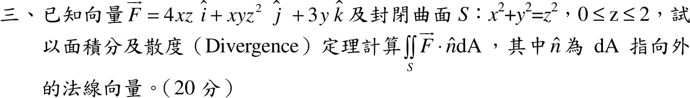
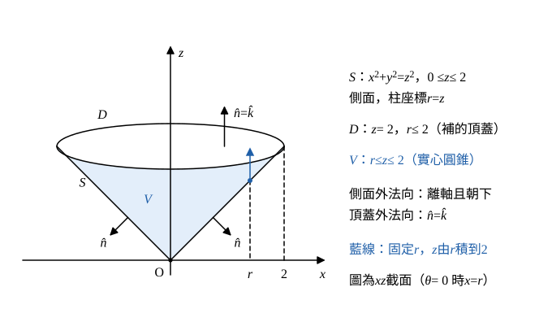

# 107 年第 3 題｜圓錐閉曲面通量

## 已知與所求

\(\vec F=4xz\,\hat i+xyz^2\,\hat j+3y\,\hat k\)；\(S:x^2+y^2=z^2,\ 0\le z\le2\)（20 分）。以面積分及散度定理求 \(\iint_S\vec F\cdot\hat n\,dA\)（\(\hat n\) 指向外）。

## 考場標準作答

**解題邏輯**：題目要用兩種方法算同一個向外通量。\(S\) 是頂點在原點、\(z=2\) 處半徑 2 的圓錐側面；題稱「封閉曲面」，但側面本身不封閉，須補上頂蓋 \(D:\ z=2,\ x^2+y^2\le4\) 才圍成實心圓錐 \(V\)。讀成「只算側面」或「側面＋頂蓋的封閉面」答案相同，因為頂蓋通量為 \(0\)（步驟 2）。面積分法：側面以 \((r,\theta)\) 參數化、取外向面積元直接積分；散度定理法：\(\vec F\) 各分量是多項式（處處連續可微），在 \(S\cup D\) 圍成的 \(V\) 上 \(\iiint_V\nabla\cdot\vec F\,dV=\)（側面通量）\(+\)（頂蓋通量）。

### 步驟 1：曲面、補的頂蓋與外法向

- 柱座標 \(r=\sqrt{x^2+y^2}\)：側面 \(x^2+y^2=z^2\)（\(z\ge0\)）即 \(r=z\)，\(0\le r\le2\)。
- 補的頂蓋 \(D\)：平面 \(z=2\) 上 \(r\le2\) 的圓盤。\(S\cup D\) 圍成實心圓錐 \(V:\ r\le z\le2\)。
- 外法向（離開 \(V\)）：側面上指向「離開 \(z\) 軸且朝下」（\(V\) 在側面的上方、軸側）；頂蓋上 \(\hat n=\hat k\)。

### 步驟 2：頂蓋通量（兩法共用）

\(D\) 上 \(\hat n=\hat k\)，只有 \(\vec F\) 的 \(\hat k\) 分量有貢獻：
\[
\vec F\cdot\hat k=3y
\]
圓盤用極座標（\(y=r\sin\theta\)，\(dA=r\,dr\,d\theta\)）：
\[
\iint_D3y\,dA=\int_0^{2\pi}\!\!\int_0^2 3r\sin\theta\cdot r\,dr\,d\theta=3\int_0^2r^2\,dr\cdot\int_0^{2\pi}\sin\theta\,d\theta
\]
\[
\int_0^2r^2\,dr=\Big[\frac{r^3}{3}\Big]_0^2=\frac83,\qquad
\int_0^{2\pi}\sin\theta\,d\theta=\Big[-\cos\theta\Big]_0^{2\pi}=-1-(-1)=0
\]
\[
\iint_D\vec F\cdot\hat n\,dA=3\cdot\frac83\cdot0=0
\]

### （一）面積分

**邏輯**：側面參數化為 \(\vec r(r,\theta)\)，向量面積元 \(d\vec A=\hat n\,dA\) 是兩個切向量的外積；外積順序決定朝向，須選與步驟 1 外法向（離軸、朝下）一致的順序，再把 \(\vec F\) 在曲面上取值做內積。

參數化：
\[
\vec r(r,\theta)=(r\cos\theta,\ r\sin\theta,\ r),\qquad 0\le r\le2,\ 0\le\theta\le2\pi
\]
兩個切向量（對參數偏微分）：
\[
\vec r_r=(\cos\theta,\ \sin\theta,\ 1),\qquad \vec r_\theta=(-r\sin\theta,\ r\cos\theta,\ 0)
\]
外積 \(\vec r_r\times\vec r_\theta\)，逐分量：
\[
\hat i:\ \sin\theta\cdot0-1\cdot r\cos\theta=-r\cos\theta
\]
\[
\hat j:\ 1\cdot(-r\sin\theta)-\cos\theta\cdot0=-r\sin\theta
\]
\[
\hat k:\ \cos\theta\cdot r\cos\theta-\sin\theta\cdot(-r\sin\theta)=r(\cos^2\theta+\sin^2\theta)=r
\]
\(\vec r_r\times\vec r_\theta=(-r\cos\theta,\ -r\sin\theta,\ r)\) 的 \(z\) 分量為正、指向軸側，是向內；外向取反序 \(\vec r_\theta\times\vec r_r\)：
\[
d\vec A=\vec r_\theta\times\vec r_r\,dr\,d\theta=(r\cos\theta,\ r\sin\theta,\ -r)\,dr\,d\theta
\]
\(\vec F\) 在曲面上（\(x=r\cos\theta,\ y=r\sin\theta,\ z=r\)）逐分量：
\[
4xz=4(r\cos\theta)(r)=4r^2\cos\theta
\]
\[
xyz^2=(r\cos\theta)(r\sin\theta)(r^2)=r^4\cos\theta\sin\theta
\]
\[
3y=3r\sin\theta
\]
內積（對應分量相乘後相加）：
\[
\vec F\cdot d\vec A=\bigl(4r^2\cos\theta\cdot r\cos\theta+r^4\cos\theta\sin\theta\cdot r\sin\theta+3r\sin\theta\cdot(-r)\bigr)dr\,d\theta
\]
\[
\vec F\cdot d\vec A=\bigl(4r^3\cos^2\theta+r^5\cos\theta\sin^2\theta-3r^2\sin\theta\bigr)dr\,d\theta
\]
三個 \(\theta\) 積分：
\[
\int_0^{2\pi}\cos^2\theta\,d\theta=\int_0^{2\pi}\frac{1+\cos2\theta}{2}\,d\theta=\Big[\frac\theta2+\frac{\sin2\theta}{4}\Big]_0^{2\pi}=\pi
\]
\[
\int_0^{2\pi}\cos\theta\sin^2\theta\,d\theta=\Big[\frac{\sin^3\theta}{3}\Big]_0^{2\pi}=0\qquad(\text{代換 }u=\sin\theta)
\]
\[
\int_0^{2\pi}\sin\theta\,d\theta=0\qquad(\text{步驟 2})
\]
對 \(\theta\) 積完只剩第一項：
\[
\int_0^{2\pi}\bigl(4r^3\cos^2\theta+r^5\cos\theta\sin^2\theta-3r^2\sin\theta\bigr)d\theta=4r^3\cdot\pi+r^5\cdot0-3r^2\cdot0=4\pi r^3
\]
再對 \(r\) 積分：
\[
\iint_S\vec F\cdot\hat n\,dA=\int_0^24\pi r^3\,dr=\pi\Big[r^4\Big]_0^2=\pi(16-0)
\]
\[
\boxed{\iint_S\vec F\cdot\hat n\,dA=16\pi}\approx50.27
\]
若 \(S\) 讀成側面＋頂蓋：\(16\pi+0=16\pi\)（步驟 2），答案相同。

### （二）散度定理

**邏輯**：散度定理只適用封閉面，故用步驟 1 的 \(S\cup D\)（外法向）：\(\iint_S+\iint_D=\iiint_V\nabla\cdot\vec F\,dV\)；體積分用柱座標，先對 \(z\) 由 \(r\) 積到 \(2\)（圖 1 藍線），再對 \(r\)、\(\theta\) 積分，最後扣掉步驟 2 的頂蓋通量。

散度（各分量對自己的變數偏微分）：
\[
\frac{\partial(4xz)}{\partial x}=4z,\qquad \frac{\partial(xyz^2)}{\partial y}=xz^2,\qquad \frac{\partial(3y)}{\partial z}=0
\]
\[
\nabla\cdot\vec F=4z+xz^2
\]
柱座標代入（\(x=r\cos\theta\)，\(dV=r\,dz\,dr\,d\theta\)）：
\[
\iiint_V\nabla\cdot\vec F\,dV=\int_0^{2\pi}\!\!\int_0^2\!\!\int_r^2(4z+r\cos\theta\,z^2)\,r\,dz\,dr\,d\theta
\]
第二項含因子 \(\cos\theta\)，其 \(z\)、\(r\) 積分為有限值，而 \(\int_0^{2\pi}\cos\theta\,d\theta=\Big[\sin\theta\Big]_0^{2\pi}=0\)，整項為 0；只剩 \(4z\) 項：
\[
\iiint_V\nabla\cdot\vec F\,dV=\int_0^{2\pi}\!\!\int_0^2 r\left(\int_r^24z\,dz\right)dr\,d\theta
\]
最內層（對 \(z\)）：
\[
\int_r^24z\,dz=\Big[2z^2\Big]_r^2=8-2r^2
\]
中層（對 \(r\)）：
\[
\int_0^2r(8-2r^2)\,dr=\int_0^2(8r-2r^3)\,dr=\Big[4r^2-\frac{r^4}{2}\Big]_0^2=16-8=8
\]
外層（對 \(\theta\)）：
\[
\iiint_V\nabla\cdot\vec F\,dV=\int_0^{2\pi}8\,d\theta=16\pi
\]
扣掉頂蓋通量（步驟 2）得側面通量：
\[
\iint_S\vec F\cdot\hat n\,dA=\iiint_V\nabla\cdot\vec F\,dV-\iint_D\vec F\cdot\hat n\,dA
\]
\[
\boxed{\iint_S\vec F\cdot\hat n\,dA=16\pi-0=16\pi}\approx50.27
\]
與（一）相同。

## 驗算

\(\iiint_V4z\,dV=4\bar z\,V\)：圓錐體積 \(V=\tfrac13\pi(2^2)(2)=\tfrac{8\pi}3\)，自頂點量起的形心高 \(\bar z=\tfrac34\cdot2=1.5\)，得 \(4\cdot1.5\cdot\tfrac{8\pi}3=16\pi\)；\(xz^2\) 項在 \(V\) 上對 \(x\) 奇對稱，積分為 0。一致。

## 失分點

- 頂蓋外法向是 \(+\hat k\)，\(\vec F\cdot\hat k=3y\)（不是 \(4xz\) 或 \(xyz^2\)）。
- 側面外向面積元的 \(z\) 分量為 \(-r\)（向外且向下）；誤取 \(\vec r_r\times\vec r_\theta\)（向內）會得 \(-16\pi\)。
- \(\int_0^{2\pi}\cos^2\theta\,d\theta=\pi\)，不是 \(2\pi\)；寫成 \(2\pi\) 得 \(32\pi\)。
