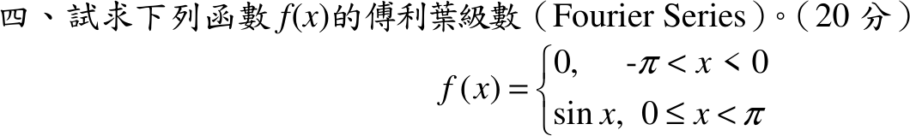
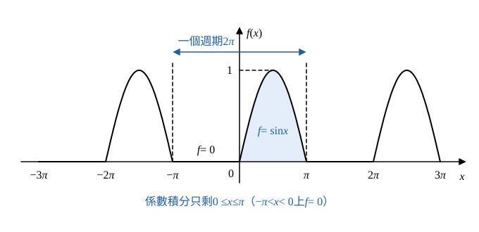

# 107 年第 4 題｜分段函數傅立葉級數

## 已知與所求

\(f(x)=0\)（\(-\pi<x<0\)）、\(f(x)=\sin x\)（\(0\le x<\pi\)），週期 \(2\pi\)。求 \(f(x)\) 的傅立葉級數（20 分）。

## 考場標準作答

### 步驟 1：積分範圍與共用積分

週期 \(2\pi\)（\(L=\pi\)），由 Euler 公式：
\[
f(x)\sim\frac{a_0}{2}+\sum_{n=1}^{\infty}(a_n\cos nx+b_n\sin nx),\quad
a_n=\frac1\pi\int_{-\pi}^{\pi}f(x)\cos nx\,dx,\quad
b_n=\frac1\pi\int_{-\pi}^{\pi}f(x)\sin nx\,dx
\]

- 一個週期取 \((-\pi,\pi)\)；左半段 \(f=0\)，積分為 0，故 \(\displaystyle\int_{-\pi}^{\pi}f(x)g(x)\,dx=\int_0^{\pi}\sin x\,g(x)\,dx\)。
- 共用積分（\(m\) 為正整數）：
\[
\int_0^\pi\sin mx\,dx=\Big[-\frac{\cos mx}{m}\Big]_0^\pi=\frac{1-\cos m\pi}{m}=\frac{1-(-1)^m}{m}
\]
\[
\int_0^\pi\cos mx\,dx=\Big[\frac{\sin mx}{m}\Big]_0^\pi=\frac{\sin m\pi-0}{m}=0
\]

### 常數項 \(a_0\)

\[
a_0=\frac1\pi\int_0^\pi\sin x\,dx=\frac1\pi\Big[-\cos x\Big]_0^\pi
\]
\[
=\frac1\pi\bigl[-\cos\pi-(-\cos0)\bigr]=\frac1\pi(1+1)
\]
\[
\boxed{a_0=\frac2\pi}\qquad\Bigl(\text{常數項 }\frac{a_0}{2}=\frac1\pi\Bigr)
\]

### 餘弦係數 \(a_n\)

\[
\sin x\cos nx=\frac12\bigl[\sin(n+1)x-\sin(n-1)x\bigr]
\]
\[
a_n=\frac1\pi\int_0^\pi\sin x\cos nx\,dx=\frac1{2\pi}\Bigl[\int_0^\pi\sin(n+1)x\,dx-\int_0^\pi\sin(n-1)x\,dx\Bigr]
\]

\(n=1\)（第二項為 \(\sin0=0\)）：
\[
a_1=\frac1{2\pi}\int_0^\pi\sin2x\,dx=\frac1{2\pi}\cdot\frac{1-(-1)^2}{2}=\frac1{2\pi}\cdot0=0
\]

\(n\ge2\)：代入步驟 1 公式（\(m=n+1\)、\(m=n-1\)）：
\[
a_n=\frac1{2\pi}\Bigl[\frac{1-(-1)^{n+1}}{n+1}-\frac{1-(-1)^{n-1}}{n-1}\Bigr]
\]
因 \((-1)^{n+1}=(-1)^{n-1}=-(-1)^n\)，兩個分子都是 \(1+(-1)^n\)：
\[
a_n=\frac{1+(-1)^n}{2\pi}\Bigl(\frac1{n+1}-\frac1{n-1}\Bigr)
\]
通分：
\[
\frac1{n+1}-\frac1{n-1}=\frac{(n-1)-(n+1)}{n^2-1}=\frac{-2}{n^2-1}
\]
代回：
\[
a_n=\frac{1+(-1)^n}{2\pi}\cdot\frac{-2}{n^2-1}=-\frac{1+(-1)^n}{\pi(n^2-1)}
\]
- \(n\) 為奇數（\(n\ge3\)）：\(1+(-1)^n=0\)，\(a_n=0\)。
- \(n\) 為偶數：\(1+(-1)^n=2\)，令 \(n=2k\)（\(n^2-1=4k^2-1\)）：
\[
\boxed{a_1=0,\qquad a_{2k-1}=0\ (k\ge2),\qquad a_{2k}=-\frac{2}{\pi(4k^2-1)}}
\]

### 正弦係數 \(b_n\)

\[
\sin x\sin nx=\frac12\bigl[\cos(n-1)x-\cos(n+1)x\bigr]
\]
\(n=1\)：
\[
b_1=\frac1\pi\int_0^\pi\sin^2x\,dx=\frac1\pi\int_0^\pi\frac{1-\cos2x}{2}\,dx
\]
\[
=\frac1\pi\Bigl[\frac x2-\frac{\sin2x}{4}\Bigr]_0^\pi=\frac1\pi\Bigl(\frac\pi2-0\Bigr)
\]
\[
=\frac12
\]
\(n\ge2\)（\(n-1\ge1\)、\(n+1\ge3\)，皆用步驟 1 的餘弦積分）：
\[
b_n=\frac1{2\pi}\Bigl[\int_0^\pi\cos(n-1)x\,dx-\int_0^\pi\cos(n+1)x\,dx\Bigr]=\frac1{2\pi}(0-0)=0
\]
\[
\boxed{b_1=\frac12,\qquad b_n=0\ (n\ge2)}
\]

### 傅立葉級數

\[
f(x)\sim\frac{a_0}{2}+b_1\sin x+\sum_{k=1}^{\infty}a_{2k}\cos2kx
\]
\[
\boxed{f(x)\sim\frac1\pi+\frac12\sin x-\frac2\pi\sum_{k=1}^{\infty}\frac{\cos2kx}{4k^2-1}}
\]
（\(f\) 在 \(x=0\)、\(\pm\pi\) 兩側極限都是 \(0\)，處處連續，級數在每一點都收斂到 \(f(x)\)。）

## 驗算

取 \(x=0\)（\(f(0)=0\)）：\(\displaystyle\sum_{k\ge1}\frac1{4k^2-1}=\frac12\sum_{k\ge1}\Bigl(\frac1{2k-1}-\frac1{2k+1}\Bigr)=\frac12\)（伸縮和），級數值 \(\dfrac1\pi-\dfrac2\pi\cdot\dfrac12=0\)，吻合。

Parseval：\(\dfrac1\pi\displaystyle\int_{-\pi}^{\pi}f^2dx=\dfrac1\pi\cdot\dfrac\pi2=\dfrac12\)；而 \(\dfrac{a_0^2}{2}+b_1^2+\sum a_{2k}^2=\dfrac2{\pi^2}+\dfrac14+\dfrac4{\pi^2}\cdot\dfrac{\pi^2-8}{16}=\dfrac2{\pi^2}+\dfrac14+\dfrac14-\dfrac2{\pi^2}=\dfrac12\)，一致。

## 失分點

- \(\int_{-\pi}^{0}\)（\(f=0\)）不必計算；常數項是 \(a_0/2=1/\pi\)，不是 \(a_0\)。
- \(n=1\) 要單獨處理：通式 \(a_n=-\dfrac{1+(-1)^n}{\pi(n^2-1)}\) 在 \(n=1\) 分母為 \(0\)，須另算 \(a_1=0\)、\(b_1=\tfrac12\)。
- 奇數 \(n\ge3\) 的 \(a_n=0\)，級數只含偶數倍頻 \(\cos2kx\)。
