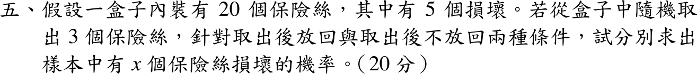

# 107 年第 5 題｜抽取損壞保險絲

## 已知與所求

20 個保險絲中有 5 個損壞，隨機取 3 個（20 分）。分別就取出後放回、不放回，求樣本中恰有 \(x\) 個損壞的機率。題目要求任意 \(x\) 的機率函數，不必額外求指定 \(x\) 的數值。

## 考場標準作答

### 步驟 1：盒內組成與損壞率

設每個保險絲被抽中的機會相等，令 \(X\) 為 3 個樣本中損壞的個數，\(x=0,1,2,3\)。

- 總數 \(N=20\)，損壞 \(K=5\)，正常 \(N-K=20-5=15\)，取樣數 \(n=3\)。
- 單次抽到損壞的機率與抽到正常的機率：
\[
p=\frac{K}{N}=\frac5{20}=\frac14,\qquad q=1-p=1-\frac14=\frac34
\]
- \(x\) 的範圍：至少 0 個、至多 \(n=3\) 個；又 \(x\le K=5\)、\(3-x\le15\) 自動成立，故 \(x=0,1,2,3\)。

### 取出後放回

放回時三次抽取獨立、每次損壞機率皆為 \(p=\tfrac14\)，故 \(X\sim\operatorname{Binomial}(3,\tfrac14)\)。

某一個指定順序（例如前 \(x\) 次壞、後 \(3-x\) 次好）的機率，由獨立事件乘法律：
\[
\underbrace{p\cdots p}_{x\text{ 次}}\cdot\underbrace{q\cdots q}_{3-x\text{ 次}}=p^x q^{3-x}=\left(\frac14\right)^x\left(\frac34\right)^{3-x}
\]
3 次中哪 \(x\) 次是壞的有 \(\binom3x\) 種排法，各排法互斥、機率相同，相加：
\[
P(X=x)=\binom3x p^x q^{3-x}
\]
\[
\boxed{P(X=x)=\binom3x\left(\frac14\right)^x\left(\frac34\right)^{3-x}},\qquad x=0,1,2,3
\]

### 取出後不放回

不放回時三次抽取不獨立；20 個中任取 3 個的每個組合等可能，有利組合為 5 個壞的取 \(x\) 個、15 個好的取 \(3-x\) 個（乘法原理）。

全部組合數：
\[
\binom{20}{3}=\frac{20\cdot19\cdot18}{3!}=\frac{6840}{6}=1140
\]
有利組合數（乘法原理）：
\[
\binom5x\binom{15}{3-x}
\]
古典機率 = 有利組合數 ÷ 全部組合數，為超幾何分布：
\[
\boxed{P(X=x)=\frac{\binom5x\binom{15}{3-x}}{\binom{20}{3}}},\qquad x=0,1,2,3
\]

兩種抽法的機率函數在 \(x\notin\{0,1,2,3\}\) 時均為 \(0\)。

## 驗算

總和：二項式定理 \((\tfrac14+\tfrac34)^3=1\)；Vandermonde 恆等式 \(\sum_x\binom5x\binom{15}{3-x}=\binom{20}{3}=1140\)。

逐一列出 \(x=0,1,2,3\) 只是驗算示例，不是題目另問的小題：

| \(x\) | 0 | 1 | 2 | 3 |
| --- | --- | --- | --- | --- |
| 放回 | \(27/64\) | \(27/64\) | \(9/64\) | \(1/64\) |
| 不放回 | \(91/228\) | \(35/76\) | \(5/38\) | \(1/114\) |

兩列各自總和為 \(1\)，期望損壞數皆為 \(3\cdot\tfrac14=0.75\)。

## 失分點

- 「不放回」仍套二項分布，忽略每抽一次母體比例會改變。
- 超幾何分子只寫 \(\binom5x\)，漏掉正常品的 \(\binom{15}{3-x}\)。
- 把「恰有 \(x\) 個損壞」誤解成「至少 \(x\) 個」，或擅自把 \(x\) 固定成某個值。
