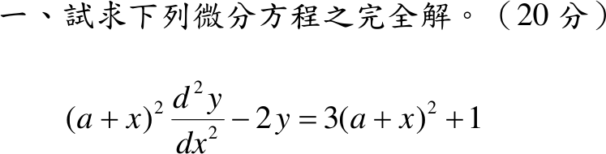

# 108 年第 1 題｜Euler 型方程

## 已知與所求

\((a+x)^2\dfrac{d^2y}{dx^2}-2y=3(a+x)^2+1\)，\(a\) 為常數。求完全解（通解）（20 分）。

## 考場標準作答

**解題邏輯**：係數 \((a+x)^2\) 與二階導數的次數相同，是以 \(a+x\) 為底的 Euler–Cauchy 方程。先令 \(u=a+x\) 化成標準 Euler 型 \(u^2y''-2y=3u^2+1\)；齊次解試 \(y=u^m\) 得指標方程；特解依右側兩項分開求再疊加，其中 \(3u^2\) 與齊次解 \(u^2\) 重複（共振），須改設 \(Au^2\ln u\)。完全解 = 齊次解 + 特解，定義於 \(x\ne-a\)（\(u\ne0\)）。

### 步驟 1：變數代換 \(u=a+x\)

\[
u=a+x\quad\Longrightarrow\quad\frac{du}{dx}=1
\]
連鎖律：
\[
\frac{dy}{dx}=\frac{dy}{du}\cdot\frac{du}{dx}=\frac{dy}{du},\qquad
\frac{d^2y}{dx^2}=\frac{d}{du}\Bigl(\frac{dy}{du}\Bigr)\cdot\frac{du}{dx}=\frac{d^2y}{du^2}
\]
以下 \(y'\)、\(y''\) 皆對 \(u\) 微分，原式化為
\[
u^2y''-2y=3u^2+1,\qquad u\ne0
\]

### 齊次解

**邏輯**：Euler 型 \(u^2y''+\beta y=0\) 的每一項在 \(y=u^m\) 下都變成 \(u^m\) 的倍數，消去 \(u^m\) 得指標方程，兩相異實根給兩個獨立解。

設 \(y=u^m\)：
\[
y'=mu^{m-1},\qquad y''=m(m-1)u^{m-2}
\]
代入 \(u^2y''-2y=0\)：
\[
u^2\cdot m(m-1)u^{m-2}-2u^m=\bigl[m(m-1)-2\bigr]u^m=0
\]
\(u^m\ne0\)，指標方程：
\[
m^2-m-2=0
\]
因式分解：
\[
(m-2)(m+1)=0\quad\Longrightarrow\quad m=2,\ -1
\]
\[
\boxed{y_h=C_1u^2+C_2u^{-1}}
\]

### 特解

**邏輯**：右側 \(3u^2+1\) 為兩項之和，方程為線性，可對每項各求特解再相加（疊加原理）。常數項 \(1\) 不是齊次解，設常數；\(3u^2\) 正是齊次解 \(u^2\)，代 \(Au^2\) 會得 \(0\)，比照 Euler 型重根規則乘上 \(\ln u\)。

右側 \(1\)：設 \(y=B\)，則 \(y''=0\)，代入：
\[
u^2(0)-2B=1\quad\Longrightarrow\quad B=-\frac12
\]

右側 \(3u^2\)：設 \(y=Au^2\ln u\)。一階導數（乘積律）：
\[
y'=A\Bigl(2u\ln u+u^2\cdot\frac1u\Bigr)=A(2u\ln u+u)
\]
二階導數：
\[
y''=A\Bigl(2\ln u+2u\cdot\frac1u+1\Bigr)=A(2\ln u+3)
\]
代入左邊：
\[
u^2y''-2y=A(2u^2\ln u+3u^2)-2Au^2\ln u=3Au^2
\]
與右側比較係數：
\[
3Au^2=3u^2\quad\Longrightarrow\quad A=1
\]
疊加兩項：
\[
\boxed{y_p=u^2\ln u-\frac12}
\]
（\(u<0\) 時以 \(\ln|u|\) 取代 \(\ln u\)；因 \(\dfrac{d}{du}\ln|u|=\dfrac1u\)，上面每一行照樣成立。）

### 完全解

**邏輯**：線性非齊次方程的完全解 = 齊次通解 + 一個特解；再把 \(u=a+x\) 代回。

\[
y=y_h+y_p=C_1u^2+\frac{C_2}{u}+u^2\ln|u|-\frac12
\]
代回 \(u=a+x\)：
\[
\boxed{y=C_1(a+x)^2+\frac{C_2}{a+x}+(a+x)^2\ln|a+x|-\frac12},\qquad x\ne-a
\]

## 驗算

變數變易法：\(y_1=u^2\)、\(y_2=u^{-1}\)，
\(W=y_1y_2'-y_2y_1'=u^2(-u^{-2})-u^{-1}(2u)=-1-2=-3\)；標準式 \(y''-\tfrac{2}{u^2}y=g\)，\(g=\dfrac{3u^2+1}{u^2}=3+u^{-2}\)。
\[
y_p=-y_1\!\int\!\frac{y_2g}{W}du+y_2\!\int\!\frac{y_1g}{W}du
=\frac{u^2}{3}\Bigl(3\ln u-\frac1{2u^2}\Bigr)-\frac{u^3+u}{3u}
=u^2\ln u-\frac{u^2}{3}-\frac12 ,
\]
多出的 \(-u^2/3\) 是齊次解，併入 \(C_1u^2\)，與上式一致。

## 失分點

- 右側 \(3u^2\) 與齊次解 \(u^2\) 共振，直接設 \(y=Au^2\) 會得 \(0=3u^2\) 而無解，必須乘 \(\ln u\)。
- 右側 \(1\) 的特解是 \(-\tfrac12\)（\(-2B=1\)），常漏負號。
- 沒換成 \(u=a+x\) 就試 \(x^m\) 會失敗；結果要用 \(\ln|a+x|\)，標明 \(x\ne-a\)。
