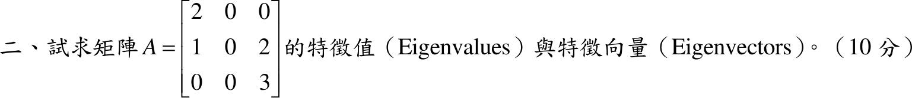

# 108 年第 2 題｜特徵值與特徵向量

## 已知與所求

\(A=\begin{bmatrix}2&0&0\\1&0&2\\0&0&3\end{bmatrix}\)。求 \(A\) 的特徵值與特徵向量（10 分）。

## 考場標準作答

### 特徵值

\[
A-\lambda I=\begin{bmatrix}2-\lambda&0&0\\1&-\lambda&2\\0&0&3-\lambda\end{bmatrix}
\]
沿第 2 行展開（\((2,2)\) 位置餘因子符號為 \(+\)）：
\[
\det(A-\lambda I)=(-\lambda)\begin{vmatrix}2-\lambda&0\\0&3-\lambda\end{vmatrix}
\]
子行列式：
\[
\begin{vmatrix}2-\lambda&0\\0&3-\lambda\end{vmatrix}=(2-\lambda)(3-\lambda)-0\cdot0=(2-\lambda)(3-\lambda)
\]
\[
\det(A-\lambda I)=-\lambda(2-\lambda)(3-\lambda)=0
\]
\[
\boxed{\lambda_1=0,\qquad \lambda_2=2,\qquad \lambda_3=3}
\]

### 特徵向量

\(\lambda_1=0\)：
\[
A\mathbf x=\mathbf 0:\qquad 2x_1=0,\qquad x_1+2x_3=0,\qquad 3x_3=0
\]
第 1、3 式：
\[
x_1=0,\qquad x_3=0
\]
第 2 式自動成立，\(x_2\) 自由，取 \(x_2=1\)：
\[
\boxed{\mathbf p_1=(0,\ 1,\ 0)^T}
\]

\(\lambda_2=2\)：
\[
A-2I=\begin{bmatrix}0&0&0\\1&-2&2\\0&0&1\end{bmatrix}
\]
第 3 列：
\[
x_3=0
\]
第 2 列代入 \(x_3=0\)：
\[
x_1-2x_2+2(0)=0\quad\Longrightarrow\quad x_1=2x_2
\]
取 \(x_2=1\)：
\[
\boxed{\mathbf p_2=(2,\ 1,\ 0)^T}
\]

\(\lambda_3=3\)：
\[
A-3I=\begin{bmatrix}-1&0&0\\1&-3&2\\0&0&0\end{bmatrix}
\]
第 1 列：
\[
-x_1=0\quad\Longrightarrow\quad x_1=0
\]
第 2 列代入 \(x_1=0\)：
\[
0-3x_2+2x_3=0\quad\Longrightarrow\quad x_3=\frac32x_2
\]
取 \(x_2=2\)，則 \(x_3=3\)：
\[
\boxed{\mathbf p_3=(0,\ 2,\ 3)^T}
\]
（特徵向量可乘任意非零常數。）

## 驗算

\(\operatorname{tr}A=2+0+3=5=0+2+3\)；\(\det A=0=0\cdot2\cdot3\)。
直接回代：\(A\mathbf p_1=(0,0,0)^T=0\cdot\mathbf p_1\)，\(A\mathbf p_2=(4,2,0)^T=2\mathbf p_2\)，\(A\mathbf p_3=(0,6,9)^T=3\mathbf p_3\)。

## 失分點

- 第 2 行全為 \(0\)，所以 \(\lambda=0\) 是特徵值（\(A\) 不可逆），不可漏掉。
- \(\lambda=3\) 的特徵向量 \((0,2,3)^T\) 需同時滿足第 2 列 \(-3x_2+2x_3=0\)，不是 \((0,0,1)^T\)。
