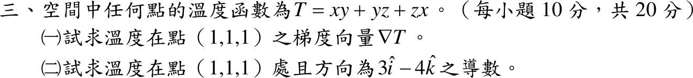

# 108 年第 3 題｜梯度與方向導數

## 已知與所求

溫度函數 \(T=xy+yz+zx\)（每小題 10 分，共 20 分）。求（一）點 \((1,1,1)\) 的梯度向量 \(\nabla T\)；（二）該點沿方向 \(3\hat i-4\hat k\) 的方向導數。

## 考場標準作答

**解題邏輯**：純量場的梯度 \(\nabla T=\left(\frac{\partial T}{\partial x},\frac{\partial T}{\partial y},\frac{\partial T}{\partial z}\right)\) 由三個偏導數組成，先求一般式再代點 \((1,1,1)\)；沿某方向的變化率（方向導數）是梯度在該方向「單位」向量上的投影 \(D_{\hat u}T=\nabla T\cdot\hat u\)，所以（二）先把 \(3\hat i-4\hat k\) 除以長度化成 \(\hat u\)，再與（一）的梯度內積。

### （一）梯度（10 分）

**邏輯**：對某一變數偏微分時，其餘變數視為常數；三個偏導數依序排成梯度向量後代入點 \((1,1,1)\)。

對 \(x\) 偏微分（\(y,z\) 視為常數，\(yz\) 項為常數、導數為 0）：
\[
\frac{\partial T}{\partial x}=y+0+z=y+z
\]
對 \(y\) 偏微分（\(zx\) 項為常數）：
\[
\frac{\partial T}{\partial y}=x+z+0=x+z
\]
對 \(z\) 偏微分（\(xy\) 項為常數）：
\[
\frac{\partial T}{\partial z}=0+y+x=x+y
\]
組成梯度並代入 \((x,y,z)=(1,1,1)\)：
\[
\nabla T=(y+z,\ x+z,\ x+y)
\]
\[
\nabla T(1,1,1)=(1+1,\ 1+1,\ 1+1)
\]
\[
\boxed{\nabla T(1,1,1)=(2,2,2)=2\hat i+2\hat j+2\hat k}
\]

### （二）方向導數（10 分）

**邏輯**：方向導數 \(D_{\hat u}T=\nabla T\cdot\hat u\) 只對單位向量成立；給定方向 \(\vec d=3\hat i-4\hat k\) 長度不是 1，須先除以 \(\lVert\vec d\rVert\)。

方向向量（沒有 \(\hat j\) 分量，\(y\) 分量為 0）：
\[
\vec d=3\hat i+0\hat j-4\hat k=(3,0,-4)
\]
長度：
\[
\lVert\vec d\rVert=\sqrt{3^2+0^2+(-4)^2}=\sqrt{9+0+16}=\sqrt{25}=5
\]
單位向量：
\[
\hat u=\frac{\vec d}{\lVert\vec d\rVert}=\left(\frac35,\ 0,\ -\frac45\right)
\]
與（一）的梯度內積（對應分量相乘後相加）：
\[
D_{\hat u}T=\nabla T\cdot\hat u=2\cdot\frac35+2\cdot0+2\cdot\left(-\frac45\right)
\]
\[
D_{\hat u}T=\frac65+0-\frac85=\frac{6-8}{5}
\]
\[
D_{\hat u}T=\boxed{-\frac25}=-0.40
\]
負值表示沿該方向溫度遞減。

## 驗算

沿直線 \((x,y,z)=(1+\tfrac35s,\ 1,\ 1-\tfrac45s)\)（\(s\) 為弧長）以鏈鎖律直接微分：\(y=1\) 時 \(T=x+z+xz\)，
\[
\frac{dT}{ds}\Big|_{s=0}=\frac{dx}{ds}+\frac{dz}{ds}+\frac{dx}{ds}z+x\frac{dz}{ds}=\frac35-\frac45+\frac35\cdot1+1\cdot\left(-\frac45\right)=\frac65-\frac85=-0.40,
\]
一致。

## 失分點

- 方向 \(3\hat i-4\hat k\) 的長度是 \(5\)，未化為單位向量會得 \(-2\)。
- 方向中沒有 \(\hat j\) 分量，\(\hat u\) 的 \(y\) 分量是 \(0\)，不要把 \(-4\hat k\) 當成 \(-4\hat j\)。
- 梯度是向量，（一）要寫出三個分量 \((2,2,2)\)，只寫大小 \(2\sqrt3\) 不算答對。
