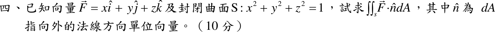

# 108 年第 4 題｜球面通量

## 已知與所求

\(\vec F=x\hat i+y\hat j+z\hat k\)，封閉曲面 \(S:x^2+y^2+z^2=1\)，\(\hat n\) 為 \(dA\) 向外的單位法向量。求 \(\iint_S\vec F\cdot\hat n\,dA\)（10 分）。

## 考場標準作答

**解題邏輯**：\(S\) 是半徑 1 的球面（封閉、有界），\(\hat n\) 取向外，\(\vec F\) 各分量為一次多項式（處處連續可微），散度定理的條件全部成立，可把面積分換成單位實心球 \(V\) 上 \(\nabla\cdot\vec F\) 的體積分。先求散度；散度是常數，體積分只剩「常數 × 球體積」。

### 步驟 1：散度

散度 = 各分量對自己的變數偏微分後相加：
\[
\nabla\cdot\vec F=\frac{\partial x}{\partial x}+\frac{\partial y}{\partial y}+\frac{\partial z}{\partial z}
\]
\[
\nabla\cdot\vec F=1+1+1=3
\]

### 散度定理求通量（10 分）

**邏輯**：\(S\) 封閉、\(\hat n\) 向外、\(\vec F\) 連續可微，散度定理 \(\iint_S\vec F\cdot\hat n\,dA=\iiint_V\nabla\cdot\vec F\,dV\) 適用；步驟 1 的散度 \(3\) 是常數，可提到積分號外。

\(V:\ x^2+y^2+z^2\le1\)，半徑 \(R=1\)。球體積公式代入：
\[
\iiint_V dV=\frac43\pi R^3=\frac43\pi(1)^3=\frac43\pi
\]
散度定理（常數 3 提出）：
\[
\iint_S\vec F\cdot\hat n\,dA=\iiint_V3\,dV=3\iiint_V dV
\]
\[
\iint_S\vec F\cdot\hat n\,dA=3\cdot\frac43\pi
\]
\[
\boxed{\iint_S\vec F\cdot\hat n\,dA=4\pi}\approx12.57
\]

## 驗算

直接做面積分：單位球面上外法向 \(\hat n=(x,y,z)\)（長度 \(\sqrt{x^2+y^2+z^2}=1\)），\(\vec F\cdot\hat n=x^2+y^2+z^2=1\)，故通量 \(=1\times S\text{ 的面積}=4\pi(1)^2=4\pi\)，一致。

## 失分點

- 散度定理只適用封閉曲面，通量取外法向；單位球體積是 \(\tfrac43\pi R^3\)，不是 \(\pi R^2\) 或 \(4\pi R^2\)。
- 通量是純量；\(\vec F\cdot\hat n=x^2+y^2+z^2\) 在 \(R=1\) 的球面上恆為 1，別把它當成還要積分的函數。
- 散度寫成向量 \((1,1,1)\) 或只取一項得 \(1\)，答案會少 3 倍。
