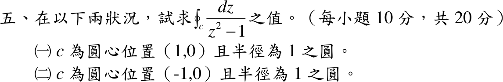
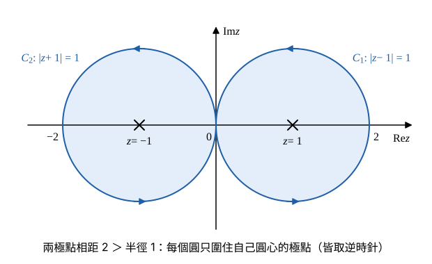

# 108 年第 5 題｜兩個圓周的留數積分

## 已知與所求

求 \(\displaystyle\oint_C\frac{dz}{z^2-1}\)，兩種情況（每小題 10 分，共 20 分）：（一）\(C\) 為圓心 \((1,0)\)、半徑 \(1\) 的圓（記 \(C_1\)，積分值記 \(I_1\)）；（二）\(C\) 為圓心 \((-1,0)\)、半徑 \(1\) 的圓（記 \(C_2\)，積分值記 \(I_2\)）。

## 考場標準作答

**解題邏輯**：被積函數 \(f(z)=\dfrac1{z^2-1}\) 除了 \(z=\pm1\) 外處處解析，用留數定理 \(\oint_Cf\,dz=2\pi i\sum\operatorname{Res}\)（只加圍道內部的極點）。先分解分母求兩個一階極點的留數，再逐一判斷哪個極點落在各圓內。題目未標方向，依慣例取正向（逆時針）；兩極點到另一圓心的距離 \(2\) 大於半徑 \(1\)，且都不在圓周上，積分有定義。

### 步驟 1：極點與留數

分母因式分解：
\[
f(z)=\frac1{z^2-1}=\frac1{(z-1)(z+1)}
\]
\(z=1\)、\(z=-1\) 各為一階極點。一階極點留數公式 \(\operatorname{Res}_{z=z_0}f=\lim_{z\to z_0}(z-z_0)f(z)\)：
\[
\operatorname{Res}_{z=1}f=\lim_{z\to1}\frac{z-1}{(z-1)(z+1)}=\frac1{z+1}\Big|_{z=1}=\frac12
\]
\[
\operatorname{Res}_{z=-1}f=\lim_{z\to-1}\frac{z+1}{(z-1)(z+1)}=\frac1{z-1}\Big|_{z=-1}=-\frac12
\]

### （一）圓心 \((1,0)\)、半徑 \(1\)（10 分）

**邏輯**：\(C_1:\ |z-1|=1\)；極點到圓心距離小於半徑者在圓內，只把圓內極點的留數代入留數定理。

\(z=1\) 到圓心的距離：
\[
|1-1|=0<1\quad(\text{圓內})
\]
\(z=-1\) 到圓心的距離：
\[
|-1-1|=2>1\quad(\text{圓外})
\]
留數定理只取 \(z=1\)：
\[
I_1=2\pi i\,\operatorname{Res}_{z=1}f=2\pi i\cdot\frac12
\]
\[
\boxed{I_1=\pi i}
\]

### （二）圓心 \((-1,0)\)、半徑 \(1\)（10 分）

**邏輯**：\(C_2:\ |z+1|=1\)；同樣以距離判斷，只有 \(z=-1\) 在圓內。

\(z=-1\) 到圓心的距離：
\[
|-1-(-1)|=0<1\quad(\text{圓內})
\]
\(z=1\) 到圓心的距離：
\[
|1-(-1)|=2>1\quad(\text{圓外})
\]
留數定理只取 \(z=-1\)：
\[
I_2=2\pi i\,\operatorname{Res}_{z=-1}f=2\pi i\left(-\frac12\right)
\]
\[
\boxed{I_2=-\pi i}
\]

## 驗算

部分分式 \(\dfrac1{z^2-1}=\dfrac12\Bigl(\dfrac1{z-1}-\dfrac1{z+1}\Bigr)\)，而 \(\oint\dfrac{dz}{z-z_0}=2\pi i\)（\(z_0\) 在圓內）或 \(0\)（圓外）：\(C_1\) 上 \(\tfrac12(2\pi i-0)=\pi i\)，\(C_2\) 上 \(\tfrac12(0-2\pi i)=-\pi i\)，一致。

## 失分點

- 圓心在 \(1\) 不表示 \(-1\) 也在圓內；兩圓各只含一個極點（兩圓只在原點相切，原點不是極點）。
- 題目未標方向時要寫明取逆時針；順時針時兩個答案同時變號。
