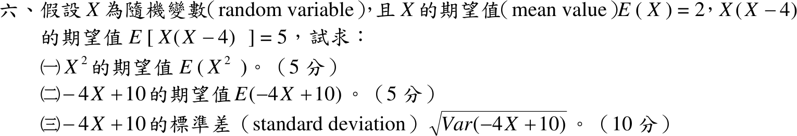

# 108 年第 6 題｜期望值與線性變換的變異數

## 已知與所求

\(E(X)=2\)，\(E[X(X-4)]=5\)，分布未知。求（一）\(E(X^2)\)（5 分）；（二）\(E(-4X+10)\)（5 分）；（三）\(-4X+10\) 的標準差 \(\sqrt{\operatorname{Var}(-4X+10)}\)（10 分）。

## 考場標準作答

### （一）\(E(X^2)\)（5 分）

展開乘積：
\[
X(X-4)=X^2-4X
\]
取期望值並用線性性質：
\[
E[X(X-4)]=E[X^2-4X]=E[X^2]-4E[X]
\]
代入 \(E[X(X-4)]=5\)、\(E[X]=2\)：
\[
5=E[X^2]-4(2)
\]
\[
5=E[X^2]-8
\]
移項：
\[
E[X^2]=5+8
\]
\[
\boxed{E[X^2]=13}
\]

### （二）\(E(-4X+10)\)（5 分）

\[
E[aX+b]=aE[X]+b
\]
代入 \(a=-4\)、\(b=10\)、\(E[X]=2\)：
\[
E[-4X+10]=-4E[X]+10=-4(2)+10
\]
\[
E[-4X+10]=-8+10
\]
\[
\boxed{E[-4X+10]=2}
\]

### （三）\(-4X+10\) 的標準差（10 分）

\(X\) 的變異數（代入（一）的 \(E[X^2]=13\) 與 \(E[X]=2\)）：
\[
\operatorname{Var}(X)=E[X^2]-[E(X)]^2=13-2^2
\]
\[
\operatorname{Var}(X)=13-4=9
\]
縮放公式，\(a=-4\)、\(b=10\)：
\[
\operatorname{Var}(aX+b)=a^2\operatorname{Var}(X)
\]
\[
(-4)^2=16
\]
\[
\operatorname{Var}(-4X+10)=16\times9=144
\]
即 \(\operatorname{Var}(-4X+10)=(-4)^2\operatorname{Var}(X)=144\)。開根號得標準差：
\[
\sqrt{\operatorname{Var}(-4X+10)}=\sqrt{144}
\]
\[
\boxed{\sigma_{-4X+10}=12}
\]

## 驗算

不用縮放公式，令 \(Y=-4X+10\) 直接算二階動差：\(Y^2=16X^2-80X+100\)，
\[
E[Y^2]=16E[X^2]-80E[X]+100=16(13)-80(2)+100=208-160+100=148,
\]
\(\operatorname{Var}(Y)=E[Y^2]-[E(Y)]^2=148-2^2=144\)，\(\sqrt{144}=12\)，一致。

## 失分點

- 第（三）小題問的是標準差，\(144\) 是變異數，最後要開根號得 \(12\)。
- \(E[X^2]\ne[E(X)]^2=4\)；兩者差正是 \(\operatorname{Var}(X)=9\)。
- 縮放公式是 \(a^2\) 倍：寫成 \(-4\times9=-36\)（變異數不可能為負）或把常數 \(10\) 也算進變異數。
