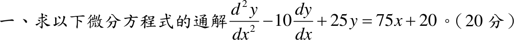

# 109 年第 1 題｜常係數非齊次 ODE

## 已知與所求

\(\dfrac{d^2y}{dx^2}-10\dfrac{dy}{dx}+25y=75x+20\)，求通解（20 分）。

## 考場標準作答

觀念：常係數線性非齊次 ODE 的通解 \(y=y_h+y_p\)；\(y_h\) 由特徵方程求得，\(y_p\) 因右側是一次多項式，用未定係數法設同次多項式。

齊次解：特徵方程
\[
r^2-10r+25=(r-5)^2=0\Rightarrow r=5\ (\text{重根})
\]
重根時第二個獨立解要乘 \(x\)：
\[
y_h=(C_1+C_2x)e^{5x}
\]
特解：\(r=0\) 不是特徵根，設 \(y_p=Ax+B\)，則 \(y_p'=A\)、\(y_p''=0\)，代入原式：
\[
0-10A+25(Ax+B)=75x+20
\]
比較係數：
\[
x:\ 25A=75\Rightarrow A=3,\qquad 1:\ 25B-10A=20\Rightarrow 25B=50\Rightarrow B=2
\]
\[
\boxed{y=(C_1+C_2x)e^{5x}+3x+2}
\]

## 驗算

\(y_p=3x+2\)：\(y_p''-10y_p'+25y_p=0-30+75x+50=75x+20\)。重根的兩解 \(e^{5x}\)、\(xe^{5x}\) 的 Wronskian 為 \(e^{10x}\ne0\)，線性獨立。

## 失分點

- 重根 \(r=5\) 的第二解是 \(xe^{5x}\)，寫成 \(C_1e^{5x}+C_2e^{5x}\) 會少一個獨立解。
- 代入 \(y_p\) 時常數項要含 \(-10A\)：\(25B-10A=20\)，漏掉會得 \(B=0.80\)。
